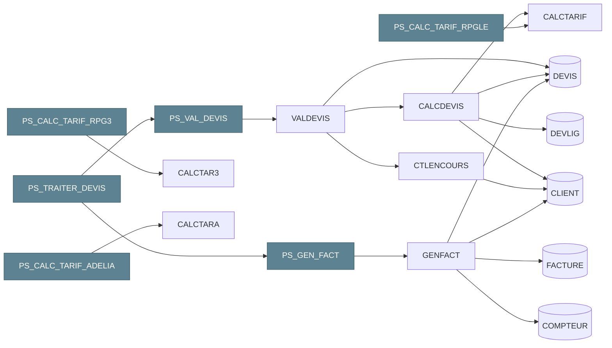

# Db2 for i : un héritage puissant qui ne demande qu'à évoluer

**Andy** · Ingénieur de données · 15 octobre 2026

<!--
Bonjour à toutes et à tous. Merci à Itheis et IBM pour l'invitation.
Aujourd'hui, pas de démo produit, pas de vente : je vais vous montrer ce qui est possible avec Db2 for i.
-->

---
layout: default
chapitre: intro
---

# Qui suis-je ?

<div class="grid grid-cols-5 gap-6 items-center">

<div class="col-span-2">
<div class="text-6xl font-bold" style="color: var(--slidev-theme-primary)">Andy</div>
<div class="text-xl mt-2">Ingénieur de données · Sinapse</div>
</div>

<div class="col-span-3 flex flex-col gap-3 text-lg">
<div class="flex items-center gap-3"><carbon-microphone class="text-2xl shrink-0" style="color: var(--slidev-theme-primary)" /><span>iBelieve 2021 : <b>500+ tables DDS → SQL</b></span></div>
<div class="flex items-center gap-3"><carbon-favorite-filled class="text-2xl shrink-0" style="color: #b56959" /><span><b>Fan assumé de l'IBM i</b>, depuis mes années DBA</span></div>
<div class="flex items-center gap-3"><carbon-connect class="text-2xl shrink-0" style="color: var(--slidev-theme-primary)" /><span><b>Le passeur</b> : l'existant IBM i ↔ la data moderne</span></div>
</div>

</div>

<div class="parcours mt-10">

<div class="etape-avec-fleche">
  <div class="etape legacy">
    <div class="etape__annee">avant 2016</div>
    <div class="etape__role">Bureautique</div>
    <div class="etape__logos"><simple-icons-microsoftexcel style="color: #217346" /><simple-icons-microsoftaccess style="color: #a4373a" /></div>
    <div class="etape__note">déjà du SQL</div>
  </div>
</div>

<div v-click class="etape-avec-fleche moyen">
  <carbon-arrow-right class="fleche" />
  <div class="etape">
    <div class="etape__annee">2016 – 2019</div>
    <div class="etape__role">Développeur BI</div>
    <div class="etape__logos"><simple-icons-talend style="color: #ff6d70" /><span class="cognos">Cognos</span></div>
    <div class="etape__note">consomme la base</div>
  </div>
</div>

<div v-click class="etape-avec-fleche moyen">
  <carbon-arrow-right class="fleche" />
  <div class="etape fort">
    <div class="etape__annee">2019 – 2022</div>
    <div class="etape__role">DBA / DBE Db2 for i</div>
    <div class="etape__logos"><span class="puce puce--multi"><carbon-ibm-i style="color: #1f3b47" /><simple-icons-postgresql style="color: #4169e1" /><carbon-sql style="color: #5d8392" /></span></div>
    <div class="etape__note">500+ tables → SQL</div>
  </div>
</div>

<div v-click class="etape-avec-fleche large">
  <carbon-arrow-right class="fleche" />
  <div class="etape">
    <div class="etape__annee">2022 – 2026</div>
    <div class="etape__role">Architecte données</div>
    <div class="etape__logos"><Logo nom="cafat.jpg" alt="CAFAT" hauteur="2.6rem" /></div>
    <div class="outils">
      <span><simple-icons-dbt style="color: #ff694b" />dbt</span>
      <span><simple-icons-dlthub style="color: #1f3b47" />dlt</span>
      <span><Logo nom="kestra-icone.svg" alt="Kestra" hauteur="1.7rem" />Kestra</span>
      <span><simple-icons-clickhouse style="color: #e6b800" />ClickHouse</span>
    </div>
  </div>
</div>

<div v-click class="etape-avec-fleche">
  <div class="fleche-texte"><carbon-arrow-right class="fleche fil" /><span>continuité</span></div>
  <div class="etape fort">
    <div class="etape__annee">2026 →</div>
    <div class="etape__role">Ingénieur données</div>
    <div class="etape__logos"><span class="puce"><Logo nom="sinapse.png" alt="Sinapse" hauteur="2rem" /></span></div>
  </div>
</div>

</div>

<style>
.parcours { display: flex; align-items: stretch; gap: 0.4rem; }
.parcours > * { flex: 1 1 0; min-width: 0; }
.parcours > .moyen { flex: 1.25 1 0; }
.parcours > .large { flex: 2.2 1 0; }
.etape-avec-fleche { display: flex; align-items: stretch; gap: 0.3rem; }
.etape-avec-fleche > .etape { flex: 1; }
.fleche { align-self: center; font-size: 1.4rem; color: #b56959; flex: none; }
.fleche-texte { align-self: center; display: flex; flex-direction: column; align-items: center; font-size: 0.6rem; color: #b56959; font-weight: 700; flex: none; }
.etape { min-width: 0; display: flex; flex-direction: column; align-items: center; justify-content: center; gap: 0.5rem; padding: 0.8rem 0.4rem; border-radius: 12px; background: #eef3f5; border: 2px solid #5d8392; text-align: center; }
.etape.legacy { background: #f1eee8; border-color: #9a8f7d; }
.etape.fort { background: #5d8392; border-color: #2f4f5c; color: #fff; }
.etape__annee { white-space: nowrap; font-size: 0.7rem; font-weight: 700; letter-spacing: 0.04em; color: #b56959; }
.etape.fort .etape__annee { color: #f6d7cf; }
.etape__role { font-weight: 700; font-size: 0.85rem; line-height: 1.15; }
.etape__logos { display: flex; align-items: center; justify-content: center; gap: 0.4rem; font-size: 1.8rem; min-height: 2.4rem; }
.etape__note { font-size: 0.7rem; opacity: 0.8; }
.puce { display: inline-flex; align-items: center; background: rgba(255, 255, 255, 0.96); border-radius: 0.6rem; padding: 0.3rem 0.6rem; }
.cognos { display: inline-flex; align-items: center; font-size: 1rem; font-weight: 800; letter-spacing: 0.02em; color: #1f3b47; }
.puce--multi { gap: 0.3rem; padding: 0.3rem 0.45rem; }
.puce--multi svg { font-size: 1.4rem; }
.outils { display: flex; justify-content: center; gap: 0.8rem; font-size: 1.3rem; }
.outils span { display: flex; flex-direction: column; align-items: center; gap: 0.1rem; font-size: 0.6rem; color: #1f3b47; }
.outils span svg { font-size: 1.5rem; }
</style>

<!--
Mes premières requêtes SQL, avant 2016, je les ai écrites dans Access, pour alimenter des outils Excel. Je ne le savais pas encore, mais le fil rouge de ma carrière était déjà là.
[clic] De 2016 à 2019, je suis passé à la data, comme concepteur développeur Talend et Cognos. J'étais alors consommateur de la base IBM i.
[clic] De 2019 à 2022, je suis passé de l'autre côté du miroir, DBA puis DBE sur Db2 for i. J'y ai mené la modernisation de plus de 500 tables DDS vers SQL — c'est là que je suis tombé amoureux du SQL sur IBM i. Et je l'assume : depuis, je suis un vrai fan de l'IBM i.
[clic] De 2022 à 2026, retour à la data : architecte de données à la CAFAT, avec les outils de la data moderne — dbt, dlt, Kestra, ClickHouse. [clic] Et depuis 2026, ingénieur de données à Sinapse, dans la continuité.
Je connais cette base de l'intérieur, et aujourd'hui je la connecte à une plateforme de données moderne. C'est ce regard de passeur que je veux partager.
-->

---
chapitre: intro
---

# De la CAFAT à Sinapse : une suite logique

<div class="grid grid-cols-3 gap-4 mt-2 mb-4">
<IconCard titre="GIE · 2024" texte="CAFAT · Gouvernement · FSH"><carbon-partnership /></IconCard>
<IconCard titre="265 000" texte="Calédoniens concernés"><carbon-user-multiple /></IconCard>
<IconCard titre="Étape par étape" texte="le recouvrement d'abord"><carbon-roadmap /></IconCard>
</div>

<div class="flex items-center justify-center gap-5 mt-2">
  <div class="flex flex-col items-center gap-1 px-4 py-2 rounded-xl" style="border: 2px dashed #5d8392">
    <div class="text-xs font-bold" style="color: #5d8392">Membres fondateurs</div>
    <div class="flex items-center gap-4">
      <Logo nom="cafat.jpg" alt="CAFAT" hauteur="4.5rem" />
      <Logo nom="gouvernement.jpg" alt="Gouvernement de la Nouvelle-Calédonie" hauteur="4.5rem" />
      <Logo nom="fsh.png" alt="Fonds social de l'habitat" hauteur="4.5rem" />
    </div>
  </div>
  <carbon-arrow-right class="text-3xl" style="color: #5d8392" />
  <Logo nom="sinapse.png" alt="Sinapse" hauteur="3.6rem" />
  <div class="flex flex-col items-center"><carbon-arrow-right class="text-3xl" style="color: #b56959" /><span class="text-xs" style="color: #b56959">étape par étape</span></div>
  <div class="px-4 py-3 rounded-xl text-center font-bold" style="background: #eef3f5; border: 2px solid #5d8392; color: #1f3b47">SI social<br>modernisé</div>
</div>

> Ce que j'ai appris à la CAFAT, je le mets au service du **SI de demain**, avec l'équipe Sinapse.

<div class="absolute bottom-4 left-8 text-xs opacity-60">
<a href="https://sinapse.nc/qui">sinapse.nc — Qui sommes-nous ?</a> ·
<a href="https://sinapse.nc/projet">sinapse.nc — Projet</a> ·
<a href="https://sinapse.nc/">sinapse.nc</a>
</div>

<!--
Quelques mots sur là où je travaille aujourd'hui, parce que ça explique le regard que je porte.
Sinapse est un groupement d'intérêt économique créé en 2024 par la CAFAT, le Gouvernement de la Nouvelle-Calédonie et le Fonds social de l'habitat. Sa mission : moderniser le système d'information de la protection sociale, en commençant par le recouvrement et les parcours des employeurs et des travailleurs indépendants. 265 000 Calédoniens sont concernés.
Pour moi, c'est une suite logique. À la CAFAT, j'ai appris à connaître ces données, leur histoire, leurs contraintes. Aujourd'hui, je mets cette connaissance au service du système d'information de demain, avec toute l'équipe Sinapse. Même mission de service public, un autre rôle.
Et la méthode affichée par Sinapse — partir des besoins, livrer étape par étape — c'est ce que je vais vous montrer côté base de données dans la deuxième partie : moderniser progressivement.
-->

---
layout: default
chapitre: intro
---

# Faire évoluer son IBM i : par où commencer ?

<div class="opacity-70 -mt-2">40 ans d'applicatif, des règles dans les programmes, peu de documentation</div>

<div class="grid grid-cols-3 gap-6 mt-6">
<IconCard titre="Avec un outil" texte="jusqu'où aident-ils ?"><carbon-tool-kit /></IconCard>
<IconCard titre="Sans outil" texte="comment avancer quand même ?"><carbon-idea /></IconCard>
<IconCard titre="Avec le natif seul" texte="que permet le SQL ?"><carbon-ibm-i /></IconCard>
</div>

<div class="text-center mt-10 text-xl">Le fil de la réponse : le SQL, <b>bien plus que des transactions</b></div>

<div class="grid grid-cols-4 gap-4 mt-3">
<IconCard petit titre="moderniser"><carbon-migrate /></IconCard>
<IconCard petit titre="administrer"><carbon-settings /></IconCard>
<IconCard petit titre="exploiter"><carbon-dashboard /></IconCard>
<IconCard petit titre="ouvrir les données"><carbon-data-share /></IconCard>
</div>

<!--
Le point de départ, c'est une situation que beaucoup d'entre vous connaissent : un IBM i qui tourne depuis des décennies, 40 ans d'applicatif, des règles métier cachées dans les programmes, et peu de documentation. On veut le faire évoluer. Par où commencer ?
Trois façons de s'y prendre, et trois questions qui vont guider toute la session. Avec un outil du marché : jusqu'où nous aident-ils ? Sans outil, parce qu'il n'y a pas de budget ou pas encore : comment avancer quand même ? Et avec le natif seul : que permet le SQL de l'IBM i ?
Le fil de la réponse, vous allez le voir tout au long : le SQL sur IBM i dépasse largement les transactions. Il sert à moderniser, à administrer, à exploiter, et à ouvrir les données au reste du système d'information.
-->

---
layout: two-cols
chapitre: 1
layoutClass: gabarit
---

# 1. Le chantier 2019-2022

<div class="mt-2 leading-none font-bold" style="font-size: 4.6rem; color: var(--slidev-theme-primary)">500+</div>
<div class="text-2xl mt-2">tables DDS → SQL, <b>sans recompiler</b></div>
<div class="flex items-center gap-4 mt-2"><Logo nom="itheis.jpg" alt="Itheis" hauteur="2.4rem" /><Logo nom="gaia.png" alt="Gaia" hauteur="2.4rem" /><Logo nom="xcase.png" alt="Xcase for i" hauteur="2.4rem" /></div>

<div class="mt-4 opacity-70 text-sm uppercase tracking-wider">Et après</div>
<div class="grid grid-cols-3 gap-2 mt-1 w-4/5">
<IconCard petit titre="contraintes"><carbon-connect /></IconCard>
<IconCard petit titre="temporel"><carbon-time /></IconCard>
<IconCard petit titre="RCAC"><carbon-security /></IconCard>
</div>

::right::

```d2 {maxHeight: '18rem'}
...@theme
direction: down

pgm: "Programmes RPG\nexistants" {class: legacy}
lf: "LF de substitution\n(même format)" {class: bloc}
new: "Nouveaux\ndéveloppements" {class: bloc}
table: "Nouvelle table SQL" {class: donnees}

pgm -> lf: sans recompilation
lf -> table
new -> table: SQL {class: fil}
```

<div class="absolute bottom-24 left-14 right-14 text-lg">

<div class="text-sm opacity-80 mb-2"><carbon-favorite-filled class="inline" style="color: #b56959" /> Merci à <b>E. Sadiman</b>, qui m'a confié ce chantier — et m'a rendu fan de l'IBM i</div>

> iBelieve 2021 : **migrer des tables**. iBelieve 2026 : en faire **une plateforme de données**.

</div>

<div class="absolute bottom-4 left-8 text-xs opacity-60">
Source : <a href="https://www.itheis.com/sql-comment-migrer-votre-base-de-donnees-sans-perturber-lexistant-applicatif/">Itheis — méthode surrogate</a>
</div>

<!--
En 2021, je vous ai parlé de migrer des tables. Rappel rapide : entre 2019 et 2022, plus de 500 tables DDS passées en SQL, accompagnés par Itheis et Gaia, avec l'outil Xcase for i. La clé, c'est la méthode surrogate : un fichier logique de substitution garde le format de l'ancien fichier, et les programmes existants continuent de tourner sans recompilation.
Et après la migration, ce que le SQL débloque : des contraintes — les relations enfin portées par la base —, des tables temporelles pour l'historisation, RCAC pour la sécurité par ligne et par colonne. Pour un petit périmètre, le natif suffit : QSYS2.GENERATE_SQL régénère le DDL d'une bibliothèque (kit/04-la-base.sql, exécuté sur pub400).
Pourquoi les contraintes comptent : une application moderne qui écrit directement dans une table, sans passer par le RPG, ne rencontre que les clés et l'intégrité référentielle ; plafond d'encours et cycle de vie du devis vivent dans les programmes, et elle les contourne sans le savoir. Chaque règle remontée dans la base est une règle qu'aucun nouveau client ne peut oublier.
Et une dédicace, parce qu'on ne mène pas un chantier pareil seul : merci à E. Sadiman, qui m'a fait confiance sur ce sujet — et qui, sans le savoir, m'a rendu fan de l'IBM i.
Transition : migrer la base, c'était la première marche. Mais une base moderne avec des programmes des années 80 autour, ça ne suffit pas. En 2026, je vous montre ce que cette base devient quand on la traite comme une vraie plateforme de données.
-->

---
layout: center
chapitre: 2
etape: 0
---

# 2. Moderniser progressivement

On ne réécrit pas 40 ans d'applicatif d'un coup

```d2 {maxHeight: '13rem'}
...@theme
direction: right

c: "1. Cartographier\nchaînes d'appels\ntables ↔ programmes" {class: bloc}
e: "2. Encapsuler\nRPG → procédures\nstockées" {class: [bloc; etape2]}
d: "3. Découpler\nla base publie\nles changements" {class: [bloc; etape3]}
m: "4. Moderniser\nun bloc\nà la fois" {class: [fort; etape4]}

c -> e: {class: etape2}
e -> d: {class: etape3}
d -> m: {class: etape4}
m -> c: on recommence {class: [fil; etape5]; style.stroke-dash: 4}
```

<br>

**Le SQL est l'outil de chacune de ces étapes.**

<div class="absolute bottom-4 left-8 text-xs opacity-60">
Principes : <a href="https://redbooks.ibm.com/abstracts/sg248185.html">SG24-8185</a> ·
<a href="https://www.redbooks.ibm.com/docs/MD260020/MD260020.html">Redbook 2026 MD260020</a> ·
<a href="https://www.redbooks.ibm.com/abstracts/redp5095.html">REDP-5095</a>
</div>

<!--
Le Redbook SG24-8185 ne parle pas seulement d'interface web. Il pose quatre principes qu'on oublie : modularisation, architecture en couches, data-centric — les règles portées par la base —, et orientation service. Le Redbook 2026 reprend l'approche data-centric et y ajoute l'exposition en API REST.
Concrètement, ça donne une démarche en quatre temps. D'abord cartographier : savoir ce qui existe. [clic] Encapsuler : rendre l'existant appelable, sans le réécrire. [clic] Découpler : que la base publie ce qui change. [clic] Et seulement alors, moderniser un bloc à la fois. [clic] Et on recommence, sur le bloc suivant. Le SQL est l'outil de chacune de ces étapes.
-->

---
chapitre: 2
etape: 0
---

# Le terrain : une mini-application de devis

<div class="opacity-70 -mt-2 mb-2"><carbon-checkmark-outline class="inline" /> Tout le SQL qui suit a <b>tourné</b> sur pub400 — et se rejoue avec le <b>kit</b> du dépôt</div>

```d2 {maxHeight: '21rem'}
...@theme
direction: right

sql: "SQL, par-dessus" {
  class: zone
  trt: "PS_TRAITER_DEVIS\nenchaîne" {class: fort}
  val: "PS_VAL_DEVIS" {class: bloc}
  gen: "PS_GEN_FACT" {class: bloc}
  trt -> val
  trt -> gen
}
rpg: "Programmes RPG existants" {
  class: zone
  valdevis: "VALDEVIS\nvalide un devis" {class: legacy}
  calcdevis: "CALCDEVIS" {class: legacy}
  calctarif: "CALCTARIF\nremise + TVA" {class: legacy}
  ctl: "CTLENCOURS\nencours" {class: legacy}
  genfact: "GENFACT\nfacture" {class: legacy}
  valdevis -> calcdevis -> calctarif
  valdevis -> ctl
}
donnees: "Données · journalisées" {
  class: zone
  client: CLIENT {class: donnees}
  devis: DEVIS {class: donnees}
  devlig: DEVLIG {class: donnees}
  facture: FACTURE {class: donnees}
}

sql.val -> rpg.valdevis: CALL {class: fil}
sql.gen -> rpg.genfact: CALL {class: fil}
rpg.calcdevis -> donnees.devlig
rpg.ctl -> donnees.client
rpg.genfact -> donnees.facture
```

<div class="absolute bottom-4 left-8 text-xs opacity-60">
Kit : <code>kit/rpg/</code> — 5 tables, 7 programmes RPG compilés depuis ACS, 3 procédures SQL · sans compilateur : <code>kit/00-terrain.sql</code>
</div>

<!--
Pour que ce ne soit pas que de la théorie, tous les exemples de cette partie ont été exécutés sur pub400, un IBM i public — et vous pouvez les rejouer : tout est dans le kit du dépôt, à lancer dans votre propre bibliothèque. Le schéma est volontairement petit : des clients, des devis, des lignes, des factures. Mais il a les défauts d'une vraie base : une date stockée en numérique, « parce que c'est partout », et des règles métier — remise, plafond d'encours, cycle de vie du devis — qui vivent dans les programmes.
Le terrain, ce sont de vrais programmes RPG, publiés avec le kit et compilés depuis ACS : VALDEVIS valide un devis — il appelle CALCDEVIS, qui appelle CALCTARIF pour la remise et la TVA, et CTLENCOURS pour le plafond d'encours. GENFACT facture, et possède sa transaction. Par-dessus, un début de SQL : deux façades, PS_VAL_DEVIS et PS_GEN_FACT, et une procédure SQL, PS_TRAITER_DEVIS, qui les enchaîne. On verra à l'étape 2.2 comment on les écrit.
Un mot : PS_ désigne une procédure stockée ; un programme RPG n'a pas de préfixe (détail dans kit/README.md).
Pas de compilateur, ou pas le droit de compiler ? Le kit a une variante tout SQL (kit/00-terrain.sql), où des procédures SQL jouent le rôle des programmes.
-->

---
chapitre: 2
etape: 1
---

# 2.1 Cartographier

<div class="opacity-70 -mt-2">En clair : savoir qui appelle quoi avant de toucher à quoi que ce soit.</div>

<div class="grid grid-cols-3 gap-4 mt-2">
<IconCard titre="Avec un outil" texte="X-Analysis : modèle déduit du code"><carbon-tool-kit /></IconCard>
<IconCard titre="Avec l'IA" texte="Bob ou un autre assistant lit le RPG"><carbon-chat-bot /></IconCard>
<IconCard titre="Sans outil" texte="DSPPGMREF, piloté en SQL"><carbon-ibm-i /></IconCard>
</div>

```sql
CALL QSYS2.QCMDEXC(
  'DSPPGMREF PGM(' CONCAT CURRENT SCHEMA CONCAT '/*ALL) OUTPUT(*OUTFILE) OBJTYPE(*PGM) '
  CONCAT 'OUTFILE(' CONCAT CURRENT SCHEMA CONCAT '/T_PGMREF) OUTMBR(*FIRST *REPLACE)');
```

<div class="flex items-baseline justify-center gap-6 mt-4">
<div class="text-center"><div class="text-5xl font-bold" style="color: var(--slidev-theme-primary)">8</div><div class="opacity-70">programmes analysés</div></div>
<carbon-arrow-right class="text-3xl opacity-50" />
<div class="text-center"><div class="text-5xl font-bold" style="color: var(--slidev-theme-primary)">3</div><div class="opacity-70">appels entre eux</div></div>
<div class="text-3xl opacity-50">+</div>
<div class="text-center"><div class="text-5xl font-bold" style="color: var(--slidev-theme-primary)">9</div><div class="opacity-70">références de tables</div></div>
</div>

<div class="absolute bottom-4 left-8 text-xs opacity-60">
<a href="https://fr.freschesolutions.com/wp-content/uploads/archive/miscellaneous/X-Analysis_Comparisons.pdf">X-Analysis</a> ·
<a href="https://www.ibm.com/docs/en/i/7.3.0?topic=ssw_ibm_i_73%2Fcl%2Fdsppgmref.html">DSPPGMREF</a> ·
<a href="https://www.ibm.com/support/pages/detailed-file-field-description-file-qadsppgm-format-qwhdrppr-dsppgmref-output-file">Format QADSPPGM</a> ·
<a href="https://www.ibm.com/products/ai-coding-agent/ibm-i-modernization">IBM Bob pour IBM i</a> ·
<a href="https://www.itjungle.com/2026/03/02/ibm-gets-bob-1-0-off-the-ground/">IT Jungle — Bob 1.0</a> ·
<code>kit/rpg/15-cartographier-rpg.sql</code>
</div>

<!--
Des programmes des années 80 tournent toujours, et les relations entre tables vivent souvent dans le code, pas dans la base. Avant de toucher à quoi que ce soit, il faut retrouver les chaînes d'appels et les tables utilisées.
Avec un outil comme X-Analysis : diagrammes de structure, modèle de données déduit du code RPG, analyse d'impact. Et depuis peu, l'IA change la donne : avec Bob, l'assistant d'IBM disponible depuis mars 2026, ou avec un autre assistant, faire l'état des lieux devient bien plus facile — il lit le RPG, le CL, les DDS, explique, documente, dessine les relations. Mon avis : c'est un accélérateur, pas un substitut ; il faut toujours savoir vérifier. Sans outil : le natif, DSPPGMREF, de quoi cadrer grossièrement — et de quoi vérifier ce que l'IA affirme.
Une commande CL, pilotée depuis SQL, sur toute la bibliothèque courante. Le résultat est matérialisé dans une table de la bibliothèque, T_PGMREF : c'est le début d'un référentiel, qu'on interroge ensuite comme n'importe quelle table. (Pour explorer sans rien laisser, QTEMP suffit : c'est ce que fait la variante tout SQL du kit.)
Le fichier de sortie (format QADSPPGM) : WHPNAM, le programme analysé ; WHFNAM et WHLNAM, l'objet référencé et sa bibliothèque ; WHOTYP, son type (*PGM, *FILE, *SRVPGM…) ; WHFUSG, l'usage — 1 lecture, 2 écriture, 4 mise à jour, cumulables. Pour un programme SQLRPGLE ou une procédure SQL, les tables du SQL statique apparaissent aussi.
Sur le kit (exécuté sur pub400 le 29/09, kit/rpg/15-cartographier-rpg.sql) : 8 programmes analysés — les 7 RPG et PS_TRTDEV, le *PGM de la procédure SQL —, 3 appels entre programmes (VALDEVIS vers CALCDEVIS et CTLENCOURS, CALCDEVIS vers CALCTARIF), 9 références de tables. Les références au système — moteur SQL, runtime RPG, catalogue QSYS2 — sont écartées.
-->

---
chapitre: 2
etape: 1
---

# La chaîne d'appels, du SQL jusqu'au RPG

<v-switch>
<template #0>

<div class="etape-carto"><carbon-data-table /> Trois sources, une table : T_APPELS</div>

```d2 {maxHeight: '15rem'}
...@theme
direction: right

sql: "Catalogue SQL" {
  class: zone
  dep: "SYSROUTINEDEP\nprocédure → procédure" {class: bloc}
  ext: "SYSROUTINES\nfaçade → programme" {class: bloc}
}
rpg: "Programmes compilés" {
  class: zone
  ref: "DSPPGMREF → T_PGMREF\nprogramme → programme" {class: legacy}
}
t: "T_APPELS\nAPPELANT · APPELÉ · SOURCE" {class: [donnees; fort]}
rec: "Requête récursive\ndescend la chaîne" {class: bloc}

sql.dep -> t: UNION
sql.ext -> t: UNION
rpg.ref -> t: UNION
t -> rec {class: fil}
```

<div class="text-sm opacity-70 mt-2">Chaque monde se lit à un endroit différent ; on matérialise, puis on interroge.</div>

</template>
<template #1>

<div class="etape-carto"><carbon-flow /> Une requête récursive descend la chaîne</div>

```sql
WITH CHAINE (APPELE, NIVEAU, CHEMIN, SOURCE) AS (
  SELECT APPELE, 1, CAST(APPELANT CONCAT ' > ' CONCAT APPELE AS VARCHAR(1000)), SOURCE
    FROM T_APPELS WHERE APPELANT = 'PS_TRAITER_DEVIS'
  UNION ALL
  SELECT A.APPELE, C.NIVEAU + 1, C.CHEMIN CONCAT ' > ' CONCAT A.APPELE, A.SOURCE
    FROM CHAINE C JOIN T_APPELS A ON A.APPELANT = C.APPELE
   WHERE C.NIVEAU < 15                                    -- profondeur max
     AND LOCATE(' ' CONCAT A.APPELE CONCAT ' ',
                ' ' CONCAT C.CHEMIN CONCAT ' ') = 0       -- pas de boucle
)
SELECT NIVEAU, CHEMIN, SOURCE FROM CHAINE ORDER BY CHEMIN;
```


> Le natif ne remplace pas un outil. Il permet de savoir **par où commencer** et **quoi ne pas casser**.

</template>
<template #2>

<div class="etape-carto"><carbon-checkmark-outline /> Résultat sur pub400</div>

<Resultat :colonnes="['NIVEAU', 'CHEMIN', 'SOURCE']"
  :lignes="[
    ['1', 'PS_TRAITER_DEVIS > PS_GEN_FACT', 'SYSROUTINEDEP'],
    ['2', 'PS_TRAITER_DEVIS > PS_GEN_FACT > GENFACT', 'SYSROUTINES'],
    ['1', 'PS_TRAITER_DEVIS > PS_VAL_DEVIS', 'SYSROUTINEDEP'],
    ['2', 'PS_TRAITER_DEVIS > PS_VAL_DEVIS > VALDEVIS', 'SYSROUTINES'],
    ['3', 'PS_TRAITER_DEVIS > PS_VAL_DEVIS > VALDEVIS > CALCDEVIS', 'DSPPGMREF'],
    ['4', 'PS_TRAITER_DEVIS > PS_VAL_DEVIS > VALDEVIS > CALCDEVIS > CALCTARIF', 'DSPPGMREF'],
    ['3', 'PS_TRAITER_DEVIS > PS_VAL_DEVIS > VALDEVIS > CTLENCOURS', 'DSPPGMREF'],
  ]" />

> Le natif ne remplace pas un outil. Il permet de savoir **par où commencer** et **quoi ne pas casser**.

</template>
<template #3>

<div class="flex items-center gap-6">
<div class="shrink-0">



</div>
<div>

<div class="text-sm opacity-70 mb-4">Le même graphe, écrit en Mermaid par une requête SQL (kit).</div>

> Le natif ne remplace pas un outil. Il permet de savoir **par où commencer** et **quoi ne pas casser**.

</div>
</div>

</template>
</v-switch>

<style>
.etape-carto {
  display: flex;
  align-items: center;
  gap: 0.5rem;
  margin-bottom: 0.75rem;
  font-weight: 600;
  font-size: 1.1rem;
  color: var(--slidev-theme-primary, #5d8392);
}
</style>

<div class="absolute bottom-4 left-8 text-xs opacity-60">
<a href="https://www.ibm.com/docs/en/i/7.5.0?topic=views-sysroutinedep">SYSROUTINEDEP</a> ·
<a href="https://www.ibm.com/docs/en/i/7.5.0?topic=views-sysroutines">SYSROUTINES</a> ·
<a href="https://www.linkedin.com/pulse/dsppgmref-sql-table-function-ibmi-bob-cozzi">Bob Cozzi — DSPPGMREF en UDTF</a> ·
<code>kit/rpg/15-cartographier-rpg.sql</code>
</div>

<!--
Point de départ : PS_TRAITER_DEVIS, la procédure SQL qui valide puis facture un devis. La chaîne traverse deux mondes, le SQL et le RPG, et chaque maillon se lit à un endroit différent. Procédure vers procédure : le catalogue, SYSROUTINEDEP. Façade vers programme : le catalogue encore, SYSROUTINES, qui donne le programme derrière chaque façade. Programme vers programme : DSPPGMREF, matérialisé dans T_PGMREF. Un UNION des trois, et on a une table, T_APPELS — la requête est dans le kit. On matérialise, puis on interroge.
[clic] Ensuite, une récursion classique : les programmes appelés par les programmes appelés, avec deux garde-fous, une profondeur maximale et la détection de boucle.
[clic] Résultat réel sur pub400 : on part du SQL, on passe par les façades, on descend dans le RPG — VALDEVIS, CALCDEVIS, CALCTARIF… et une branche qu'on n'avait pas en tête, le contrôle d'encours CTLENCOURS. La colonne SOURCE dit d'où vient chaque maillon.
[clic] Et une autre requête écrit le même graphe en Mermaid, avec les tables : on colle le résultat dans un éditeur, et on a un diagramme de structure, où l'on voit ce qui est SQL et ce qui est RPG.
Les limites, honnêtement — c'est là qu'un outil fait la différence : DSPPGMREF ne voit que les appels à nom littéral, et il ne voit pas les appels réseau.
Le natif ne remplace pas un outil. Il permet de savoir par où commencer, et quoi ne pas casser.
(En réserve pour les questions : la requête qui rassemble les trois sources et celle qui génère le Mermaid, dans kit/rpg/15-cartographier-rpg.sql ; SQL dynamique — SYSPROGRAMSTMTSTAT, PARSE_STATEMENT, BOUND_MODULE_INFO ; « qui touche à DEVIS ? » : CALCDEVIS, VALDEVIS et GENFACT, usage 5.)
(Exécuté sur pub400 le 29/09 : kit/rpg/15-cartographier-rpg.sql, résultat repris de pub400/resultats-kit/rpg/15-cartographier-rpg.txt ; Mermaid : sortie réelle de 27 lignes, seul l'ordre des lignes est retouché pour l'écran.)
-->
---
zoom: 0.9
chapitre: 2
etape: 2
---

# 2.2 Encapsuler

Un programme existant devient une **procédure stockée**. Sans toucher à son code.

<div class="grid grid-cols-5 gap-4 mt-2">

<div class="col-span-3">

```sql
CREATE OR REPLACE PROCEDURE PS_CALC_TARIF_RPG3 (
    IN  p_montant_ht   DECIMAL(9,2),
    IN  p_taux_remise  DECIMAL(5,2),
    OUT p_remise       DECIMAL(11,2),
    OUT p_tva          DECIMAL(11,2),
    OUT p_ttc          DECIMAL(11,2),
    OUT p_rc           CHAR(1)
)
  LANGUAGE RPG                       -- RPG, pas RPGLE : c'est de l'OPM
  SPECIFIC PS_TARIF3
  NO SQL
  EXTERNAL NAME 'VOTREBIB/CALCTAR3'
  PARAMETER STYLE GENERAL;

CALL PS_CALC_TARIF_RPG3(10000.00, 5.00, ?, ?, ?, ?);
```

</div>

<div class="col-span-2">

```d2 {maxHeight: '22rem'}
...@theme
direction: down

prog: "3 programmes, 3 époques" {
  class: zone
  p3: "CALCTAR3\nRPG III" {class: legacy}
  p4: "CALCTARIF\nRPG IV" {class: legacy}
  pa: "CALCTARA\nAdélia" {class: legacy}
}
contrat: "Même contrat SQL\n9500 · 1900 · 11400" {class: fort}
app: "ODBC · JDBC · Mapepire\npipeline data" {class: bloc}

prog.p3 -> contrat
prog.p4 -> contrat
prog.pa -> contrat
contrat -> app: CALL {class: fil}
```

</div>

</div>

<div class="absolute bottom-4 left-8 text-xs opacity-60">
<a href="https://www.oreilly.com/library/view/modernizing-ibm-eserver/0738492132/chapter-47.html">SG24-6393 — External stored procedures</a> ·
<code>kit/rpg/13-facades.sql</code>
</div>

<!--
Trois programmes d'époques différentes — un RPG III en OPM, un RPG IV free-form, et du RPG généré à la façon d'Adélia — derrière trois procédures au contrat identique. Aucun n'a été recompilé pour ça : on n'a écrit que du DDL. LANGUAGE RPG et non RPGLE, parce que c'est de l'OPM ; PARAMETER STYLE GENERAL, parce que le programme reçoit ses paramètres tels quels.
Le schéma, à droite : vu du catalogue, ce sont trois procédures interchangeables, appelables depuis ODBC, JDBC, Mapepire, un orchestrateur ou un pipeline data. Et sur pub400 elles rendent la même chose pour 10 000 HT et 5 % de remise : 9500 HT remisé, 1900 de TVA, 11400 TTC.
Et ça s'appelle de partout : en JDBC, on lit directement les paramètres de sortie ; en ODBC, beaucoup d'outils ne savent pas les lire, alors une petite fonction table rend les valeurs par un simple SELECT. Les deux exemples sont dans le kit.
Et une fois encapsulés, on les compose : une procédure SQL peut enchaîner une validation existante, un peu de SQL neuf, puis une facturation existante. Chaque étape se remplace individuellement, le contrat est documenté dans le catalogue.
Point d'attention : une transaction ouverte par l'appelant ne traverse pas un programme compilé COMMIT(*NONE), et sans lever d'erreur. Encapsuler, c'est aussi décider qui possède la transaction — dans le kit, c'est le programme de facturation.
Anecdote à garder si le temps le permet : sur 99,99 avec 33,33 % de remise, les trois versions divergent d'un centime — 79,99 contre 80,00 — parce que les arrondis ne sont pas écrits pareil. Encapsuler n'efface pas les différences : ça les rend testables (kit/rpg/14-rejouer.sql le montre).
(Exécuté sur pub400 le 29/09 avec le kit RPG : sources chargées par SQL, compilées, façades créées ; les trois CALL rendent 9500.00 / 1900.00 / 11400.00.)
-->

---
zoom: 0.9
chapitre: 2
etape: 2
hide: true
---

# Appeler la façade depuis l'extérieur

<div class="grid grid-cols-2 gap-6 mt-2">

<div>

### <logos-java class="inline" /> JDBC : les OUT, directement

```java
try (CallableStatement cs = cnx.prepareCall(
        "CALL VOTREBIB.PS_CALC_TARIF_RPG3(?, ?, ?, ?, ?, ?)")) {
  cs.setBigDecimal(1, new BigDecimal("10000.00"));  // HT
  cs.setBigDecimal(2, new BigDecimal("5.00"));      // remise %
  for (int i = 3; i <= 5; i++)                      // OUT
    cs.registerOutParameter(i, Types.DECIMAL, 2);
  cs.registerOutParameter(6, Types.CHAR);
  cs.execute();
  System.out.println(cs.getBigDecimal(3) + " / "
      + cs.getBigDecimal(4) + " / " + cs.getBigDecimal(5));
}
```

</div>

<div>

### <logos-python class="inline" /> ODBC : par une fonction table

<div class="text-sm px-3 py-2 mb-2 rounded" style="background: #f7ebe7; border-left: 4px solid #b56959">
<carbon-warning-alt class="inline" style="color: #b56959" /> <b>pyodbc</b> et bien des outils BI <b>ne lisent pas les paramètres OUT</b> d'un <code>CALL</code>.
On crée donc une <b>UDTF</b> (fonction table SQL) qui appelle la façade et rend ses valeurs en ligne : <code>kit/rpg/16-appeler.sql</code>.
</div>

```sql
SELECT * FROM TABLE(F_TARIF_RPG3(10000.00, 5.00)) T;
```

```python
import pyodbc

cnx = pyodbc.connect("DSN=MONIBMI")   # IBM i Access ODBC
remise, tva, ttc, rc = cnx.execute(
    "SELECT * FROM TABLE(VOTREBIB.F_TARIF_RPG3(?, ?)) T",
    10000.00, 5.00).fetchone()
print(remise, tva, ttc)   # 9500.00 1900.00 11400.00
```

</div>

</div>

<div class="text-center mt-4 text-lg"><carbon-checkmark-outline class="inline" /> Dans les deux cas : <b>9500.00 · 1900.00 · 11400.00</b>, calculés par le RPG III</div>

<div class="absolute bottom-4 left-8 text-xs opacity-60">
<a href="https://github.com/IBM/JTOpen">JTOpen</a> ·
<a href="https://github.com/mkleehammer/pyodbc/wiki/Calling-Stored-Procedures">pyodbc — procédures stockées</a> ·
<code>kit/rpg/16-appeler.sql</code> · <code>AppelerFacade.java</code> · <code>appeler_facade.py</code>
</div>

<!--
(Slide en réserve, masquée par hide: true : à montrer en questions.)
Une fois encapsulé, le RPG s'appelle comme n'importe quelle procédure, depuis n'importe quel langage. Deux exemples.
À gauche, JDBC, avec le pilote JTOpen : un CallableStatement, on passe le montant et le taux, on enregistre les quatre paramètres de sortie, on exécute — et on lit ce que le programme RPG III a calculé. 9500, 1900, 11400.
À droite, ODBC. Piège : beaucoup de clients ODBC, dont pyodbc en Python et une partie des outils BI, ne savent pas lire les paramètres de sortie d'un CALL. La solution native : une petite fonction table SQL qui appelle la façade et rend ses valeurs en ligne. Du coup, un simple SELECT suffit — depuis Python, Excel, Power BI ou DuckDB. Et c'est une idée qu'on retrouvera au chapitre 4 : l'IBM i comme source de données.
(Exécuté sur pub400 le 29/09 avec le kit RPG : le programme Java tel quel, et la requête du script Python avec ses marqueurs alimentés par des flottants, comme le fait pyodbc ; le script Python lui-même n'a pas tourné, le pilote ODBC ne passant pas par le tunnel. La fonction table : kit/rpg/16-appeler.sql.)
-->

---
chapitre: 2
etape: 3
---

# 2.3 Découpler : publier sans toucher aux programmes

<div class="opacity-70 -mt-2">En clair : au lieu que le programme appelle chaque service, la base publie et chacun vient lire.</div>

```d2 {maxHeight: '16.5rem'}
...@theme
direction: right

avant: "Aujourd'hui : le programme appelle chaque service" {
  class: zone
  direction: right
  p1: "Programme RPG\nécrit la donnée\net appelle l'API" {class: legacy}
  t1: "Table" {class: donnees}
  d1: "Service REST A" {class: bloc}
  d2: "Service REST B" {class: bloc}
  p1 -> t1
  p1 -> d1: HTTP, à chaque fois {class: fil}
  p1 -> d2: HTTP, à chaque fois {class: fil}
}
apres: "Alternative testée : la base publie, chacun vient lire" {
  class: [zone; etape2]
  direction: right
  p2: "Programme RPG\nnon modifié" {class: [legacy; etape2]}
  t2: "Table" {class: [donnees; etape2]}
  b: "La base publie\njournal · file" {class: [fort; etape2]}
  d3: "Un consommateur\npipeline · API · Kafka\n(à brancher)" {class: [eteint; etape2]}
  p2 -> t2 {class: etape2}
  t2 -> b {class: etape2}
  b -> d3: s'abonne {class: [eteint; etape2]}
}
```

<div class="text-center mt-3 text-xl" v-click>Le programme n'a pas changé, et <b>la base publie</b> ce qui change.<div class="text-sm opacity-60 mt-1">Testé sur pub400 : journal et file. Aucun consommateur n'est déployé.</div></div>

<!--
Découpler, c'est séparer celui qui produit un changement de ceux qui ont besoin de le connaître.
Chez nous, aujourd'hui, quand une donnée change et qu'un autre système doit le savoir, le programme appelle lui-même un service REST, avec les fonctions HTTP de Db2. Le programme est lié à chaque service : en ajouter un, c'est retoucher le programme, et une panne du service se répercute sur la transaction.
[clic] L'alternative, que j'ai testée sur pub400 : on déplace cette responsabilité dans la base. Le programme écrit sa donnée et ne sait rien de personne. La base publie le changement, par le journal ou par une file, et chacun vient lire ce qui l'intéresse.
[clic] Le programme n'a pas changé, et la base publie ce qui change. Honnêteté : ce qui a tourné, c'est le journal et la file ; le consommateur, pipeline, API ou Kafka, reste à brancher, et rien de tel n'est déployé chez nous aujourd'hui. La slide suivante montre les deux moyens : le journal, puis la file.
-->

---
zoom: 0.9
chapitre: 2
etape: 3
---

# 2.3 Le journal et la file : la base publie

<div class="grid grid-cols-5 gap-6">

<div class="col-span-3">

<v-switch>
<template #0>

<div class="etape-decouple"><carbon-document /> Le journal a déjà tout vu</div>

```sql
-- Le journal a déjà tout capté
SELECT ENTRY_TIMESTAMP, JOURNAL_ENTRY_TYPE,
       SUBSTR(OBJECT, 1, 10) AS TABLE_, PROGRAM_NAME
  FROM TABLE (QSYS2.DISPLAY_JOURNAL(
         JOURNAL_LIBRARY    => CURRENT SCHEMA,
         JOURNAL_NAME       => 'QSQJRN',
         STARTING_TIMESTAMP => CURRENT TIMESTAMP - 1 HOUR))
 WHERE JOURNAL_CODE = 'R';
```

```text
2026-09-29 09:45:54.211616 | UP | DEVIS    | CALCDEVIS
2026-09-29 09:45:54.2132   | UP | DEVIS    | VALDEVIS
2026-09-29 09:45:54.224304 | UP | COMPTEUR | GENFACT
2026-09-29 09:45:54.23416  | PT | FACTURE  | GENFACT
2026-09-29 09:45:54.235536 | UP | CLIENT   | GENFACT
2026-09-29 09:45:54.236672 | UP | DEVIS    | GENFACT
```

<div class="mt-2 opacity-80"><carbon-checkmark-outline class="inline" /> Le journal sait <b>quel programme</b> a modifié quoi. Aucun n'a été modifié.</div>

</template>
<template #1>

<div class="etape-decouple"><carbon-send /> La base publie un JSON dans une file</div>

```sql
-- Publier l'état du client en JSON
CALL QSYS2.SEND_DATA_QUEUE_UTF8(
  MESSAGE_DATA => (
    SELECT JSON_OBJECT('table'   VALUE 'CLIENT',
                       'id'      VALUE CLI_NUM,
                       'encours' VALUE CLI_ENCOURS,
                       'ts'      VALUE CURRENT TIMESTAMP)
      FROM CLIENT WHERE CLI_NUM = 1001),
  DATA_QUEUE         => 'EVT_CLIENT',
  DATA_QUEUE_LIBRARY => CURRENT SCHEMA);
```

<div class="text-sm opacity-70 mt-1">Ici l'envoi est lancé à la main. Sur un vrai système, un trigger le fait à chaque modification.</div>

</template>
<template #2>

<div class="etape-decouple"><carbon-download /> Le consommateur lit, y compris par ODBC</div>

```sql
-- Côté consommateur, y compris via ODBC
SELECT CAST(MESSAGE_DATA_UTF8 AS VARCHAR(1000)) AS MESSAGE
  FROM TABLE (QSYS2.RECEIVE_DATA_QUEUE(
         DATA_QUEUE         => 'EVT_CLIENT',
         DATA_QUEUE_LIBRARY => CURRENT SCHEMA));
```

```text
{"table":"CLIENT","id":1001,"encours":2910.00,
 "ts":"2026-09-29-09.45.57.398581"}
```

</template>
</v-switch>

</div>

<div class="col-span-2">

```d2 {maxHeight: '24rem'}
...@theme
direction: down

ibmi: "IBM i" {
  class: zone
  t: "Tables\nCLIENT · DEVIS…" {class: donnees}
  j: "Journal\nQSQJRN" {class: fort}
  q: "*DTAQ\nEVT_CLIENT" {class: fort; shape: queue}
  t -> j: chaque modification
  t -> q: SEND_DATA_QUEUE
}
cdc: "Job de capture (CDC)\nlit DISPLAY_JOURNAL\n(à écrire ou à acheter)" {class: bloc}
conso: "Consommateurs possibles\nJava · Python · RPG" {class: bloc}
cible: "Kafka · API · pipeline\nà brancher, non déployé" {class: eteint}

ibmi.j -> cdc
ibmi.q -> conso
cdc -> cible {class: eteint}
conso -> cible {class: eteint}
```

</div>

</div>

<style>
.etape-decouple {
  display: flex;
  align-items: center;
  gap: 0.5rem;
  margin-bottom: 0.75rem;
  font-weight: 600;
  font-size: 1.1rem;
  color: var(--slidev-theme-primary, #5d8392);
}
</style>

<div class="absolute bottom-4 left-8 text-xs opacity-60">
<a href="https://www.ibm.com/docs/en/i/7.5.0?topic=services-display-journal-table-function">DISPLAY_JOURNAL</a> ·
<a href="https://ibm.com/support/knowledgecenter/ssw_ibm_i_75/rzajq/rzajqprocsenddtaq.htm">SEND_DATA_QUEUE</a> ·
<a href="https://www.ibm.com/support/pages/qsys2receivedataqueue">RECEIVE_DATA_QUEUE</a> ·
<a href="https://javadoc.io/doc/net.sf.jt400/jt400/latest/com/ibm/as400/access/DataQueue.html">JTOpen DataQueue</a> ·
<a href="https://www.ibm.com/docs/en/i/7.5.0?topic=ssw_ibm_i_75/apis/qrcvdtaq.htm">QRCVDTAQ</a> ·
<code>kit/rpg/17-decoupler.sql</code>
</div>

<!--
Deux moyens pour que la base publie, sans toucher aux programmes.
Le journal d'abord. Les tables sont journalisées. On traite un devis, et le journal a tout vu : chaque modification, avec la table et le programme qui l'a faite — CALCDEVIS et VALDEVIS sur le devis, GENFACT sur la facture et le client. Ce sont les programmes RPG eux-mêmes, qu'on n'a pas touchés. C'est la base de toute capture de changements ; le job qui relaierait vers Kafka ou une API reste à écrire ou à acheter.
[clic] La file ensuite : un JSON construit en SQL, déposé dans une file de données. Ici je l'envoie à la main ; sur un vrai système, un trigger le ferait à chaque modification — pub400 refuse CREATE TRIGGER au compte gratuit.
[clic] Et n'importe qui la lit : en SQL, y compris par ODBC, un service Java, ou un vieux programme RPG. L'encours du client est passé à 2910 : la facture qu'on vient d'émettre.
Surtout pas d'appel réseau au moment où la donnée change : on écrit localement, un consommateur asynchrone relaie.
(Exécuté sur pub400 le 29/09 : kit/rpg/17-decoupler.sql — 6 entrées de journal sur les 90 de l'heure, file créée puis supprimée ; MQ et trigger non exécutés. Variante sans compilation : kit/03-decoupler.sql.)
-->

---
chapitre: 2
etape: 4
---

# 2.4 Moderniser, un bloc à la fois

<div class="opacity-70 -mt-2">En clair : on remplace ce qu'il y a derrière la façade, les appelants ne voient rien.</div>

```d2 {scale: 1.7, maxHeight: '19rem'}
...@theme
direction: right

app: "Appelants\nSQL · JDBC · ODBC\npipeline" {class: bloc}
facade: "Façade SQL\nmême contrat\nHT, remise → TVA, TTC" {class: fort}
rpg: "Aujourd'hui\nCALCTARIF\nRPG IV" {class: legacy}
neuf: "Demain\ncalcul réécrit\nSQL ou Java" {class: [bloc; etape2]}
suivant: "Bloc suivant\nCTLENCOURS, GENFACT…" {class: [eteint; etape3]}

app -> facade: CALL
facade -> rpg
facade -> neuf: remplace {class: [fil; etape2]}
neuf -> suivant: puis {class: [fil; etape3]}
```

<div class="text-center mt-8 text-2xl" v-click>Le contrat ne change pas, <b>l'implémentation si</b>.</div>

<div class="text-center text-sm opacity-60 mt-1">Principe, non exécuté : le kit montre trois implémentations derrière un même contrat (2.2), pas encore une réécriture.</div>

<!--
Dernière étape, et c'est celle pour laquelle on a fait tout le reste.
Aujourd'hui, les appelants — du SQL, un programme Java, un outil par ODBC, un pipeline — appellent la façade SQL. Derrière, c'est le RPG CALCTARIF qui calcule.
[clic] Demain, on réécrit ce calcul, en SQL ou en Java, et on le branche derrière la même façade. Le contrat ne bouge pas : mêmes paramètres, mêmes résultats. Les appelants ne voient rien.
[clic] Puis on passe au bloc suivant, le contrôle d'encours, la facturation… un bloc à la fois, jamais tout d'un coup.
[clic] Le contrat ne change pas, l'implémentation si. Et comment sait-on qu'on n'a rien cassé ? On l'a vu à l'étape 2.2 : on compare les versions sur un jeu de valeurs — c'est là qu'on avait trouvé l'écart d'un centime.
Honnêteté : c'est un principe ; le kit montre trois implémentations derrière un même contrat, pas encore une réécriture.
Transition : cartographier, encapsuler, découpler, remplacer — à chaque étape, l'outil, c'était le SQL. Le SQL sur IBM i n'est pas qu'un langage de requête : c'est un langage d'intégration. Et il sert aussi à administrer le système : c'est la suite.
-->

---
chapitre: 3
---

# 3. Administrer et exploiter en SQL

<div class="opacity-70 -mt-2">En clair : le système se consulte comme une table, sans connaître les commandes.</div>

<div class="grid grid-cols-2 gap-8 mt-2">

<div>

### Une commande CL, un service SQL

| Commande CL | Service SQL |
|---|---|
| `WRKACTJOB` | `QSYS2.ACTIVE_JOB_INFO` |
| `DSPLOG` | `QSYS2.HISTORY_LOG_INFO` |
| `DSPJRN` | `QSYS2.DISPLAY_JOURNAL` |
| `WRKOBJOWN` | `QSYS2.OBJECT_OWNERSHIP` |
| `WRKSYSVAL` | `QSYS2.SYSTEM_VALUE_INFO` |

</div>

<div>

### Les exemples sont livrés

<Capture src="captures/acs-insert-from-examples.png" sujet="ACS → Run SQL Scripts → Insert from Examples" duree="capture fixe" hauteur="17rem" />

</div>

</div>

<div class="absolute bottom-4 left-8 text-xs opacity-60">
<a href="https://www.ibm.com/support/pages/ibm-i-sql-services-information">IBM i SQL Services</a> ·
<a href="https://www.ibm.com/support/pages/db2-i-technology-updates">Db2 for i Technology Updates</a> ·
<a href="https://www.volubis.fr/news/liens/courshtm/V7.2/SQLasaService.html">Volubis (FR)</a>
</div>

<!--
Les IBM i Services : des vues, fonctions table et procédures dans QSYS2 et SYSTOOLS qui exposent le système sans passer par des fichiers de sortie. Pour presque chaque commande CL de tous les jours, il y a son équivalent SQL.
(Les cinq services du tableau répondent sur pub400, le 29/09 : kit/05-administrer.sql. WRKPTFGRP → GROUP_PTF_INFO, lui, est refusé au compte gratuit : c'est pour ça qu'il n'est pas dans le tableau.)
À droite : pas besoin de connaître les services par cœur. Dans ACS, Run SQL Scripts, menu Edit → Insert from Examples : des centaines d'exemples prêts à l'emploi, classés par thème.
-->

---
chapitre: 3
---

# Sécurité · exploitation · audit

<v-switch>
<template #0>

<div class="etape-admin"><carbon-security /> Sécurité : les valeurs système qui comptent</div>

```sql
SELECT SYSTEM_VALUE_NAME, CURRENT_CHARACTER_VALUE
  FROM QSYS2.SYSTEM_VALUE_INFO
 WHERE SYSTEM_VALUE_NAME IN ('QSECURITY', 'QMAXSIGN', 'QPWDEXPITV');
```

<Resultat class="mt-4"
  :colonnes="['SYSTEM_VALUE_NAME', 'CURRENT_CHARACTER_VALUE']"
  :lignes="[['QMAXSIGN', '000005'], ['QSECURITY', '50'], ['QPWDEXPITV', '*NOMAX']]" />

</template>
<template #1>

<div class="etape-admin"><carbon-warning-alt /> Exploitation : messages graves de la dernière heure</div>

```sql
SELECT MESSAGE_TIMESTAMP, MESSAGE_ID, SEVERITY
  FROM TABLE (QSYS2.HISTORY_LOG_INFO(
         START_TIME => CURRENT TIMESTAMP - 1 HOUR)) X
 WHERE SEVERITY >= 40;
```

<Resultat class="mt-4" :total="361"
  :colonnes="['MESSAGE_TIMESTAMP', 'MESSAGE_ID', 'SEVERITY']"
  :lignes="[
    ['2026-09-29 07:29:06.25702', 'CPF590A', '40'],
    ['2026-09-29 07:29:06.706073', 'CPF590A', '40'],
    ['2026-09-29 07:29:06.713749', 'CPF590A', '40'],
    ['2026-09-29 07:29:11.696488', 'CPF590A', '40'],
    ['2026-09-29 07:29:12.504385', 'CPI2417', '40'],
  ]" />

</template>
<template #2>

<div class="etape-admin"><carbon-locked /> Audit : qui a quels droits sur CLIENT ?</div>

```sql
SELECT AUTHORIZATION_NAME, OBJECT_AUTHORITY
  FROM QSYS2.OBJECT_PRIVILEGES
 WHERE SYSTEM_OBJECT_SCHEMA = CURRENT SCHEMA
   AND SYSTEM_OBJECT_NAME   = 'CLIENT';
```

<Resultat class="mt-4"
  :colonnes="['AUTHORIZATION_NAME', 'OBJECT_AUTHORITY']"
  :lignes="[['*PUBLIC', '*EXCLUDE'], ['‹propriétaire›', '*ALL']]" />

</template>
<template #3>

<div class="etape-admin"><carbon-security /> Tout peut partir vers un SIEM, par le chemin de 2.3</div>

<div class="siem">
  <div class="siem__col">
    <div class="siem__bloc"><carbon-document /> Journal<br><span>DISPLAY_JOURNAL</span></div>
    <div class="siem__bloc"><carbon-warning-alt /> Historique<br><span>HISTORY_LOG_INFO</span></div>
    <div class="siem__bloc"><carbon-send /> File de données<br><span>SEND_DATA_QUEUE</span></div>
  </div>
  <carbon-arrow-right class="siem__fleche" />
  <div class="siem__bloc siem__bloc--fort">syslog RFC 5424<br>ou consommateur<br><span>comme en 2.3</span></div>
  <carbon-arrow-right class="siem__fleche" />
  <div class="siem__col">
    <div class="siem__outil"><simple-icons-graylog style="color: #ff3633" />Graylog</div>
    <div class="siem__outil"><simple-icons-elasticstack style="color: #005571" />ELK</div>
    <div class="siem__outil"><simple-icons-clickhouse style="color: #e6b800" />ClickStack</div>
  </div>
</div>

<div class="text-center mt-6 text-lg">La sécurité de l'IBM i rejoint <b>la supervision de toute l'entreprise</b>.</div>
<div class="text-center text-sm opacity-60 mt-1">Principe, non exécuté : aucun SIEM branché sur pub400.</div>

<style>
.siem { display: flex; align-items: center; justify-content: center; gap: 1.2rem; margin-top: 1rem; }
.siem__col { display: flex; flex-direction: column; gap: 0.6rem; }
.siem__bloc { padding: 0.5rem 1rem; border-radius: 10px; background: #eef3f5; border: 2px solid #5d8392; text-align: center; font-weight: 700; color: #1f3b47; line-height: 1.25; }
.siem__bloc span { font-weight: 400; font-size: 0.75rem; font-family: var(--slidev-code-font-family, monospace); opacity: 0.8; }
.siem__bloc svg { display: inline; color: #5d8392; }
.siem__bloc--fort { background: #5d8392; border-color: #2f4f5c; color: #fff; }
.siem__bloc--fort span { font-family: inherit; }
.siem__fleche { color: #b56959; font-size: 2rem; }
.siem__outil { display: flex; align-items: center; gap: 0.5rem; font-size: 1.2rem; font-weight: 700; color: #1f3b47; }
.siem__outil svg { font-size: 2rem; }
</style>

</template>
</v-switch>

<style>
.etape-admin {
  display: flex;
  align-items: center;
  gap: 0.5rem;
  margin-bottom: 0.75rem;
  font-weight: 600;
  font-size: 1.1rem;
  color: var(--slidev-theme-primary, #5d8392);
}
</style>

<div class="absolute bottom-4 left-8 text-xs opacity-60">
<a href="https://www.ibm.com/docs/en/i/7.5.0?topic=services-system-value-info-view">SYSTEM_VALUE_INFO</a> ·
<a href="https://www.ibm.com/docs/en/i/7.5.0?topic=services-history-log-info-table-function">HISTORY_LOG_INFO</a> ·
<a href="https://www.ibm.com/docs/en/i/7.5.0?topic=services-object-privileges-view">OBJECT_PRIVILEGES</a> ·
<a href="https://www.ibm.com/support/pages/db2-i-generated-syslog-history-and-audit-journal">Syslog</a> ·
<a href="https://graylog.org/">Graylog</a> ·
<a href="https://www.elastic.co/elastic-stack">ELK</a> ·
<a href="https://clickhouse.com/use-cases/observability">ClickStack</a>
</div>

<!--
Trois exemples suffisent : la sécurité, l'exploitation, l'audit.
Sécurité : le niveau de sécurité du système, le nombre d'essais de connexion, l'expiration des mots de passe, en une requête. [clic] Exploitation : les messages graves de la dernière heure, sans ouvrir DSPLOG. [clic] Audit : qui a quels droits sur la table CLIENT — le public est exclu, seul le propriétaire a tout.
Sous chaque requête, son résultat sur pub400 (lignes reprises de pub400/resultats-kit/05-administrer.txt, mises en forme : ce n'est pas une capture) : QSECURITY à 50, 361 messages de sévérité 40 ou plus en une heure (les 5 premiers affichés ; le chiffre bouge d'un passage à l'autre), et la table CLIENT fermée au public. Le nom du profil propriétaire est masqué.
[clic] Et tout ça peut partir vers un SIEM, l'outil où la sécurité centralise ses journaux : Graylog, la pile Elastic (ELK), ou ClickStack, la pile d'observabilité de ClickHouse. Deux chemins. Le plus direct : DISPLAY_JOURNAL et HISTORY_LOG_INFO savent produire leurs lignes au format syslog RFC 5424, qu'un collecteur envoie tel quel. L'autre, c'est exactement ce qu'on a vu à l'étape 2.3 : le journal, ou une file de données, lu par un consommateur qui relaie vers le SIEM. Même mécanique pour les données métier et pour la sécurité.
(Principe, non exécuté : aucun SIEM n'est branché sur pub400. Le format syslog est documenté par IBM, lien en pied de slide.)
Sur un vrai système, on irait plus loin : les profils qui ont *ALLOBJ (QSYS2.USER_INFO), les échecs de mot de passe (SYSTOOLS.AUDIT_JOURNAL_PW). Sur pub400, les services respectent les droits : la première rend 0 ligne, la seconde est refusée faute d'accès au journal d'audit (SQL0443).
(Exécuté tel quel sur pub400 le 29/09 : kit/05-administrer.sql. Le texte des messages n'est pas affiché : le client JDBC utilisé en abîme les accents.)
Trois requêtes, trois domaines, et à chaque fois la même idée : le système devient une table comme les autres. Conseil d'IBM au passage : filtrer tôt, et matérialiser le résultat dans une table.
Et une table, ça s'extrait : c'est la transition vers la dernière partie.
-->

---
chapitre: 4
etape: 1
---

# 4. L'IBM i, source de données de premier plan

<div class="text-lg -mt-2 mb-1" style="color: #b56959">4.1 Se connecter</div>

<div class="opacity-70">En clair : les données de l'IBM i alimentent les outils modernes, sans recopie à la main.</div>

<div class="grid grid-cols-5 gap-3 mt-8">
<IconCard titre="ODBC" texte="Python · BI · DuckDB"><carbon-data-connected /></IconCard>
<IconCard titre="JDBC" texte="Java · Talend"><logos-java /></IconCard>
<IconCard titre="Mapepire" texte="un seul port chiffré"><carbon-cloud /></IconCard>
<IconCard titre="HTTP" texte="l'IBM i appelle des API"><carbon-api /></IconCard>
<IconCard titre="MCP" texte="assistants IA"><carbon-bot /></IconCard>
</div>

<div class="text-center mt-12 text-xl"><carbon-ibm-db2 class="inline" /> Les procédures de l'étape 2.2 passent <b>par les mêmes portes</b></div>

<div class="absolute bottom-4 left-8 text-xs opacity-60">
<a href="https://www.ibm.com/support/pages/odbc-driver-ibm-i-access-client-solutions">ODBC ACS</a> ·
<a href="https://ibmi-oss-docs.readthedocs.io/en/latest/odbc/installation.html">ODBC Linux</a> ·
<a href="https://github.com/IBM/JTOpen">JTOpen</a> ·
<a href="https://mapepire-ibmi.github.io/">Mapepire</a> ·
<a href="https://github.com/theIBMiGuy/mcp-server-db2i">MCP</a>
</div>

<!--
L'IBM i n'est pas un silo. On s'y connecte depuis de multiples points d'accès. ODBC (IBM i Access), sous Windows, Linux et macOS : Python, BI, ETL, DuckDB. JDBC (JTOpen) : Java, Talend, les outils JVM. Mapepire : des clients légers, un seul port chiffré, adapté au cloud. HTTP depuis SQL : l'IBM i qui appelle des API. MCP : des assistants IA qui interrogent Db2 for i. Point fort : le pilote ODBC sous Linux s'installe comme n'importe quel paquet, donc dans un conteneur ou un pipeline.
Et les procédures stockées de l'étape 2.2 sont appelables par ces mêmes points d'accès : un pipeline data peut déclencher un traitement RPG existant par un simple CALL.
-->

---
chapitre: 4
etape: 2
zoom: 0.93
---

# 4.2 ODBC → DuckDB, avec ou sans Arrow

<div class="opacity-70 -mt-2 mb-2"><carbon-checkmark-outline class="inline" /> Exécuté sur pub400 le 30/09, <b>en connexion directe</b> : le pilote IBM i Access ODBC et un DSN.</div>

<div class="grid grid-cols-5 gap-6">

<div class="col-span-3">

<v-switch>
<template #0>

<div class="etape-extraire"><simple-icons-duckdb /> Le plus simple : DuckDB interroge l'IBM i</div>

```sql
-- Une connexion, puis une requête exécutée par l'IBM i
SET VARIABLE ibmi = odbc_connect('DSN=MONIBMI');
CREATE TABLE client AS
  FROM odbc_query(getvariable('ibmi'),
                  'SELECT * FROM VOTREBIB.CLIENT');
```

</template>
<template #1>

<div class="etape-extraire"><simple-icons-apachearrow /> Pour le volume : des lots Arrow, en colonne</div>

```python
reader = read_arrow_batches_from_odbc(
    query="SELECT * FROM VOTREBIB.CLIENT",
    connection_string="DSN=MONIBMI",
    batch_size=50_000,
)
clients = pa.Table.from_batches(
    reader, schema=reader.schema)

duckdb.sql(
  "CREATE TABLE client AS SELECT * FROM clients")
```

</template>
</v-switch>

<div class="mt-3 text-sm opacity-80">Dans les deux cas, dans DuckDB :</div>

<Resultat class="mt-1" :colonnes="['clients', 'encours_total']" :lignes="[['3', '48000.00']]" />

</div>

<div class="col-span-2">

```d2 {maxHeight: '20rem'}
...@theme
direction: down

avant: "Ligne à ligne" {
  class: zone
  d: "Db2 for i" {class: donnees}
  p: "une ligne\n= un objet" {class: legacy}
  d -> p: "× 1 000 000"
}
apres: "En colonne" {
  class: zone
  d: "Db2 for i" {class: donnees}
  a: "lots Apache Arrow" {class: fort}
  k: "DuckDB" {class: donnees}
  d -> a: ODBC
  a -> k: sans copie {class: fil}
}
```

</div>

</div>

<style>
.etape-extraire {
  display: flex;
  align-items: center;
  gap: 0.5rem;
  margin-bottom: 0.75rem;
  font-weight: 600;
  font-size: 1.1rem;
  color: var(--slidev-theme-primary, #5d8392);
}
</style>

<div class="absolute bottom-4 left-8 text-xs opacity-60">
<a href="https://duckdb.org/docs/current/core_extensions/odbc/overview">DuckDB — extension ODBC</a> ·
<a href="https://github.com/pacman82/arrow-odbc-py">arrow-odbc-py</a> ·
<a href="https://github.com/pacman82/arrow-odbc">arrow-odbc (Rust)</a> ·
<code>kit/exemples/duckdb-odbc.sql</code> · <code>arrow_odbc_duckdb.py</code>
</div>

<!--
Deux façons de sortir les données de l'IBM i vers DuckDB, une base analytique qui tourne sur un poste, sans serveur. Les deux passent par le pilote ODBC d'IBM, et les deux ont tourné sur pub400.
La plus simple d'abord : DuckDB a depuis peu une extension ODBC officielle. On charge l'extension, on ouvre une connexion sur un DSN, et on envoie la requête à l'IBM i. Le résultat devient une table DuckDB, qu'on analyse en local. Trois lignes de SQL.
[clic] Pour le volume, l'autre chemin : arrow-odbc. Un pilote SQL classique renvoie des lignes, une par une, converties en objets du langage ; sur des millions d'enregistrements, c'est lent. arrow-odbc lit par lots et remplit directement des tableaux Arrow, en colonne, et DuckDB lit cette table en mémoire sans copie. C'est ce que montre le schéma.
Dans les deux cas, le même résultat : trois clients, 48 000 d'encours. Et les types sont conservés : les DECIMAL de l'IBM i restent des DECIMAL dans DuckDB.
Clin d'œil : le référentiel DSPPGMREF du chapitre 2 s'extrait de la même façon, et la carte des programmes devient analysable dans DuckDB.
(Exécuté sur pub400 le 30/09, en connexion directe par le pilote IBM i Access ODBC et un DSN, sans tunnel : kit/exemples/duckdb-odbc.sql et arrow_odbc_duckdb.py, sorties dans pub400/resultats-kit/exemples/. MONIBMI est le nom de DSN illustratif. Pas de mesure de performance : pub400 est un système partagé, et 3 lignes ne disent rien d'un volume.)
-->

---
chapitre: 4
etape: 3
---

# 4.3 Industrialiser l'extraction

<div class="grid grid-cols-2 gap-6">

<div>

<div class="grid grid-cols-2 gap-3 mt-2">
<IconCard titre="dlt + pyarrow" texte="vers Parquet : 20 à 30× plus rapide"><carbon-flash /></IconCard>
<IconCard titre="Orchestrer" texte="planifier · rejouer · historiser"><carbon-repeat /></IconCard>
</div>

<div class="mt-6 opacity-70 text-sm uppercase tracking-wider">Garde-fous</div>
<div class="grid grid-cols-4 gap-1">
<IconCard petit titre="lecture seule"><carbon-locked /></IconCard>
<IconCard petit titre="TLS"><carbon-security /></IconCard>
<IconCard petit titre="typage"><carbon-data-table /></IconCard>
<IconCard petit titre="hors pics"><carbon-time /></IconCard>
</div>

</div>

<div>

### <carbon-data-table class="inline" /> Paralléliser par RRN

```sql
-- Taille connue du catalogue
SELECT NUMBER_ROWS
  FROM QSYS2.SYSPARTITIONSTAT
 WHERE TABLE_SCHEMA = CURRENT SCHEMA
   AND TABLE_NAME   = 'DEVLIG';

-- Une tranche parmi N
SELECT * FROM DEVLIG D
 WHERE RRN(D) BETWEEN 1 AND 2;
```

Sur le kit : **4** lignes au catalogue → 2 tranches de 2.

</div>

</div>

<div class="absolute bottom-4 left-8 text-xs opacity-60">
<a href="https://dlthub.com/docs/dlt-ecosystem/verified-sources/sql_database/configuration">dlt sql_database</a> ·
<a href="https://www.ibm.com/support/pages/acs-odbc-driver-linux-now-supports-openssl">ODBC Linux + TLS</a> ·
<a href="https://www.ibm.com/docs/en/i/7.6.0?topic=services-add-query-threshold-procedure">Query Supervisor</a>
</div>

<!--
Pour passer du script au pipeline : dlt, avec le backend pyarrow, produit des tables Arrow et, vers Parquet, saute l'étape de normalisation — dlt annonce un gain de 20 à 30 fois.
Pour les grosses tables : découper par numéro relatif d'enregistrement, en partant du nombre de lignes connu du catalogue, et extraire les tranches en parallèle.
(Exécuté tel quel sur pub400 le 29/09 avec le kit : DEVLIG compte 4 lignes, la tranche 1-2 rend les deux lignes du devis 101 — kit/06-industrialiser.sql.)
Et quelques garde-fous : un compte technique en lecture seule (RCAC si besoin), une connexion chiffrée, un œil sur le typage — précision des DECIMAL, dates, CCSID —, et on extrait hors des pics, avec le Query Supervisor comme filet.
-->

---
chapitre: 4
etape: 4
---

# 4.4 En vrai : Sinapse construit l'outil qui manque

<Logo class="absolute bottom-4 right-8" nom="sinapse.png" alt="Sinapse" hauteur="2.4rem" />

```d2 {maxHeight: '11rem'}
...@theme
direction: right

db2: "Db2 for i" {class: donnees}
x: "arrow-odbc / ADBC\nextraction colonne" {class: fort}
duck: "DuckDB\nParquet" {class: donnees}
dbt: "dbt\nmodèles" {class: bloc}
ia: "Analyse · IA" {class: bloc}

db2 -> x: ODBC
x -> duck: Arrow {class: fil}
duck -> dbt -> ia
```

<div class="grid grid-cols-4 gap-3 mt-4">
<IconCard titre="Le besoin" texte="alimenter la plateforme data, sans peser sur la prod"><carbon-data-share /></IconCard>
<IconCard titre="L'existant" texte="ODBC, fiable mais ligne à ligne"><carbon-hourglass /></IconCard>
<IconCard titre="Construit" texte="Arrow · ADBC · piste Flight SQL"><carbon-tool-kit /></IconCard>
<div v-click><IconCard titre="Résultat" texte="[volumes, temps avant / après]"><carbon-growth /></IconCard></div>
</div>

<div class="absolute bottom-4 left-8 text-xs opacity-60">
<a href="https://arrow.apache.org/adbc/">Apache Arrow ADBC</a>
</div>

<!--
Pour finir ce chapitre, ce que ça donne en vrai chez Sinapse. Il n'y avait pas d'outil ? On s'est appuyé sur le natif — le pilote ODBC IBM — et on a construit le reste avec des standards ouverts. Le besoin : alimenter une plateforme data moderne, sans alourdir la production. L'existant : ODBC, fiable mais ligne à ligne. Ce qu'on a construit : l'extraction en colonne avec Arrow, un pilote ADBC, et la piste d'un service Arrow Flight SQL devant l'IBM i.
[clic] Le résultat.
À ajuster selon ce qui peut être montré publiquement.
-->

---
chapitre: fin
---

# À retenir

<div class="grid grid-cols-4 gap-3 mt-6">
<IconCard titre="Pas à pas" texte="cartographier · encapsuler · découpler"><carbon-roadmap /></IconCard>
<IconCard titre="Le SQL intègre" texte="administre · exploite · publie"><carbon-sql /></IconCard>
<IconCard titre="Une vraie source" texte="ODBC · Arrow · DuckDB"><carbon-data-share /></IconCard>
<IconCard titre="Un tremplin" texte="l'existant construit la suite"><carbon-education /></IconCard>
</div>

<div class="text-center mt-8 opacity-70 text-sm uppercase tracking-wider">Les trois questions du début</div>
<div class="grid grid-cols-3 gap-3 mt-2">
<IconCard petit titre="Avec un outil : il accélère, l'IA aussi"><carbon-tool-kit /></IconCard>
<IconCard petit titre="Sans outil : des standards ouverts"><carbon-idea /></IconCard>
<IconCard petit titre="Avec le natif seul : le SQL va très loin"><carbon-ibm-i /></IconCard>
</div>

<div class="text-center mt-3 text-xl"><carbon-growth class="inline" /> Un moteur qui <b>évolue</b> : <b>17 nouveaux services</b> à l'été 2026</div>

<div class="absolute bottom-4 left-8 text-xs opacity-60">
<a href="https://www.itjungle.com/2026/07/27/what-ibms-got-cooking-in-db2-for-i-in-the-summer-trs/">IT Jungle — Summer TRs 2026</a> ·
<a href="https://www.ibm.com/support/pages/ibm-i-76-tr2-enhancements">7.6 TR2</a> ·
<a href="https://poweribmi.fr/2026/07/14/annonces-7-6-tr2-7-5-tr8/">poweribmi.fr</a>
</div>

<!--
On referme sur les trois questions du début. Avec un outil : il accélère, notamment l'IA pour l'état des lieux. Sans outil : on a des standards ouverts et un peu de code. Avec le natif seul : le SQL de l'IBM i va très loin, comme on l'a vu. Quatre messages à retenir. Moderniser progressivement : cartographier, encapsuler, découpler, un bloc à la fois. Le SQL va au-delà du transactionnel : il administre, il exploite, il intègre. L'IBM i est une source de données de premier plan : ODBC, Arrow, DuckDB. Et les compétences IBM i sont un tremplin : connaître l'existant, c'est construire la suite.
Et pourquoi ça marche : la base est intégrée à l'OS — catalogue, journaux, sécurité objet ; c'est un langage d'intégration ; elle est ouverte — ODBC, JDBC, Mapepire, HTTP, MCP ; et elle évolue en continu : les TR de l'été 2026 ont livré 5 améliorations, 17 nouveaux services et 10 services enrichis.
-->

---
layout: end
---

# L'héritage est là.

## La seule question, c'est ce qu'on en fait.

Merci — questions ?

<div class="mt-8 flex justify-center items-center gap-4">
  <div class="px-5 py-2 rounded-2xl" style="background: var(--gabarit-bandeau)"><Logo nom="ibelieve.png" alt="iBelieve 2026" hauteur="2.6rem" /></div>
  <div class="flex items-center gap-6 px-6 py-2 rounded-2xl" style="background: rgba(255,255,255,0.96)">
    <Logo nom="itheis.jpg" alt="Itheis" hauteur="2.6rem" />
    <simple-icons-ibm class="text-4xl" style="color: #1f70c1" />
    <Logo nom="sinapse.png" alt="Sinapse" hauteur="2.4rem" />
  </div>
</div>

<div class="absolute bottom-4 left-[30%] right-0 text-xs opacity-70">
<a href="https://redbooks.ibm.com/abstracts/sg248185.html">SG24-8185</a> ·
<a href="https://www.redbooks.ibm.com/docs/MD260020/MD260020.html">MD260020</a> ·
<a href="https://www.redbooks.ibm.com/abstracts/redp5095.html">REDP-5095</a> ·
<a href="https://www.ibm.com/support/pages/sql-examples">Gists Scott Forstie</a> ·
<a href="https://www.ibm.com/support/pages/db2-i-technology-updates">Db2 for i Technology Updates</a>
<br>
<a href="https://ibmi-oss-docs.readthedocs.io/en/latest/odbc/installation.html">ODBC Linux</a> ·
<a href="https://github.com/pacman82/arrow-odbc-py">arrow-odbc-py</a> ·
<a href="https://arrow.apache.org/adbc/">Apache Arrow ADBC</a> ·
<a href="https://mapepire-ibmi.github.io/">Mapepire</a> ·
<a href="https://duckdb.org/docs/current/core_extensions/odbc/overview">DuckDB ODBC</a>
</div>
