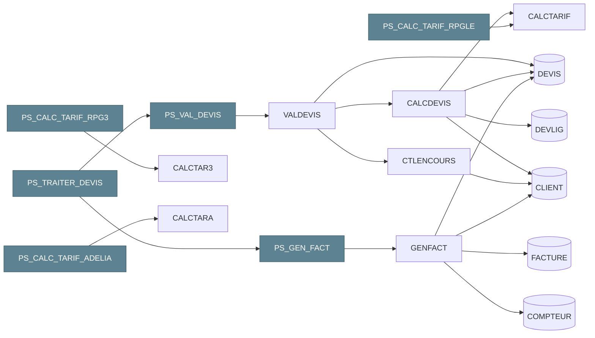

# Db2 for i : un héritage puissant qui ne demande qu'à évoluer

**Andy** · Ingénieur de données · 15 octobre 2026

<!--
*⏱ 00:00 · 25 s*

- Bonjour, merci à **Itheis et IBM** pour l'invitation
- Pas de démo produit, pas de vente
- Montrer **ce qui est possible** avec Db2 for i
-->

---
layout: default
chapitre: intro
---

# Qui suis-je ?

<div class="grid grid-cols-5 gap-6 items-center">

<div class="col-span-2">
<div class="text-6xl font-bold" style="color: var(--slidev-theme-primary)">Andy</div>
<div class="text-xl mt-2">Ingénieur de données · Sinapse</div>
</div>

<div class="col-span-3 flex flex-col gap-3 text-lg">
<div class="flex items-center gap-3"><carbon-microphone class="text-2xl shrink-0" style="color: var(--slidev-theme-primary)" /><span>iBelieve 2021 : <b>500+ tables DDS → SQL</b></span></div>
<div class="flex items-center gap-3"><carbon-favorite-filled class="text-2xl shrink-0" style="color: #b56959" /><span><b>Fan assumé de l'IBM i</b>, depuis mes années DBA</span></div>
<div class="flex items-center gap-3"><carbon-connect class="text-2xl shrink-0" style="color: var(--slidev-theme-primary)" /><span><b>Le passeur</b> : l'existant IBM i ↔ la data moderne</span></div>
</div>

</div>

<div class="parcours mt-10">

<div class="etape-avec-fleche">
  <div class="etape legacy">
    <div class="etape__annee">avant 2016</div>
    <div class="etape__role">Bureautique</div>
    <div class="etape__logos"><simple-icons-microsoftexcel style="color: #217346" /><simple-icons-microsoftaccess style="color: #a4373a" /></div>
    <div class="etape__note">déjà du SQL</div>
  </div>
</div>

<div v-click class="etape-avec-fleche moyen">
  <carbon-arrow-right class="fleche" />
  <div class="etape">
    <div class="etape__annee">2016 – 2019</div>
    <div class="etape__role">Développeur BI</div>
    <div class="etape__logos"><simple-icons-talend style="color: #ff6d70" /><span class="cognos">Cognos</span></div>
    <div class="etape__note">consomme la base</div>
  </div>
</div>

<div v-click class="etape-avec-fleche moyen">
  <carbon-arrow-right class="fleche" />
  <div class="etape fort">
    <div class="etape__annee">2019 – 2022</div>
    <div class="etape__role">DBA / DBE Db2 for i</div>
    <div class="etape__logos"><span class="puce puce--multi"><carbon-ibm-i style="color: #1f3b47" /><simple-icons-postgresql style="color: #4169e1" /><carbon-sql style="color: #5d8392" /></span></div>
    <div class="etape__note">500+ tables → SQL</div>
  </div>
</div>

<div v-click class="etape-avec-fleche large">
  <carbon-arrow-right class="fleche" />
  <div class="etape">
    <div class="etape__annee">2022 – 2026</div>
    <div class="etape__role">Architecte données</div>
    <div class="etape__logos"><Logo nom="cafat.jpg" alt="CAFAT" hauteur="2.6rem" /></div>
    <div class="outils">
      <span><simple-icons-dbt style="color: #ff694b" />dbt</span>
      <span><simple-icons-dlthub style="color: #1f3b47" />dlt</span>
      <span><Logo nom="kestra-icone.svg" alt="Kestra" hauteur="1.7rem" />Kestra</span>
      <span><simple-icons-clickhouse style="color: #e6b800" />ClickHouse</span>
    </div>
  </div>
</div>

<div v-click class="etape-avec-fleche">
  <div class="fleche-texte"><carbon-arrow-right class="fleche fil" /><span>continuité</span></div>
  <div class="etape fort">
    <div class="etape__annee">2026 →</div>
    <div class="etape__role">Ingénieur données</div>
    <div class="etape__logos"><span class="puce"><Logo nom="sinapse.png" alt="Sinapse" hauteur="2rem" /></span></div>
  </div>
</div>

</div>

<style>
.parcours { display: flex; align-items: stretch; gap: 0.4rem; }
.parcours > * { flex: 1 1 0; min-width: 0; }
.parcours > .moyen { flex: 1.25 1 0; }
.parcours > .large { flex: 2.2 1 0; }
.etape-avec-fleche { display: flex; align-items: stretch; gap: 0.3rem; }
.etape-avec-fleche > .etape { flex: 1; }
.fleche { align-self: center; font-size: 1.4rem; color: #b56959; flex: none; }
.fleche-texte { align-self: center; display: flex; flex-direction: column; align-items: center; font-size: 0.6rem; color: #b56959; font-weight: 700; flex: none; }
.etape { min-width: 0; display: flex; flex-direction: column; align-items: center; justify-content: center; gap: 0.5rem; padding: 0.8rem 0.4rem; border-radius: 12px; background: #eef3f5; border: 2px solid #5d8392; text-align: center; }
.etape.legacy { background: #f1eee8; border-color: #9a8f7d; }
.etape.fort { background: #5d8392; border-color: #2f4f5c; color: #fff; }
.etape__annee { white-space: nowrap; font-size: 0.7rem; font-weight: 700; letter-spacing: 0.04em; color: #b56959; }
.etape.fort .etape__annee { color: #f6d7cf; }
.etape__role { font-weight: 700; font-size: 0.85rem; line-height: 1.15; }
.etape__logos { display: flex; align-items: center; justify-content: center; gap: 0.4rem; font-size: 1.8rem; min-height: 2.4rem; }
.etape__note { font-size: 0.7rem; opacity: 0.8; }
.puce { display: inline-flex; align-items: center; background: rgba(255, 255, 255, 0.96); border-radius: 0.6rem; padding: 0.3rem 0.6rem; }
.cognos { display: inline-flex; align-items: center; font-size: 1rem; font-weight: 800; letter-spacing: 0.02em; color: #1f3b47; }
.puce--multi { gap: 0.3rem; padding: 0.3rem 0.45rem; }
.puce--multi svg { font-size: 1.4rem; }
.outils { display: flex; justify-content: center; gap: 0.8rem; font-size: 1.3rem; }
.outils span { display: flex; flex-direction: column; align-items: center; gap: 0.1rem; font-size: 0.6rem; color: #1f3b47; }
.outils span svg { font-size: 1.5rem; }
</style>

<!--
*⏱ 00:25 · 2 min 00 · 20 s avant le 1er clic*

- **Avant 2016** : premières requêtes SQL dans Access, pour des outils Excel
- Le fil rouge de ma carrière était déjà là : le SQL

[click] *⏱ 15 s* **2016-2019** : développeur BI, Talend et Cognos
- J'étais **consommateur** de la base IBM i

[click] *⏱ 30 s* **2019-2022** : DBA puis DBE Db2 for i, de l'autre côté du miroir
- 500+ tables DDS → SQL
- Là que je suis tombé amoureux du SQL sur IBM i : **fan assumé**

[click] *⏱ 20 s* **2022-2026** : retour à la data, architecte de données à la CAFAT
- Outils de la data moderne : dbt, dlt, Kestra, ClickHouse

[click] *⏱ 35 s* **Depuis 2026** : ingénieur de données chez Sinapse, dans la continuité

- Je connais cette base de l'intérieur, je la connecte à la data moderne
- C'est ce regard de **passeur** que je veux partager

-->

---
chapitre: intro
---

# De la CAFAT à Sinapse : une suite logique

<div class="grid grid-cols-3 gap-4 mt-2 mb-4">
<IconCard titre="GIE · 2024" texte="CAFAT · Gouvernement · FSH"><carbon-partnership /></IconCard>
<IconCard titre="265 000" texte="Calédoniens concernés"><carbon-user-multiple /></IconCard>
<IconCard titre="Étape par étape" texte="le recouvrement d'abord"><carbon-roadmap /></IconCard>
</div>

<div class="flex items-center justify-center gap-5 mt-2">
  <div class="flex flex-col items-center gap-1 px-4 py-2 rounded-xl" style="border: 2px dashed #5d8392">
    <div class="text-xs font-bold" style="color: #5d8392">Membres fondateurs</div>
    <div class="flex items-center gap-4">
      <Logo nom="cafat.jpg" alt="CAFAT" hauteur="4.5rem" />
      <Logo nom="gouvernement.jpg" alt="Gouvernement de la Nouvelle-Calédonie" hauteur="4.5rem" />
      <Logo nom="fsh.png" alt="Fonds social de l'habitat" hauteur="4.5rem" />
    </div>
  </div>
  <carbon-arrow-right class="text-3xl" style="color: #5d8392" />
  <Logo nom="sinapse.png" alt="Sinapse" hauteur="3.6rem" />
  <div class="flex flex-col items-center"><carbon-arrow-right class="text-3xl" style="color: #b56959" /><span class="text-xs" style="color: #b56959">étape par étape</span></div>
  <div class="px-4 py-3 rounded-xl text-center font-bold" style="background: #eef3f5; border: 2px solid #5d8392; color: #1f3b47">SI social<br>modernisé</div>
</div>

> Ce que j'ai appris à la CAFAT, je le mets au service du **SI de demain**, avec l'équipe Sinapse.

<div class="absolute bottom-4 left-8 text-xs opacity-60">
<a href="https://sinapse.nc/qui">sinapse.nc — Qui sommes-nous ?</a> ·
<a href="https://sinapse.nc/projet">sinapse.nc — Projet</a> ·
<a href="https://sinapse.nc/">sinapse.nc</a>
</div>

<!--
*⏱ 02:25 · 1 min 35*

- Là où je travaille aujourd'hui : ça explique mon regard
- **Sinapse** : GIE créé en 2024 par la CAFAT, le Gouvernement de la Nouvelle-Calédonie et le FSH
- Mission : moderniser le SI de la protection sociale
  - d'abord le recouvrement, les parcours employeurs et travailleurs indépendants
  - **265 000** Calédoniens concernés
- Pour moi, une **suite logique**
  - à la CAFAT, j'ai appris ces données : leur histoire, leurs contraintes
  - aujourd'hui, je mets cette connaissance au service du SI de demain, **avec toute l'équipe**
- Méthode Sinapse : partir des besoins, **livrer étape par étape**
- → c'est ce que je montre côté base au chapitre 2
-->

---
layout: default
chapitre: intro
---

# Faire évoluer son IBM i : par où commencer ?

<div class="opacity-70 -mt-2">40 ans d'applicatif, des règles dans les programmes, peu de documentation</div>

<div class="grid grid-cols-3 gap-6 mt-6">
<IconCard titre="Avec un outil" texte="jusqu'où aident-ils ?"><carbon-tool-kit /></IconCard>
<IconCard titre="Sans outil" texte="comment avancer quand même ?"><carbon-idea /></IconCard>
<IconCard titre="Avec le natif seul" texte="que permet le SQL ?"><carbon-ibm-i /></IconCard>
</div>

<div class="text-center mt-10 text-xl">Le fil de la réponse : le SQL, <b>bien plus que des transactions</b></div>

<div class="grid grid-cols-4 gap-4 mt-3">
<IconCard petit titre="moderniser"><carbon-migrate /></IconCard>
<IconCard petit titre="administrer"><carbon-settings /></IconCard>
<IconCard petit titre="exploiter"><carbon-dashboard /></IconCard>
<IconCard petit titre="ouvrir les données"><carbon-data-share /></IconCard>
</div>

<!--
*⏱ 04:00 · 1 min 15*

- Situation connue : IBM i depuis des décennies, **40 ans d'applicatif**
- Règles métier cachées dans les programmes, peu de documentation
- On veut le faire évoluer : **par où commencer ?**
- Trois questions qui guident la session :
  - **avec un outil** du marché : jusqu'où aide-t-il ?
  - **sans outil** (pas de budget, pas encore) : comment avancer ?
  - **avec le natif seul** : que permet le SQL de l'IBM i ?
- Le fil de la réponse : le SQL dépasse les transactions
  - moderniser · administrer · exploiter · ouvrir les données
-->

---
layout: two-cols
chapitre: 1
layoutClass: gabarit
---

# 1. Le chantier 2019-2022

<div class="mt-2 leading-none font-bold" style="font-size: 4.6rem; color: var(--slidev-theme-primary)">500+</div>
<div class="text-2xl mt-2">tables DDS → SQL, <b>sans recompiler</b></div>
<div class="flex items-center gap-4 mt-2"><Logo nom="itheis.jpg" alt="Itheis" hauteur="2.4rem" /><Logo nom="gaia.png" alt="Gaia" hauteur="2.4rem" /><Logo nom="xcase.png" alt="Xcase for i" hauteur="2.4rem" /></div>

<div class="mt-4 opacity-70 text-sm uppercase tracking-wider">Et après</div>
<div class="grid grid-cols-3 gap-2 mt-1 w-4/5">
<IconCard petit titre="contraintes"><carbon-connect /></IconCard>
<IconCard petit titre="temporel"><carbon-time /></IconCard>
<IconCard petit titre="RCAC"><carbon-security /></IconCard>
</div>

::right::

```d2 {maxHeight: '18rem'}
...@theme
direction: down

pgm: "Programmes RPG\nexistants" {class: legacy}
lf: "LF de substitution\n(même format)" {class: bloc}
new: "Nouveaux\ndéveloppements" {class: bloc}
table: "Nouvelle table SQL" {class: donnees}

pgm -> lf: sans recompilation
lf -> table
new -> table: SQL {class: fil}
```

<div class="absolute bottom-24 left-14 right-14 text-lg">

<div class="text-sm opacity-80 mb-2"><carbon-favorite-filled class="inline" style="color: #b56959" /> Merci à <b>E. Sadiman</b>, qui m'a confié ce chantier — et m'a rendu fan de l'IBM i</div>

> iBelieve 2021 : **migrer des tables**. iBelieve 2026 : **reprendre la maîtrise**, en cartographiant.

</div>

<div class="absolute bottom-4 left-8 text-xs opacity-60">
Source : <a href="https://www.itheis.com/sql-comment-migrer-votre-base-de-donnees-sans-perturber-lexistant-applicatif/">Itheis — méthode surrogate</a>
</div>

<!--
*⏱ 05:15 · 2 min 05*

- En 2021, je vous ai parlé de **migrer des tables**
- 2019-2022 : **500+ tables DDS → SQL**, avec Itheis, Gaia, Xcase for i
- La clé : **méthode surrogate**
  - un LF de substitution garde l'ancien format
  - les programmes tournent **sans recompilation**
- Ce que le SQL débloque ensuite : **contraintes**, **tables temporelles**, **RCAC**
- Pourquoi les contraintes comptent
  - une appli qui écrit en direct ne voit que les clés
  - plafond d'encours, cycle de vie du devis : dans les programmes → contournés
  - une règle dans la base, aucun client ne peut l'oublier
- Petit périmètre : le natif suffit, `GENERATE_SQL`


- **Dédicace** : merci à E. Sadiman, qui m'a fait confiance, et m'a rendu fan de l'IBM i
- Transition : migrer la base, c'était la **première marche**
- En 2026 : **reprendre la maîtrise** de l'existant, en commençant par le **cartographier**
-->

---
layout: center
chapitre: 2
etape: 0
---

# 2. Moderniser progressivement

On ne réécrit pas 40 ans d'applicatif d'un coup

```d2 {maxHeight: '13rem'}
...@theme
direction: right

c: "1. Cartographier\nchaînes d'appels\ntables ↔ programmes" {class: bloc}
e: "2. Encapsuler\nRPG → procédures\nstockées" {class: [bloc; etape2]}
d: "3. Découpler\nla base publie\nles changements" {class: [bloc; etape3]}
m: "4. Moderniser\nun bloc\nà la fois" {class: [fort; etape4]}

c -> e: {class: etape2}
e -> d: {class: etape3}
d -> m: {class: etape4}
m -> c: on recommence {class: [fil; etape5]; style.stroke-dash: 4}
```

<br>

**Le SQL est l'outil de chacune de ces étapes.**

<div class="absolute bottom-4 left-8 text-xs opacity-60">
Principes : <a href="https://redbooks.ibm.com/abstracts/sg248185.html">SG24-8185</a> ·
<a href="https://www.redbooks.ibm.com/docs/MD260020/MD260020.html">Redbook 2026 MD260020</a> ·
<a href="https://www.redbooks.ibm.com/abstracts/redp5095.html">REDP-5095</a>
</div>

<!--
*⏱ 07:20 · 1 min 20 · 30 s avant le 1er clic*

- Redbook SG24-8185 : pas que l'interface web, **quatre principes**
  - modularisation, couches, data-centric, orientation service
- Redbook 2026 : data-centric + API REST
- Démarche en quatre temps :
- **Cartographier** : savoir ce qui existe

[click] *⏱ 10 s* **Encapsuler** : rendre l'existant appelable, sans le réécrire

[click] *⏱ 10 s* **Découpler** : la base publie ce qui change

[click] *⏱ 10 s* **Moderniser un bloc à la fois**, et seulement alors

[click] *⏱ 20 s* **On recommence** sur le bloc suivant

- Le SQL est l'outil de **chacune** de ces étapes
-->

---
chapitre: 2
etape: 0
---

# Le terrain : une mini-application de devis

<div class="opacity-70 -mt-2 mb-2"><carbon-checkmark-outline class="inline" /> Tout le SQL qui suit a <b>tourné</b> sur pub400 — et se rejoue avec le <b>kit</b> du dépôt</div>

```d2 {maxHeight: '21rem'}
...@theme
direction: right

sql: "SQL, par-dessus" {
  class: zone
  trt: "PS_TRAITER_DEVIS\nenchaîne" {class: fort}
  val: "PS_VAL_DEVIS" {class: bloc}
  gen: "PS_GEN_FACT" {class: bloc}
  trt -> val
  trt -> gen
}
rpg: "Programmes RPG existants" {
  class: zone
  valdevis: "VALDEVIS\nvalide un devis" {class: legacy}
  calcdevis: "CALCDEVIS" {class: legacy}
  calctarif: "CALCTARIF\nremise + TVA" {class: legacy}
  ctl: "CTLENCOURS\nencours" {class: legacy}
  genfact: "GENFACT\nfacture" {class: legacy}
  valdevis -> calcdevis -> calctarif
  valdevis -> ctl
}
donnees: "Données · journalisées" {
  class: zone
  client: CLIENT {class: donnees}
  devis: DEVIS {class: donnees}
  devlig: DEVLIG {class: donnees}
  facture: FACTURE {class: donnees}
}

sql.val -> rpg.valdevis: CALL {class: fil}
sql.gen -> rpg.genfact: CALL {class: fil}
rpg.calcdevis -> donnees.devlig
rpg.ctl -> donnees.client
rpg.genfact -> donnees.facture
```

<div class="absolute bottom-4 left-8 text-xs opacity-60">
Kit : <code>kit/rpg/</code> — 5 tables, 7 programmes RPG compilés depuis ACS, 3 procédures SQL · sans compilateur : <code>kit/00-terrain.sql</code>
</div>

<!--
*⏱ 08:40 · 1 min 40*

- Tout ce qui suit a **tourné sur pub400**, un IBM i public
- Rejouable : le **kit** du dépôt, dans votre bibliothèque
- Schéma petit : clients, devis, lignes, factures
- Mais les défauts d'une vraie base
  - date stockée en numérique, « parce que c'est partout »
  - règles métier dans les programmes : remise, encours, cycle de vie
- De **vrais programmes RPG**, compilés depuis ACS
  - VALDEVIS valide → CALCDEVIS → CALCTARIF (remise, TVA)
  - VALDEVIS → CTLENCOURS (plafond d'encours)
  - GENFACT facture, possède sa transaction
- Par-dessus : deux façades, **PS_VAL_DEVIS**, **PS_GEN_FACT**, et **PS_TRAITER_DEVIS** qui les enchaîne
- `PS_` = procédure stockée ; un RPG n'a pas de préfixe (kit/README.md)
- Pas de compilateur ? Variante tout SQL : kit/00-terrain.sql
-->

---
chapitre: 2
etape: 1
---

# 2.1 Cartographier

<div class="opacity-70 -mt-2">En clair : savoir qui appelle quoi avant de toucher à quoi que ce soit.</div>

<div class="grid grid-cols-3 gap-4 mt-2">
<IconCard titre="Avec un outil" texte="X-Analysis : modèle déduit du code"><carbon-tool-kit /></IconCard>
<IconCard titre="Avec l'IA" texte="Bob ou un autre assistant lit le RPG"><carbon-chat-bot /></IconCard>
<IconCard titre="Sans outil" texte="DSPPGMREF, piloté en SQL"><carbon-ibm-i /></IconCard>
</div>

```sql
CALL QSYS2.QCMDEXC(
  'DSPPGMREF PGM(' CONCAT CURRENT SCHEMA CONCAT '/*ALL) OUTPUT(*OUTFILE) OBJTYPE(*PGM) '
  CONCAT 'OUTFILE(' CONCAT CURRENT SCHEMA CONCAT '/T_PGMREF) OUTMBR(*FIRST *REPLACE)');
```

<div class="flex items-baseline justify-center gap-6 mt-4">
<div class="text-center"><div class="text-5xl font-bold" style="color: var(--slidev-theme-primary)">8</div><div class="opacity-70">programmes analysés</div></div>
<carbon-arrow-right class="text-3xl opacity-50" />
<div class="text-center"><div class="text-5xl font-bold" style="color: var(--slidev-theme-primary)">3</div><div class="opacity-70">appels entre eux</div></div>
<div class="text-3xl opacity-50">+</div>
<div class="text-center"><div class="text-5xl font-bold" style="color: var(--slidev-theme-primary)">9</div><div class="opacity-70">références de tables</div></div>
</div>

<div class="absolute bottom-4 left-8 text-xs opacity-60">
<a href="https://fr.freschesolutions.com/wp-content/uploads/archive/miscellaneous/X-Analysis_Comparisons.pdf">X-Analysis</a> ·
<a href="https://www.ibm.com/docs/en/i/7.3.0?topic=ssw_ibm_i_73%2Fcl%2Fdsppgmref.html">DSPPGMREF</a> ·
<a href="https://www.ibm.com/support/pages/detailed-file-field-description-file-qadsppgm-format-qwhdrppr-dsppgmref-output-file">Format QADSPPGM</a> ·
<a href="https://www.ibm.com/products/ai-coding-agent/ibm-i-modernization">IBM Bob pour IBM i</a> ·
<a href="https://www.itjungle.com/2026/03/02/ibm-gets-bob-1-0-off-the-ground/">IT Jungle — Bob 1.0</a> ·
<code>kit/rpg/15-cartographier-rpg.sql</code>
</div>

<!--
*⏱ 10:20 · 1 min 40*

- Programmes des années 80, **relations dans le code**, pas dans la base
- Avant de toucher : retrouver **chaînes d'appels** et **tables utilisées**
- **Avec un outil** (X-Analysis) : diagrammes, modèle déduit du code, impact
- **Avec l'IA** (Bob, dispo depuis mars 2026, ou un autre assistant)
  - lit RPG, CL, DDS ; explique, documente, dessine
  - mon avis : **un accélérateur, pas un substitut** ; savoir vérifier
- **Sans outil** : DSPPGMREF, pour cadrer, et vérifier ce que dit l'IA
- La commande : une CL pilotée en SQL, sur toute la bibliothèque
  - résultat matérialisé dans **T_PGMREF** : début d'un référentiel
- Sur le kit : **8 programmes, 3 appels, 9 références de tables**
  - hors système : moteur SQL, runtime RPG, QSYS2

*Réserve* : format QADSPPGM — WHPNAM programme, WHFNAM/WHLNAM objet référencé, WHOTYP type, WHFUSG usage (1 lecture, 2 écriture, 4 mise à jour). QTEMP pour explorer sans rien laisser.
*Source* : exécuté sur pub400 le 29/09, kit/rpg/15-cartographier-rpg.sql.
-->

---
chapitre: 2
etape: 1
---

# La chaîne d'appels, du SQL jusqu'au RPG

<v-switch>
<template #0>

<div class="etape-carto"><carbon-data-table /> Trois sources, une table : T_APPELS</div>

```d2 {maxHeight: '15rem'}
...@theme
direction: right

sql: "Catalogue SQL" {
  class: zone
  dep: "SYSROUTINEDEP\nprocédure → procédure" {class: bloc}
  ext: "SYSROUTINES\nfaçade → programme" {class: bloc}
}
rpg: "Programmes compilés" {
  class: zone
  ref: "DSPPGMREF → T_PGMREF\nprogramme → programme" {class: legacy}
}
t: "T_APPELS\nAPPELANT · APPELÉ · SOURCE" {class: [donnees; fort]}
rec: "Requête récursive\ndescend la chaîne" {class: bloc}

sql.dep -> t: UNION
sql.ext -> t: UNION
rpg.ref -> t: UNION
t -> rec {class: fil}
```

<div class="text-sm opacity-70 mt-2">Chaque monde se lit à un endroit différent ; on matérialise, puis on interroge.</div>

</template>
<template #1>

<div class="etape-carto"><carbon-flow /> Une requête récursive descend la chaîne</div>

```sql
WITH CHAINE (APPELE, NIVEAU, CHEMIN, SOURCE) AS (
  SELECT APPELE, 1, CAST(APPELANT CONCAT ' > ' CONCAT APPELE AS VARCHAR(1000)), SOURCE
    FROM T_APPELS WHERE APPELANT = 'PS_TRAITER_DEVIS'
  UNION ALL
  SELECT A.APPELE, C.NIVEAU + 1, C.CHEMIN CONCAT ' > ' CONCAT A.APPELE, A.SOURCE
    FROM CHAINE C JOIN T_APPELS A ON A.APPELANT = C.APPELE
   WHERE C.NIVEAU < 15                                    -- profondeur max
     AND LOCATE(' ' CONCAT A.APPELE CONCAT ' ',
                ' ' CONCAT C.CHEMIN CONCAT ' ') = 0       -- pas de boucle
)
SELECT NIVEAU, CHEMIN, SOURCE FROM CHAINE ORDER BY CHEMIN;
```


> Le natif ne remplace pas un outil. Il permet de savoir **par où commencer** et **quoi ne pas casser**.

</template>
<template #2>

<div class="etape-carto"><carbon-checkmark-outline /> Résultat sur pub400</div>

<Resultat :colonnes="['NIVEAU', 'CHEMIN', 'SOURCE']"
  :lignes="[
    ['1', 'PS_TRAITER_DEVIS > PS_GEN_FACT', 'SYSROUTINEDEP'],
    ['2', 'PS_TRAITER_DEVIS > PS_GEN_FACT > GENFACT', 'SYSROUTINES'],
    ['1', 'PS_TRAITER_DEVIS > PS_VAL_DEVIS', 'SYSROUTINEDEP'],
    ['2', 'PS_TRAITER_DEVIS > PS_VAL_DEVIS > VALDEVIS', 'SYSROUTINES'],
    ['3', 'PS_TRAITER_DEVIS > PS_VAL_DEVIS > VALDEVIS > CALCDEVIS', 'DSPPGMREF'],
    ['4', 'PS_TRAITER_DEVIS > PS_VAL_DEVIS > VALDEVIS > CALCDEVIS > CALCTARIF', 'DSPPGMREF'],
    ['3', 'PS_TRAITER_DEVIS > PS_VAL_DEVIS > VALDEVIS > CTLENCOURS', 'DSPPGMREF'],
  ]" />

> Le natif ne remplace pas un outil. Il permet de savoir **par où commencer** et **quoi ne pas casser**.

</template>
<template #3>

<div class="flex items-center gap-6">
<div class="shrink-0">



</div>
<div>

<div class="text-sm opacity-70 mb-4">Le même graphe, écrit en Mermaid par une requête SQL (kit).</div>

> Le natif ne remplace pas un outil. Il permet de savoir **par où commencer** et **quoi ne pas casser**.

</div>
</div>

</template>
</v-switch>

<style>
.etape-carto {
  display: flex;
  align-items: center;
  gap: 0.5rem;
  margin-bottom: 0.75rem;
  font-weight: 600;
  font-size: 1.1rem;
  color: var(--slidev-theme-primary, #5d8392);
}
</style>

<div class="absolute bottom-4 left-8 text-xs opacity-60">
<a href="https://www.ibm.com/docs/en/i/7.5.0?topic=views-sysroutinedep">SYSROUTINEDEP</a> ·
<a href="https://www.ibm.com/docs/en/i/7.5.0?topic=views-sysroutines">SYSROUTINES</a> ·
<a href="https://www.linkedin.com/pulse/dsppgmref-sql-table-function-ibmi-bob-cozzi">Bob Cozzi — DSPPGMREF en UDTF</a> ·
<code>kit/rpg/15-cartographier-rpg.sql</code>
</div>

<!--
*⏱ 12:00 · 2 min 25 · 40 s avant le 1er clic*

- Départ : **PS_TRAITER_DEVIS**, valide puis facture un devis
- La chaîne traverse **deux mondes**, SQL et RPG
- Chaque maillon se lit à un endroit différent :
  - procédure → procédure : **SYSROUTINEDEP**
  - façade → programme : **SYSROUTINES**
  - programme → programme : **DSPPGMREF** (T_PGMREF)
- Un UNION : une table, **T_APPELS**
- **On matérialise, puis on interroge**

[click] *⏱ 20 s* Requête récursive classique
- les programmes appelés par les programmes appelés
- deux garde-fous : **profondeur max**, **pas de boucle**

[click] *⏱ 30 s* Résultat réel sur pub400
- du SQL, par les façades, jusqu'au RPG : VALDEVIS, CALCDEVIS, CALCTARIF
- une branche inattendue : **CTLENCOURS**, le contrôle d'encours
- la colonne SOURCE dit d'où vient chaque maillon

[click] *⏱ 55 s* Une autre requête écrit **le même graphe en Mermaid**
- on colle dans un éditeur : diagramme de structure, SQL et RPG distingués
- Limites, honnêtement (là qu'un outil fait la différence) :
  - appels à **nom littéral** seulement
  - **appels réseau** invisibles
- **Le natif ne remplace pas un outil** : il dit par où commencer, quoi ne pas casser

*Réserve* : requêtes T_APPELS et Mermaid dans kit/rpg/15-cartographier-rpg.sql ; SQL dynamique : SYSPROGRAMSTMTSTAT, PARSE_STATEMENT, BOUND_MODULE_INFO ; « qui touche à DEVIS ? » : CALCDEVIS, VALDEVIS, GENFACT.
*Source* : exécuté sur pub400 le 29/09 ; Mermaid : sortie réelle de 27 lignes, ordre retouché pour l'écran.
-->
---
zoom: 0.9
chapitre: 2
etape: 2
---

# 2.2 Encapsuler

Un programme existant devient une **procédure stockée**. Sans toucher à son code.

<div class="grid grid-cols-5 gap-4 mt-2">

<div class="col-span-3">

```sql
CREATE OR REPLACE PROCEDURE PS_CALC_TARIF_RPG3 (
    IN  p_montant_ht   DECIMAL(9,2),
    IN  p_taux_remise  DECIMAL(5,2),
    OUT p_remise       DECIMAL(11,2),
    OUT p_tva          DECIMAL(11,2),
    OUT p_ttc          DECIMAL(11,2),
    OUT p_rc           CHAR(1)
)
  LANGUAGE RPG                       -- RPG, pas RPGLE : c'est de l'OPM
  SPECIFIC PS_TARIF3
  NO SQL
  EXTERNAL NAME 'VOTREBIB/CALCTAR3'
  PARAMETER STYLE GENERAL;

CALL PS_CALC_TARIF_RPG3(10000.00, 5.00, ?, ?, ?, ?);
```

</div>

<div class="col-span-2">

```d2 {maxHeight: '22rem'}
...@theme
direction: down

prog: "3 programmes, 3 époques" {
  class: zone
  p3: "CALCTAR3\nRPG III" {class: legacy}
  p4: "CALCTARIF\nRPG IV" {class: legacy}
  pa: "CALCTARA\nAdélia" {class: legacy}
}
contrat: "Même contrat SQL\n9500 · 1900 · 11400" {class: fort}
app: "ODBC · JDBC · Mapepire\npipeline data" {class: bloc}

prog.p3 -> contrat
prog.p4 -> contrat
prog.pa -> contrat
contrat -> app: CALL {class: fil}
```

</div>

</div>

<div class="absolute bottom-4 left-8 text-xs opacity-60">
<a href="https://www.oreilly.com/library/view/modernizing-ibm-eserver/0738492132/chapter-47.html">SG24-6393 — External stored procedures</a> ·
<code>kit/rpg/13-facades.sql</code>
</div>

<!--
*⏱ 14:25 · 2 min 15*

- **Trois programmes, trois époques** : RPG III (OPM), RPG IV free-form, RPG façon Adélia
- Derrière **trois procédures au contrat identique**
- Aucun recompilé : **que du DDL**
  - `LANGUAGE RPG`, pas RPGLE : c'est de l'OPM
  - `PARAMETER STYLE GENERAL` : paramètres passés tels quels
- Le schéma : vu du catalogue, trois procédures **interchangeables**
  - appelables depuis ODBC, JDBC, Mapepire, un pipeline
  - 10 000 HT, 5 % → **9500 · 1900 · 11400**, les trois pareils
- S'appelle de partout
  - JDBC : lit les paramètres de sortie
  - ODBC : une fonction table rend les valeurs par un SELECT (kit)
- Une fois encapsulés, **on les compose** : validation existante + SQL neuf + facturation existante
- Attention : une transaction de l'appelant **ne traverse pas** un programme COMMIT(*NONE)
  - encapsuler, c'est aussi décider **qui possède la transaction**
- *Si le temps le permet* : 99,99 à 33,33 % → **un centime d'écart** (79,99 / 80,00)
  - encapsuler n'efface pas les différences : **ça les rend testables**

*Source* : exécuté sur pub400 le 29/09, kit RPG ; les trois CALL rendent 9500.00 / 1900.00 / 11400.00.
-->

---
zoom: 0.9
chapitre: 2
etape: 2
hide: true
---

# Appeler la façade depuis l'extérieur

<div class="grid grid-cols-2 gap-6 mt-2">

<div>

### <logos-java class="inline" /> JDBC : les OUT, directement

```java
try (CallableStatement cs = cnx.prepareCall(
        "CALL VOTREBIB.PS_CALC_TARIF_RPG3(?, ?, ?, ?, ?, ?)")) {
  cs.setBigDecimal(1, new BigDecimal("10000.00"));  // HT
  cs.setBigDecimal(2, new BigDecimal("5.00"));      // remise %
  for (int i = 3; i <= 5; i++)                      // OUT
    cs.registerOutParameter(i, Types.DECIMAL, 2);
  cs.registerOutParameter(6, Types.CHAR);
  cs.execute();
  System.out.println(cs.getBigDecimal(3) + " / "
      + cs.getBigDecimal(4) + " / " + cs.getBigDecimal(5));
}
```

</div>

<div>

### <logos-python class="inline" /> ODBC : par une fonction table

<div class="text-sm px-3 py-2 mb-2 rounded" style="background: #f7ebe7; border-left: 4px solid #b56959">
<carbon-warning-alt class="inline" style="color: #b56959" /> <b>pyodbc</b> et bien des outils BI <b>ne lisent pas les paramètres OUT</b> d'un <code>CALL</code>.
On crée donc une <b>UDTF</b> (fonction table SQL) qui appelle la façade et rend ses valeurs en ligne : <code>kit/rpg/16-appeler.sql</code>.
</div>

```sql
SELECT * FROM TABLE(F_TARIF_RPG3(10000.00, 5.00)) T;
```

```python
import pyodbc

cnx = pyodbc.connect("DSN=MONIBMI")   # IBM i Access ODBC
remise, tva, ttc, rc = cnx.execute(
    "SELECT * FROM TABLE(VOTREBIB.F_TARIF_RPG3(?, ?)) T",
    10000.00, 5.00).fetchone()
print(remise, tva, ttc)   # 9500.00 1900.00 11400.00
```

</div>

</div>

<div class="text-center mt-4 text-lg"><carbon-checkmark-outline class="inline" /> Dans les deux cas : <b>9500.00 · 1900.00 · 11400.00</b>, calculés par le RPG III</div>

<div class="absolute bottom-4 left-8 text-xs opacity-60">
<a href="https://github.com/IBM/JTOpen">JTOpen</a> ·
<a href="https://github.com/mkleehammer/pyodbc/wiki/Calling-Stored-Procedures">pyodbc — procédures stockées</a> ·
<code>kit/rpg/16-appeler.sql</code> · <code>AppelerFacade.java</code> · <code>appeler_facade.py</code>
</div>

<!--
*Slide en réserve, masquée par hide: true : à montrer en questions.*

- Une fois encapsulé, le RPG s'appelle **depuis n'importe quel langage**
- **JDBC** (JTOpen) : CallableStatement, montant et taux en entrée, quatre sorties → 9500, 1900, 11400
- **ODBC** : piège, pyodbc et beaucoup d'outils BI **ne lisent pas les OUT**
  - solution native : une **fonction table** qui appelle la façade
  - un simple SELECT suffit : Python, Excel, Power BI, DuckDB
- Idée qu'on retrouve au chapitre 4 : l'IBM i comme source de données

*Source* : exécuté sur pub400 le 29/09 : programme Java tel quel, requête du script Python ; kit/rpg/16-appeler.sql.
-->

---
chapitre: 2
etape: 3
---

# 2.3 Découpler : publier sans toucher aux programmes

<div class="opacity-70 -mt-2">En clair : au lieu que le programme appelle chaque service, la base publie et chacun vient lire.</div>

```d2 {maxHeight: '16.5rem'}
...@theme
direction: right

avant: "Aujourd'hui : le programme appelle chaque service" {
  class: zone
  direction: right
  p1: "Programme RPG\nécrit la donnée\net appelle l'API" {class: legacy}
  t1: "Table" {class: donnees}
  d1: "Service REST A" {class: bloc}
  d2: "Service REST B" {class: bloc}
  p1 -> t1
  p1 -> d1: HTTP, à chaque fois {class: fil}
  p1 -> d2: HTTP, à chaque fois {class: fil}
}
apres: "Alternative testée : la base publie, chacun vient lire" {
  class: [zone; etape2]
  direction: right
  p2: "Programme RPG\nnon modifié" {class: [legacy; etape2]}
  t2: "Table" {class: [donnees; etape2]}
  b: "La base publie\njournal · file" {class: [fort; etape2]}
  d3: "Un consommateur\npipeline · API · Kafka\n(à brancher)" {class: [eteint; etape2]}
  p2 -> t2 {class: etape2}
  t2 -> b {class: etape2}
  b -> d3: s'abonne {class: [eteint; etape2]}
}
```

<div class="text-center mt-3 text-xl" v-click>Le programme n'a pas changé, et <b>la base publie</b> ce qui change.<div class="text-sm opacity-60 mt-1">Testé sur pub400 : journal et file. Aucun consommateur n'est déployé.</div></div>

<!--
*⏱ 16:40 · 2 min 00 · 45 s avant le 1er clic*

- Découpler : séparer **celui qui produit un changement** de **ceux qui doivent le connaître**
- Chez nous aujourd'hui : le programme **appelle lui-même** un service REST (fonctions HTTP de Db2)
  - lié à chaque service : en ajouter un = retoucher le programme
  - une panne du service se répercute sur la transaction

[click] *⏱ 30 s* L'alternative, **testée sur pub400**
- la responsabilité passe **dans la base**
- le programme écrit sa donnée, ne sait rien de personne
- la base publie (journal ou file), chacun vient lire

[click] *⏱ 45 s* **Le programme n'a pas changé, et la base publie ce qui change**
- Honnêteté : journal et file ont tourné ; le consommateur (pipeline, API, Kafka) **reste à brancher**
- Rien de tel n'est déployé chez nous aujourd'hui
- Slide suivante : les deux moyens, le journal puis la file
-->

---
zoom: 0.9
chapitre: 2
etape: 3
---

# 2.3 Le journal et la file : la base publie

<div class="grid grid-cols-5 gap-6">

<div class="col-span-3">

<v-switch>
<template #0>

<div class="etape-decouple"><carbon-document /> Le journal a déjà tout vu</div>

```sql
-- Le journal a déjà tout capté
SELECT ENTRY_TIMESTAMP, JOURNAL_ENTRY_TYPE,
       SUBSTR(OBJECT, 1, 10) AS TABLE_, PROGRAM_NAME
  FROM TABLE (QSYS2.DISPLAY_JOURNAL(
         JOURNAL_LIBRARY    => CURRENT SCHEMA,
         JOURNAL_NAME       => 'QSQJRN',
         STARTING_TIMESTAMP => CURRENT TIMESTAMP - 1 HOUR))
 WHERE JOURNAL_CODE = 'R';
```

```text
2026-09-29 09:45:54.211616 | UP | DEVIS    | CALCDEVIS
2026-09-29 09:45:54.2132   | UP | DEVIS    | VALDEVIS
2026-09-29 09:45:54.224304 | UP | COMPTEUR | GENFACT
2026-09-29 09:45:54.23416  | PT | FACTURE  | GENFACT
2026-09-29 09:45:54.235536 | UP | CLIENT   | GENFACT
2026-09-29 09:45:54.236672 | UP | DEVIS    | GENFACT
```

<div class="mt-2 opacity-80"><carbon-checkmark-outline class="inline" /> Le journal sait <b>quel programme</b> a modifié quoi. Aucun n'a été modifié.</div>

</template>
<template #1>

<div class="etape-decouple"><carbon-send /> La base publie un JSON dans une file</div>

```sql
-- Publier l'état du client en JSON
CALL QSYS2.SEND_DATA_QUEUE_UTF8(
  MESSAGE_DATA => (
    SELECT JSON_OBJECT('table'   VALUE 'CLIENT',
                       'id'      VALUE CLI_NUM,
                       'encours' VALUE CLI_ENCOURS,
                       'ts'      VALUE CURRENT TIMESTAMP)
      FROM CLIENT WHERE CLI_NUM = 1001),
  DATA_QUEUE         => 'EVT_CLIENT',
  DATA_QUEUE_LIBRARY => CURRENT SCHEMA);
```

<div class="text-sm opacity-70 mt-1">Ici l'envoi est lancé à la main. Sur un vrai système, un trigger le fait à chaque modification.</div>

</template>
<template #2>

<div class="etape-decouple"><carbon-download /> Le consommateur lit, y compris par ODBC</div>

```sql
-- Côté consommateur, y compris via ODBC
SELECT CAST(MESSAGE_DATA_UTF8 AS VARCHAR(1000)) AS MESSAGE
  FROM TABLE (QSYS2.RECEIVE_DATA_QUEUE(
         DATA_QUEUE         => 'EVT_CLIENT',
         DATA_QUEUE_LIBRARY => CURRENT SCHEMA));
```

```text
{"table":"CLIENT","id":1001,"encours":2910.00,
 "ts":"2026-09-29-09.45.57.398581"}
```

</template>
</v-switch>

</div>

<div class="col-span-2">

```d2 {maxHeight: '24rem'}
...@theme
direction: down

ibmi: "IBM i" {
  class: zone
  t: "Tables\nCLIENT · DEVIS…" {class: donnees}
  j: "Journal\nQSQJRN" {class: fort}
  q: "*DTAQ\nEVT_CLIENT" {class: fort; shape: queue}
  t -> j: chaque modification
  t -> q: SEND_DATA_QUEUE
}
cdc: "Job de capture (CDC)\nlit DISPLAY_JOURNAL\n(à écrire ou à acheter)" {class: bloc}
conso: "Consommateurs possibles\nJava · Python · RPG" {class: bloc}
cible: "Kafka · API · pipeline\nà brancher, non déployé" {class: eteint}

ibmi.j -> cdc
ibmi.q -> conso
cdc -> cible {class: eteint}
conso -> cible {class: eteint}
```

</div>

</div>

<style>
.etape-decouple {
  display: flex;
  align-items: center;
  gap: 0.5rem;
  margin-bottom: 0.75rem;
  font-weight: 600;
  font-size: 1.1rem;
  color: var(--slidev-theme-primary, #5d8392);
}
</style>

<div class="absolute bottom-4 left-8 text-xs opacity-60">
<a href="https://www.ibm.com/docs/en/i/7.5.0?topic=services-display-journal-table-function">DISPLAY_JOURNAL</a> ·
<a href="https://ibm.com/support/knowledgecenter/ssw_ibm_i_75/rzajq/rzajqprocsenddtaq.htm">SEND_DATA_QUEUE</a> ·
<a href="https://www.ibm.com/support/pages/qsys2receivedataqueue">RECEIVE_DATA_QUEUE</a> ·
<a href="https://javadoc.io/doc/net.sf.jt400/jt400/latest/com/ibm/as400/access/DataQueue.html">JTOpen DataQueue</a> ·
<a href="https://www.ibm.com/docs/en/i/7.5.0?topic=ssw_ibm_i_75/apis/qrcvdtaq.htm">QRCVDTAQ</a> ·
<code>kit/rpg/17-decoupler.sql</code>
</div>

<!--
*⏱ 18:40 · 2 min 30 · 1 min 10 avant le 1er clic*

- Deux moyens de publier, **sans toucher aux programmes**
- **Le journal** d'abord : les tables sont journalisées
  - on traite un devis : le journal a **tout vu**
  - chaque modification, avec la table et **le programme** qui l'a faite
  - CALCDEVIS, VALDEVIS sur le devis ; GENFACT sur facture et client
  - des programmes RPG **qu'on n'a pas touchés**
  - base de toute capture de changements ; le relais vers Kafka ou une API reste à écrire ou à acheter

[click] *⏱ 35 s* **La file** ensuite : un JSON construit en SQL, déposé dans une file de données
- ici envoyé **à la main** ; en vrai, un **trigger** le ferait à chaque modification
- pub400 refuse CREATE TRIGGER au compte gratuit

[click] *⏱ 45 s* **N'importe qui la lit** : SQL, ODBC, Java, un vieux programme RPG
- l'encours du client passe à **2910** : la facture qu'on vient d'émettre
- Règle d'or : **pas d'appel réseau** au moment où la donnée change
  - on écrit localement, un consommateur asynchrone relaie

*Source* : exécuté sur pub400 le 29/09, kit/rpg/17-decoupler.sql ; MQ et trigger non exécutés.
-->

---
chapitre: 2
etape: 4
---

# 2.4 Moderniser, un bloc à la fois

<div class="opacity-70 -mt-2">En clair : on remplace ce qu'il y a derrière la façade, les appelants ne voient rien.</div>

```d2 {scale: 1.7, maxHeight: '19rem'}
...@theme
direction: right

app: "Appelants\nSQL · JDBC · ODBC\npipeline" {class: bloc}
facade: "Façade SQL\nmême contrat\nHT, remise → TVA, TTC" {class: fort}
rpg: "Aujourd'hui\nCALCTARIF\nRPG IV" {class: legacy}
neuf: "Demain\ncalcul réécrit\nSQL ou Java" {class: [bloc; etape2]}
suivant: "Bloc suivant\nCTLENCOURS, GENFACT…" {class: [eteint; etape3]}

app -> facade: CALL
facade -> rpg
facade -> neuf: remplace {class: [fil; etape2]}
neuf -> suivant: puis {class: [fil; etape3]}
```

<div class="text-center mt-8 text-2xl" v-click>Le contrat ne change pas, <b>l'implémentation si</b>.</div>

<div class="text-center text-sm opacity-60 mt-1">Principe, non exécuté : le kit montre trois implémentations derrière un même contrat (2.2), pas encore une réécriture.</div>

<!--
*⏱ 21:10 · 2 min 10 · 25 s avant le 1er clic*

- Dernière étape : **celle pour laquelle on a fait tout le reste**
- Aujourd'hui : les appelants (SQL, Java, ODBC, pipeline) appellent **la façade**
- Derrière, le RPG **CALCTARIF** calcule

[click] *⏱ 25 s* **Demain** : on réécrit le calcul, en SQL ou en Java
- branché derrière **la même façade**
- mêmes paramètres, mêmes résultats : **les appelants ne voient rien**

[click] *⏱ 20 s* Puis **le bloc suivant** : contrôle d'encours, facturation…
- un bloc à la fois, **jamais tout d'un coup**

[click] *⏱ 1 min 00* **Le contrat ne change pas, l'implémentation si**
- Comment savoir qu'on n'a rien cassé ? Comparer les versions (2.2 : l'écart d'un centime)
- Honnêteté : **un principe** ; le kit montre trois implémentations, pas une réécriture
- Transition : cartographier, encapsuler, découpler, remplacer → **toujours le SQL**
  - pas qu'un langage de requête : un **langage d'intégration**
  - il sert aussi à **administrer** : c'est la suite
-->

---
chapitre: 3
---

# 3. Administrer et exploiter en SQL

<div class="opacity-70 -mt-2">En clair : le système se consulte comme une table, sans connaître les commandes.</div>

<div class="grid grid-cols-2 gap-8 mt-2">

<div>

### Une commande CL, un service SQL

| Commande CL | Service SQL |
|---|---|
| `WRKACTJOB` | `QSYS2.ACTIVE_JOB_INFO` |
| `DSPLOG` | `QSYS2.HISTORY_LOG_INFO` |
| `DSPJRN` | `QSYS2.DISPLAY_JOURNAL` |
| `WRKOBJOWN` | `QSYS2.OBJECT_OWNERSHIP` |
| `WRKSYSVAL` | `QSYS2.SYSTEM_VALUE_INFO` |

</div>

<div>

### Les exemples sont livrés

<Capture src="captures/acs-insert-from-examples.png" sujet="ACS → Run SQL Scripts → Insert from Examples" duree="capture fixe" hauteur="17rem" />

</div>

</div>

<div class="absolute bottom-4 left-8 text-xs opacity-60">
<a href="https://www.ibm.com/support/pages/ibm-i-sql-services-information">IBM i SQL Services</a> ·
<a href="https://www.ibm.com/support/pages/db2-i-technology-updates">Db2 for i Technology Updates</a> ·
<a href="https://www.volubis.fr/news/liens/courshtm/V7.2/SQLasaService.html">Volubis (FR)</a>
</div>

<!--
*⏱ 23:20 · 50 s*

- **IBM i Services** : vues, fonctions table, procédures dans QSYS2 et SYSTOOLS
- Le système exposé **sans fichier de sortie**
- Pour presque chaque commande CL : **son équivalent SQL** (le tableau)
- À droite : pas besoin de tout connaître par cœur
  - ACS → Run SQL Scripts → **Edit → Insert from Examples**
  - des centaines d'exemples, classés par thème

*Source* : les cinq services répondent sur pub400 (29/09, kit/05-administrer.sql) ; GROUP_PTF_INFO refusé au compte gratuit.
-->

---
chapitre: 3
---

# Sécurité · exploitation · audit

<v-switch>
<template #0>

<div class="etape-admin"><carbon-security /> Sécurité : les valeurs système qui comptent</div>

```sql
SELECT SYSTEM_VALUE_NAME, CURRENT_CHARACTER_VALUE
  FROM QSYS2.SYSTEM_VALUE_INFO
 WHERE SYSTEM_VALUE_NAME IN ('QSECURITY', 'QMAXSIGN', 'QPWDEXPITV');
```

<Resultat class="mt-4"
  :colonnes="['SYSTEM_VALUE_NAME', 'CURRENT_CHARACTER_VALUE']"
  :lignes="[['QMAXSIGN', '000005'], ['QSECURITY', '50'], ['QPWDEXPITV', '*NOMAX']]" />

</template>
<template #1>

<div class="etape-admin"><carbon-warning-alt /> Exploitation : messages graves de la dernière heure</div>

```sql
SELECT MESSAGE_TIMESTAMP, MESSAGE_ID, SEVERITY
  FROM TABLE (QSYS2.HISTORY_LOG_INFO(
         START_TIME => CURRENT TIMESTAMP - 1 HOUR)) X
 WHERE SEVERITY >= 40;
```

<Resultat class="mt-4" :total="361"
  :colonnes="['MESSAGE_TIMESTAMP', 'MESSAGE_ID', 'SEVERITY']"
  :lignes="[
    ['2026-09-29 07:29:06.25702', 'CPF590A', '40'],
    ['2026-09-29 07:29:06.706073', 'CPF590A', '40'],
    ['2026-09-29 07:29:06.713749', 'CPF590A', '40'],
    ['2026-09-29 07:29:11.696488', 'CPF590A', '40'],
    ['2026-09-29 07:29:12.504385', 'CPI2417', '40'],
  ]" />

</template>
<template #2>

<div class="etape-admin"><carbon-locked /> Audit : qui a quels droits sur CLIENT ?</div>

```sql
SELECT AUTHORIZATION_NAME, OBJECT_AUTHORITY
  FROM QSYS2.OBJECT_PRIVILEGES
 WHERE SYSTEM_OBJECT_SCHEMA = CURRENT SCHEMA
   AND SYSTEM_OBJECT_NAME   = 'CLIENT';
```

<Resultat class="mt-4"
  :colonnes="['AUTHORIZATION_NAME', 'OBJECT_AUTHORITY']"
  :lignes="[['*PUBLIC', '*EXCLUDE'], ['‹propriétaire›', '*ALL']]" />

</template>
<template #3>

<div class="etape-admin"><carbon-security /> Tout peut partir vers un SIEM ou une plateforme data, par le chemin de 2.3</div>

<div class="siem">
  <div class="siem__col">
    <div class="siem__bloc"><carbon-document /> Journal<br><span>DISPLAY_JOURNAL</span></div>
    <div class="siem__bloc"><carbon-warning-alt /> Historique<br><span>HISTORY_LOG_INFO</span></div>
    <div class="siem__bloc"><carbon-send /> File de données<br><span>SEND_DATA_QUEUE</span></div>
  </div>
  <carbon-arrow-right class="siem__fleche" />
  <div class="siem__bloc siem__bloc--fort">syslog RFC 5424<br>ou consommateur<br><span>comme en 2.3</span></div>
  <carbon-arrow-right class="siem__fleche" />
  <div class="siem__col">
    <div class="siem__dest">
      <div class="siem__dest-titre"><carbon-security /> Sécurité → SIEM</div>
      <div class="siem__outils">
        <span class="siem__outil"><simple-icons-graylog style="color: #ff3633" />Graylog</span>
        <span class="siem__outil"><simple-icons-elasticstack style="color: #005571" />ELK</span>
        <span class="siem__outil"><simple-icons-clickhouse style="color: #e6b800" />ClickStack</span>
      </div>
    </div>
    <div class="siem__dest">
      <div class="siem__dest-titre"><carbon-data-share /> Données → plateforme data</div>
      <div class="siem__outils">
        <span class="siem__outil"><carbon-data-base style="color: #5d8392" />Entrepôt</span>
        <span class="siem__outil"><carbon-data-set style="color: #5d8392" />Datalake</span>
        <span class="siem__outil"><carbon-data-vis-1 style="color: #5d8392" />Lakehouse</span>
      </div>
    </div>
  </div>
</div>

<div class="text-center mt-3 text-base">Un même chemin : la sécurité rejoint <b>la supervision</b>, les données rejoignent <b>la plateforme data</b>.</div>
<div class="text-center text-sm opacity-60 mt-1">Principe, non exécuté : ni SIEM ni entrepôt branché sur pub400.</div>

<style>
.siem { display: flex; align-items: center; justify-content: center; gap: 1rem; margin-top: 0.5rem; }
.siem__col { display: flex; flex-direction: column; gap: 0.45rem; }
.siem__bloc { padding: 0.35rem 0.8rem; border-radius: 10px; background: #eef3f5; border: 2px solid #5d8392; text-align: center; font-weight: 700; color: #1f3b47; line-height: 1.2; font-size: 0.9rem; white-space: nowrap; }
.siem__bloc span { font-weight: 400; font-size: 0.75rem; font-family: var(--slidev-code-font-family, monospace); opacity: 0.8; }
.siem__bloc svg { display: inline; color: #5d8392; }
.siem__bloc--fort { background: #5d8392; border-color: #2f4f5c; color: #fff; }
.siem__bloc--fort span { font-family: inherit; }
.siem__fleche { color: #b56959; font-size: 2rem; }
.siem__dest { padding: 0.45rem 0.8rem; border-radius: 10px; border: 2px dashed #5d8392; }
.siem__dest-titre { display: flex; align-items: center; gap: 0.35rem; font-weight: 700; font-size: 0.85rem; color: #5d8392; margin-bottom: 0.3rem; }
.siem__outils { display: flex; gap: 0.9rem; }
.siem__outil { display: flex; align-items: center; gap: 0.35rem; font-size: 0.95rem; font-weight: 700; color: #1f3b47; }
.siem__outil svg { font-size: 1.5rem; }
</style>

</template>
</v-switch>

<style>
.etape-admin {
  display: flex;
  align-items: center;
  gap: 0.5rem;
  margin-bottom: 0.75rem;
  font-weight: 600;
  font-size: 1.1rem;
  color: var(--slidev-theme-primary, #5d8392);
}
</style>

<div class="absolute bottom-4 left-8 text-xs opacity-60">
<a href="https://www.ibm.com/docs/en/i/7.5.0?topic=services-system-value-info-view">SYSTEM_VALUE_INFO</a> ·
<a href="https://www.ibm.com/docs/en/i/7.5.0?topic=services-history-log-info-table-function">HISTORY_LOG_INFO</a> ·
<a href="https://www.ibm.com/docs/en/i/7.5.0?topic=services-object-privileges-view">OBJECT_PRIVILEGES</a> ·
<a href="https://www.ibm.com/support/pages/db2-i-generated-syslog-history-and-audit-journal">Syslog</a> ·
<a href="https://graylog.org/">Graylog</a> ·
<a href="https://www.elastic.co/elastic-stack">ELK</a> ·
<a href="https://clickhouse.com/use-cases/observability">ClickStack</a>
</div>

<!--
*⏱ 24:10 · 3 min 00 · 20 s avant le 1er clic*

- Trois exemples suffisent
- **Sécurité** : niveau de sécurité, essais de connexion, expiration des mots de passe
  - QSECURITY à 50, en une requête

[click] *⏱ 20 s* **Exploitation** : messages graves de la dernière heure, sans DSPLOG
- 361 messages de sévérité 40+ en une heure (le chiffre bouge)

[click] *⏱ 30 s* **Audit** : qui a quels droits sur CLIENT ?
- public exclu, seul le propriétaire a tout (nom masqué)
- Sur un vrai système, plus loin : profils *ALLOBJ, échecs de mot de passe (pas sur pub400)

[click] *⏱ 1 min 50* **Tout peut partir ailleurs, par le chemin de l'étape 2.3**
- deux sorties : **syslog RFC 5424** (DISPLAY_JOURNAL, HISTORY_LOG_INFO), ou journal / file lus par un consommateur
- **Sécurité → SIEM** : Graylog, ELK, ClickStack
  - la sécurité de l'IBM i rejoint la supervision de l'entreprise
- **Données → plateforme data** : entrepôt, datalake, lakehouse
  - les changements métier alimentent l'analyse, sans toucher aux programmes
  - c'est **mon métier d'architecte data** : relier l'IBM i à cette plateforme
- **Même mécanique** pour la sécurité et pour les données
- Principe, **non exécuté** : ni SIEM ni entrepôt sur pub400
- À chaque fois : **le système devient une table**
  - conseil IBM : filtrer tôt, matérialiser dans une table
- Et une table, **ça s'extrait** : c'est le chapitre 4

*Source* : exécuté tel quel sur pub400 le 29/09, kit/05-administrer.sql ; texte des messages non affiché (accents abîmés côté JDBC).
-->

---
chapitre: 4
etape: 1
---

# 4. L'IBM i, source de données de premier plan

<div class="text-lg -mt-2 mb-1" style="color: #b56959">4.1 Se connecter</div>

<div class="opacity-70">En clair : les données de l'IBM i alimentent les outils modernes, sans recopie à la main.</div>

<div class="grid grid-cols-5 gap-3 mt-8">
<IconCard titre="ODBC" texte="Python · BI · DuckDB"><carbon-data-connected /></IconCard>
<IconCard titre="JDBC" texte="Java · Talend"><logos-java /></IconCard>
<IconCard titre="Mapepire" texte="un seul port chiffré"><carbon-cloud /></IconCard>
<IconCard titre="HTTP" texte="l'IBM i appelle des API"><carbon-api /></IconCard>
<IconCard titre="MCP" texte="assistants IA"><carbon-bot /></IconCard>
</div>

<div class="text-center mt-12 text-xl"><carbon-ibm-db2 class="inline" /> Les procédures de l'étape 2.2 passent <b>par les mêmes portes</b></div>

<div class="absolute bottom-4 left-8 text-xs opacity-60">
<a href="https://www.ibm.com/support/pages/odbc-driver-ibm-i-access-client-solutions">ODBC ACS</a> ·
<a href="https://ibmi-oss-docs.readthedocs.io/en/latest/odbc/installation.html">ODBC Linux</a> ·
<a href="https://github.com/IBM/JTOpen">JTOpen</a> ·
<a href="https://mapepire-ibmi.github.io/">Mapepire</a> ·
<a href="https://github.com/theIBMiGuy/mcp-server-db2i">MCP</a>
</div>

<!--
*⏱ 27:10 · 1 min 20*

- L'IBM i **n'est pas un silo** : 4.1, se connecter
- **ODBC** (IBM i Access) : Windows, Linux, macOS → Python, BI, ETL, DuckDB
- **JDBC** (JTOpen) : Java, Talend, outils JVM
- **Mapepire** : clients légers, un seul port chiffré, cloud
- **HTTP** depuis SQL : l'IBM i appelle des API
- **MCP** : des assistants IA interrogent Db2 for i
- Point fort : ODBC sous Linux s'installe **comme un paquet** → conteneur, pipeline
- Les procédures de l'étape 2.2 passent **par les mêmes portes**
  - un pipeline déclenche un traitement RPG par un simple CALL
-->

---
chapitre: 4
etape: 2
zoom: 0.93
---

# 4.2 ODBC → DuckDB, avec ou sans Arrow

<div class="opacity-70 -mt-2 mb-2"><carbon-checkmark-outline class="inline" /> Exécuté sur pub400 le 30/09, <b>en connexion directe</b> : le pilote IBM i Access ODBC et un DSN.</div>

<div class="grid grid-cols-5 gap-6">

<div class="col-span-3">

<v-switch>
<template #0>

<div class="etape-extraire"><simple-icons-duckdb /> Le plus simple : DuckDB interroge l'IBM i</div>

```sql
-- Une connexion, puis une requête exécutée par l'IBM i
SET VARIABLE ibmi = odbc_connect('DSN=MONIBMI');
CREATE TABLE client AS
  FROM odbc_query(getvariable('ibmi'),
                  'SELECT * FROM VOTREBIB.CLIENT');
```

</template>
<template #1>

<div class="etape-extraire"><simple-icons-apachearrow /> Pour le volume : des lots Arrow, en colonne</div>

```python
reader = read_arrow_batches_from_odbc(
    query="SELECT * FROM VOTREBIB.CLIENT",
    connection_string="DSN=MONIBMI",
    batch_size=50_000,
)
clients = pa.Table.from_batches(
    reader, schema=reader.schema)

duckdb.sql(
  "CREATE TABLE client AS SELECT * FROM clients")
```

</template>
</v-switch>

<div class="mt-3 text-sm opacity-80">Dans les deux cas, dans DuckDB :</div>

<Resultat class="mt-1" :colonnes="['clients', 'encours_total']" :lignes="[['3', '48000.00']]" />

</div>

<div class="col-span-2">

```d2 {maxHeight: '20rem'}
...@theme
direction: down

avant: "Ligne à ligne" {
  class: zone
  d: "Db2 for i" {class: donnees}
  p: "une ligne\n= un objet" {class: legacy}
  d -> p: "× 1 000 000"
}
apres: "En colonne" {
  class: zone
  d: "Db2 for i" {class: donnees}
  a: "lots Apache Arrow" {class: fort}
  k: "DuckDB" {class: donnees}
  d -> a: ODBC
  a -> k: sans copie {class: fil}
}
```

</div>

</div>

<style>
.etape-extraire {
  display: flex;
  align-items: center;
  gap: 0.5rem;
  margin-bottom: 0.75rem;
  font-weight: 600;
  font-size: 1.1rem;
  color: var(--slidev-theme-primary, #5d8392);
}
</style>

<div class="absolute bottom-4 left-8 text-xs opacity-60">
<a href="https://duckdb.org/docs/current/core_extensions/odbc/overview">DuckDB — extension ODBC</a> ·
<a href="https://github.com/pacman82/arrow-odbc-py">arrow-odbc-py</a> ·
<a href="https://github.com/pacman82/arrow-odbc">arrow-odbc (Rust)</a> ·
<code>kit/exemples/duckdb-odbc.sql</code> · <code>arrow_odbc_duckdb.py</code>
</div>

<!--
*⏱ 28:30 · 2 min 00 · 55 s avant le 1er clic*

- Sortir les données vers **DuckDB** : base analytique sur un poste, sans serveur
- Deux chemins, par le pilote ODBC IBM, **les deux ont tourné sur pub400**
- **Le plus simple** : l'extension ODBC officielle de DuckDB
  - une connexion sur un DSN, la requête part à l'IBM i
  - le résultat devient une table DuckDB, analysée en local
  - trois lignes de SQL

[click] *⏱ 1 min 05* **Pour le volume** : arrow-odbc
- un pilote classique : une ligne = un objet → lent sur des millions
- arrow-odbc lit **par lots, en colonne** (Arrow)
- DuckDB lit la table Arrow **sans copie** : c'est le schéma
- Même résultat : **3 clients, 48 000** d'encours
- **Types conservés** : les DECIMAL restent des DECIMAL
- Clin d'œil : le référentiel DSPPGMREF s'extrait pareil → la carte des programmes dans DuckDB

*Source* : exécuté sur pub400 le 30/09, connexion directe, kit/exemples/ ; pas de mesure de performance (système partagé, 3 lignes).
-->

---
chapitre: 4
etape: 3
---

# 4.3 Industrialiser l'extraction

<div class="grid grid-cols-2 gap-6">

<div>

<div class="grid grid-cols-2 gap-3 mt-2">
<IconCard titre="dlt + pyarrow" texte="vers Parquet : 20 à 30× plus rapide"><carbon-flash /></IconCard>
<IconCard titre="Orchestrer" texte="planifier · rejouer · historiser"><carbon-repeat /></IconCard>
</div>

<div class="mt-6 opacity-70 text-sm uppercase tracking-wider">Garde-fous</div>
<div class="grid grid-cols-4 gap-1">
<IconCard petit titre="lecture seule"><carbon-locked /></IconCard>
<IconCard petit titre="TLS"><carbon-security /></IconCard>
<IconCard petit titre="typage"><carbon-data-table /></IconCard>
<IconCard petit titre="hors pics"><carbon-time /></IconCard>
</div>

</div>

<div>

### <carbon-data-table class="inline" /> Paralléliser par RRN

```sql
-- Taille connue du catalogue
SELECT NUMBER_ROWS
  FROM QSYS2.SYSPARTITIONSTAT
 WHERE TABLE_SCHEMA = CURRENT SCHEMA
   AND TABLE_NAME   = 'DEVLIG';

-- Une tranche parmi N
SELECT * FROM DEVLIG D
 WHERE RRN(D) BETWEEN 1 AND 2;
```

Sur le kit : **4** lignes au catalogue → 2 tranches de 2.

</div>

</div>

<div class="absolute bottom-4 left-8 text-xs opacity-60">
<a href="https://dlthub.com/docs/dlt-ecosystem/verified-sources/sql_database/configuration">dlt sql_database</a> ·
<a href="https://www.ibm.com/support/pages/acs-odbc-driver-linux-now-supports-openssl">ODBC Linux + TLS</a> ·
<a href="https://www.ibm.com/docs/en/i/7.6.0?topic=services-add-query-threshold-procedure">Query Supervisor</a>
</div>

<!--
*⏱ 30:30 · 55 s*

- Du script **au pipeline** : dlt, backend pyarrow
  - vers Parquet, saute la normalisation : **20 à 30×** annoncé
- **Orchestrer** : planifier, rejouer, historiser
- **Grosses tables** : découper par numéro relatif (RRN)
  - nombre de lignes connu du catalogue
  - tranches extraites **en parallèle**
- **Garde-fous**
  - compte en **lecture seule** (RCAC si besoin)
  - connexion **chiffrée**
  - **typage** : DECIMAL, dates, CCSID
  - **hors pics**, Query Supervisor en filet

*Source* : exécuté tel quel sur pub400 le 29/09 : DEVLIG, 4 lignes, tranche 1-2 (kit/06-industrialiser.sql).
-->

---
chapitre: 4
etape: 4
---

# 4.4 En vrai : Sinapse construit l'outil qui manque

<Logo class="absolute bottom-4 right-8" nom="sinapse.png" alt="Sinapse" hauteur="2.4rem" />

```d2 {maxHeight: '11rem'}
...@theme
direction: right

db2: "Db2 for i" {class: donnees}
x: "arrow-odbc / ADBC\nextraction colonne" {class: fort}
duck: "DuckDB\nParquet" {class: donnees}
dbt: "dbt\nmodèles" {class: bloc}
carto: "Cartographie du SI\nface IBM i\n(livrables HTML)" {class: bloc}
ia: "Analyse · IA" {class: bloc}

db2 -> x: ODBC
x -> duck: Arrow {class: fil}
duck -> dbt
dbt -> carto
dbt -> ia
```

<div class="grid grid-cols-4 gap-3 mt-4">
<IconCard titre="Le besoin" texte="préparer l'intégration du nouveau SI, anticiper les régressions"><carbon-data-share /></IconCard>
<IconCard titre="L'existant" texte="ODBC, fiable mais ligne à ligne"><carbon-hourglass /></IconCard>
<IconCard titre="Construit" texte="Arrow · ADBC · piste Flight SQL"><carbon-tool-kit /></IconCard>
<div v-click><IconCard titre="Résultat" texte="[volumes, temps avant / après]"><carbon-growth /></IconCard></div>
</div>

<div class="absolute bottom-4 left-8 text-xs opacity-60">
<a href="https://arrow.apache.org/adbc/">Apache Arrow ADBC</a>
</div>

<!--
*⏱ 31:25 · 2 min 05 · 2 min 00 avant le 1er clic*

- Pour finir le chapitre : **en vrai, chez Sinapse**
- Pas d'outil ? On s'est appuyé **sur le natif** (le pilote ODBC IBM)
- Et on a construit le reste avec des **standards ouverts**
- **Le besoin** : préparer l'**intégration du SI modernisé** livré par Sinapse
  - avoir les données de l'existant sous la main pour **anticiper les régressions**
  - le but premier n'est pas d'alimenter une plateforme data
  - et sans alourdir la prod
- **L'existant** : ODBC, fiable mais ligne à ligne
- **Construit** : extraction en colonne avec Arrow, un pilote ADBC, piste Arrow Flight SQL
- **Ce qui en sort**, par dbt :
  - une **cartographie du SI, face IBM i** : livrables HTML que j'ai développés, mis à jour à partir des sources et des traitements dbt
  - de l'**analyse**, et de l'IA

[click] *⏱ 5 s* **Le résultat**

-->

---
chapitre: fin
---

# À retenir

<div class="grid grid-cols-4 gap-3 mt-6">
<IconCard titre="Pas à pas" texte="cartographier · encapsuler · découpler"><carbon-roadmap /></IconCard>
<IconCard titre="Le SQL intègre" texte="administre · exploite · publie"><carbon-sql /></IconCard>
<IconCard titre="Une vraie source" texte="ODBC · Arrow · DuckDB"><carbon-data-share /></IconCard>
<IconCard titre="Un tremplin" texte="l'existant construit la suite"><carbon-education /></IconCard>
</div>

<div class="text-center mt-8 opacity-70 text-sm uppercase tracking-wider">Les trois questions du début</div>
<div class="grid grid-cols-3 gap-3 mt-2">
<IconCard petit titre="Avec un outil : il accélère, l'IA aussi"><carbon-tool-kit /></IconCard>
<IconCard petit titre="Sans outil : des standards ouverts"><carbon-idea /></IconCard>
<IconCard petit titre="Avec le natif seul : le SQL va très loin"><carbon-ibm-i /></IconCard>
</div>

<div class="text-center mt-3 text-xl"><carbon-growth class="inline" /> Un moteur qui <b>évolue</b> : <b>17 nouveaux services</b> à l'été 2026</div>

<div class="absolute bottom-4 left-8 text-xs opacity-60">
<a href="https://www.itjungle.com/2026/07/27/what-ibms-got-cooking-in-db2-for-i-in-the-summer-trs/">IT Jungle — Summer TRs 2026</a> ·
<a href="https://www.ibm.com/support/pages/ibm-i-76-tr2-enhancements">7.6 TR2</a> ·
<a href="https://poweribmi.fr/2026/07/14/annonces-7-6-tr2-7-5-tr8/">poweribmi.fr</a>
</div>

<!--
*⏱ 33:30 · 1 min 35*

- On referme sur **les trois questions** du début
  - **avec un outil** : il accélère, l'IA aussi pour l'état des lieux
  - **sans outil** : des standards ouverts et un peu de code
  - **avec le natif seul** : le SQL de l'IBM i va très loin
- Quatre messages
  - **pas à pas** : cartographier, encapsuler, découpler, un bloc à la fois
  - **le SQL intègre** : il administre, exploite, publie
  - **une vraie source** : ODBC, Arrow, DuckDB
  - **un tremplin** : connaître l'existant, c'est construire la suite
- Pourquoi ça marche : base intégrée à l'OS, ouverte, et qui **évolue**
  - été 2026 : 5 améliorations, **17 nouveaux services**, 10 enrichis
-->

---
layout: end
---

# L'héritage est là.

## La seule question, c'est ce qu'on en fait.

Merci — questions ?

<div class="mt-8 flex justify-center items-center gap-4">
  <div class="px-5 py-2 rounded-2xl" style="background: var(--gabarit-bandeau)"><Logo nom="ibelieve.png" alt="iBelieve 2026" hauteur="2.6rem" /></div>
  <div class="flex items-center gap-6 px-6 py-2 rounded-2xl" style="background: rgba(255,255,255,0.96)">
    <Logo nom="itheis.jpg" alt="Itheis" hauteur="2.6rem" />
    <simple-icons-ibm class="text-4xl" style="color: #1f70c1" />
    <Logo nom="sinapse.png" alt="Sinapse" hauteur="2.4rem" />
  </div>
</div>

<div class="absolute bottom-4 left-[30%] right-0 text-xs opacity-70">
<a href="https://redbooks.ibm.com/abstracts/sg248185.html">SG24-8185</a> ·
<a href="https://www.redbooks.ibm.com/docs/MD260020/MD260020.html">MD260020</a> ·
<a href="https://www.redbooks.ibm.com/abstracts/redp5095.html">REDP-5095</a> ·
<a href="https://www.ibm.com/support/pages/sql-examples">Gists Scott Forstie</a> ·
<a href="https://www.ibm.com/support/pages/db2-i-technology-updates">Db2 for i Technology Updates</a>
<br>
<a href="https://ibmi-oss-docs.readthedocs.io/en/latest/odbc/installation.html">ODBC Linux</a> ·
<a href="https://github.com/pacman82/arrow-odbc-py">arrow-odbc-py</a> ·
<a href="https://arrow.apache.org/adbc/">Apache Arrow ADBC</a> ·
<a href="https://mapepire-ibmi.github.io/">Mapepire</a> ·
<a href="https://duckdb.org/docs/current/core_extensions/odbc/overview">DuckDB ODBC</a>
</div>

<!--
*⏱ 35:05 · 25 s*

- **L'héritage est là. La seule question, c'est ce qu'on en fait.**
- Merci
- Le kit et le deck sont sur GitHub : tout se rejoue
- Place aux questions
-->
