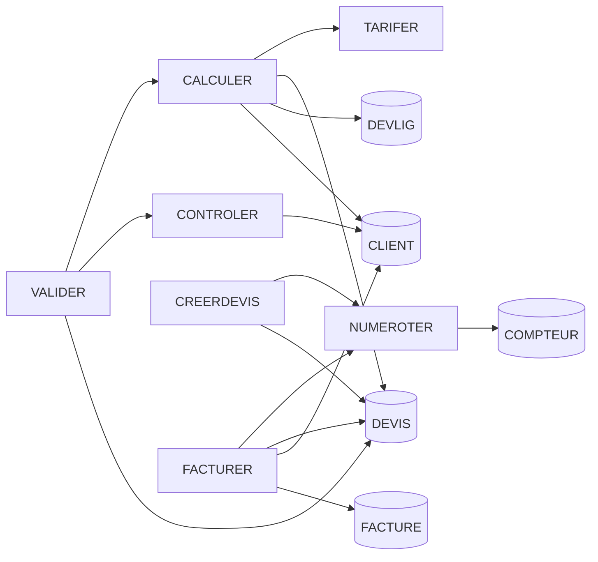

# Db2 for i

## Un héritage puissant qui ne demande qu'à évoluer

<br>

**Andy** — Ingénieur de données, Sinapse NC

iBelieve 2026 · 15 octobre 2026

<!--
Bonjour à toutes et à tous. Merci à Itheis et IBM pour l'invitation.
Aujourd'hui, pas de démo produit, pas de vente : je vais vous montrer ce qui est possible avec Db2 for i.
-->

---
layout: default
---

# Qui suis-je ?

<div class="grid grid-cols-5 gap-6 items-center">

<div class="col-span-2">
<div class="text-6xl font-bold" style="color: var(--slidev-theme-primary)">Andy</div>
<div class="text-xl mt-2">Ingénieur de données · Sinapse NC</div>
</div>

<div class="col-span-3 flex flex-col gap-3 text-lg">
<div class="flex items-center gap-3"><carbon-microphone class="text-2xl shrink-0" style="color: var(--slidev-theme-primary)" /><span>iBelieve 2021 : <b>500+ tables DDS → SQL</b></span></div>
<div class="flex items-center gap-3"><carbon-favorite-filled class="text-2xl shrink-0" style="color: #b56959" /><span><b>Fan assumé de l'IBM i</b>, depuis mes années DBA</span></div>
<div class="flex items-center gap-3"><carbon-connect class="text-2xl shrink-0" style="color: var(--slidev-theme-primary)" /><span><b>Le passeur</b> : l'existant IBM i ↔ la data moderne</span></div>
</div>

</div>

<div class="mt-16">

```d2 {maxHeight: '15rem'}
...@theme
direction: right

access: "Excel · Access\n(déjà du SQL)" {class: legacy}

data1: "Data" {
  class: [zone; etape2]
  talend: "Développeur BI\nTalend · Cognos" {class: [bloc; etape2]}
}
ibmi: "IBM i" {
  class: [zone; etape3]
  dba: "DBA / DBE Db2 for i\n500+ tables → SQL" {class: [fort; etape3]}
}
data2: "Data" {
  class: [zone; etape4]
  cafat: "Architecte données\nCAFAT" {class: [bloc; etape4]}
  sinapse: "Ingénieur données\nSinapse NC" {class: [fort; etape5]}
  cafat -> sinapse: continuité {class: [fil; etape5]}
}

access -> data1.talend: {class: [fil; etape2]}
data1.talend -> ibmi.dba: {class: [fil; etape3]}
ibmi.dba -> data2.cafat: {class: [fil; etape4]}
```

</div>

<!--
Mes premières requêtes SQL, je les ai écrites dans Access, pour alimenter des outils Excel. Je ne le savais pas encore, mais le fil rouge de ma carrière était déjà là.
[clic] Ensuite, je suis passé à la data, comme concepteur développeur Talend et Cognos. J'étais alors consommateur de la base IBM i.
[clic] Puis je suis passé de l'autre côté du miroir, DBA puis DBE sur Db2 for i. J'y ai mené la modernisation de plus de 500 tables DDS vers SQL — c'est là que je suis tombé amoureux du SQL sur IBM i. Et je l'assume : depuis, je suis un vrai fan de l'IBM i.
[clic] Puis retour à la data : architecte de données à la CAFAT, [clic] et aujourd'hui ingénieur de données à Sinapse NC, dans la continuité.
Je connais cette base de l'intérieur, et aujourd'hui je la connecte à une plateforme de données moderne. C'est ce regard de passeur que je veux partager.
-->

---

# Sinapse NC : la suite de la CAFAT

<div class="grid grid-cols-3 gap-4 mt-2 mb-4">
<IconCard titre="GIE · 2024" texte="CAFAT · Gouvernement · FSH"><carbon-partnership /></IconCard>
<IconCard titre="265 000" texte="Calédoniens concernés"><carbon-user-multiple /></IconCard>
<IconCard titre="Étape par étape" texte="le recouvrement d'abord"><carbon-roadmap /></IconCard>
</div>

```d2 {maxHeight: '11rem'}
...@theme
direction: right

fond: "Membres fondateurs" {
  class: zone
  cafat: "CAFAT\nprotection sociale" {class: legacy}
  gouv: "Gouvernement\nde la N.-C." {class: bloc}
  fsh: "FSH" {class: bloc}
}
sinapse: "Sinapse NC\nGIE · 2024" {class: fort}
si: "SI social\nmodernisé" {class: bloc}

fond.cafat -> sinapse
fond.gouv -> sinapse
fond.fsh -> sinapse
sinapse -> si: étape par étape
fond.cafat -> si: continuité {class: fil}
```

> Hier **architecte de données à la CAFAT**, aujourd'hui je **construis la suite**.

<div class="absolute bottom-4 left-8 text-xs opacity-60">
<a href="https://sinapse.nc/qui">sinapse.nc — Qui sommes-nous ?</a> ·
<a href="https://sinapse.nc/projet">sinapse.nc — Projet</a> ·
<a href="https://sinapse.nc/">sinapse.nc</a>
</div>

<!--
Quelques mots sur là où je travaille aujourd'hui, parce que ça explique le regard que je porte.
Sinapse est un groupement d'intérêt économique créé en 2024 par la CAFAT, le Gouvernement de la Nouvelle-Calédonie et le Fonds social de l'habitat. Sa mission : moderniser le système d'information de la protection sociale, en commençant par le recouvrement et les parcours des employeurs et des travailleurs indépendants. 265 000 Calédoniens sont concernés.
Pour moi, c'est une continuité : même mission de service public, même terrain, un autre rôle.
(À l'écran : trois cartes et le schéma ; le détail est ici.) Hier, architecte de données à la CAFAT ; aujourd'hui, je construis la suite. C'est exactement la posture du passeur : on ne modernise bien que ce qu'on connaît de l'intérieur.
Et la méthode affichée par Sinapse — partir des besoins, livrer étape par étape — c'est ce que je vais vous montrer côté base de données dans la deuxième partie : moderniser progressivement.
-->

---
layout: default
---

# Faire évoluer son IBM i : par où commencer ?

<div class="opacity-70 -mt-2">40 ans d'applicatif, des règles dans les programmes, peu de documentation</div>

<div class="grid grid-cols-3 gap-6 mt-6">
<IconCard titre="Avec un outil" texte="jusqu'où aident-ils ?"><carbon-tool-kit /></IconCard>
<IconCard titre="Sans outil" texte="comment avancer quand même ?"><carbon-idea /></IconCard>
<IconCard titre="Avec le natif seul" texte="que permet le SQL ?"><carbon-ibm-i /></IconCard>
</div>

<div class="text-center mt-10 text-xl">Le fil de la réponse : le SQL, <b>bien plus que des transactions</b></div>

<div class="grid grid-cols-4 gap-4 mt-3">
<IconCard petit titre="moderniser"><carbon-migrate /></IconCard>
<IconCard petit titre="administrer"><carbon-settings /></IconCard>
<IconCard petit titre="exploiter"><carbon-dashboard /></IconCard>
<IconCard petit titre="ouvrir les données"><carbon-data-share /></IconCard>
</div>

<!--
Le point de départ, c'est une situation que beaucoup d'entre vous connaissent : un IBM i qui tourne depuis des décennies, 40 ans d'applicatif, des règles métier cachées dans les programmes, et peu de documentation. On veut le faire évoluer. Par où commencer ?
Trois façons de s'y prendre, et trois questions qui vont guider toute la session. Avec un outil du marché : jusqu'où nous aident-ils ? Sans outil, parce qu'il n'y a pas de budget ou pas encore : comment avancer quand même ? Et avec le natif seul : que permet le SQL de l'IBM i ?
Le fil de la réponse, vous allez le voir tout au long : le SQL sur IBM i dépasse largement les transactions. Il sert à moderniser, à administrer, à exploiter, et à ouvrir les données au reste du système d'information.
-->

---
layout: two-cols
---

# 1. Le chantier 2019-2022

<div class="mt-2 leading-none font-bold" style="font-size: 5.5rem; color: var(--slidev-theme-primary)">500+</div>
<div class="text-2xl mt-2">tables DDS → SQL, <b>sans recompiler</b></div>
<div class="opacity-60 mt-1">Itheis · Gaia · Xcase for i</div>

<div class="mt-8 opacity-70 text-sm uppercase tracking-wider">Et après</div>
<div class="grid grid-cols-3 gap-2 mt-1 w-4/5">
<IconCard petit titre="contraintes"><carbon-connect /></IconCard>
<IconCard petit titre="temporel"><carbon-time /></IconCard>
<IconCard petit titre="RCAC"><carbon-security /></IconCard>
</div>

::right::

<br><br>

```d2 {maxHeight: '17rem'}
...@theme
direction: down

pgm: "Programmes RPG\nexistants" {class: legacy}
lf: "LF de substitution\n(même format)" {class: bloc}
new: "Nouveaux\ndéveloppements" {class: bloc}
table: "Nouvelle table SQL" {class: donnees}

pgm -> lf: sans recompilation
lf -> table
new -> table: SQL {class: fil}
```

<div class="absolute bottom-14 left-14 right-14 text-lg">

<div class="text-sm opacity-80 mb-2"><carbon-favorite-filled class="inline" style="color: #b56959" /> Merci à <b>E. Sadiman</b>, qui m'a confié ce chantier — et m'a rendu fan de l'IBM i</div>

> iBelieve 2021 : **migrer des tables**. iBelieve 2026 : en faire **une plateforme de données**.

</div>

<div class="absolute bottom-4 left-8 text-xs opacity-60">
Source : <a href="https://www.itheis.com/sql-comment-migrer-votre-base-de-donnees-sans-perturber-lexistant-applicatif/">Itheis — méthode surrogate</a>
</div>

<!--
En 2021, je vous ai parlé de migrer des tables. Rappel rapide : entre 2019 et 2022, plus de 500 tables DDS passées en SQL, accompagnés par Itheis et Gaia, avec l'outil Xcase for i. La clé, c'est la méthode surrogate : un fichier logique de substitution garde le format de l'ancien fichier, et les programmes existants continuent de tourner sans recompilation.
Et après la migration, ce que le SQL débloque : des contraintes — les relations enfin portées par la base —, des tables temporelles pour l'historisation, RCAC pour la sécurité par ligne et par colonne. Pour un petit périmètre, le natif suffit : QSYS2.GENERATE_SQL régénère le DDL d'une bibliothèque (kit/04-la-base.sql, exécuté sur pub400).
Pourquoi les contraintes comptent : une application moderne qui écrit directement dans une table, sans passer par le RPG, ne rencontre que les clés et l'intégrité référentielle ; plafond d'encours et cycle de vie du devis vivent dans les programmes, et elle les contourne sans le savoir. Chaque règle remontée dans la base est une règle qu'aucun nouveau client ne peut oublier.
Et une dédicace, parce qu'on ne mène pas un chantier pareil seul : merci à E. Sadiman, qui m'a fait confiance sur ce sujet — et qui, sans le savoir, m'a rendu fan de l'IBM i.
Transition : migrer la base, c'était la première marche. Mais une base moderne avec des programmes des années 80 autour, ça ne suffit pas. En 2026, je vous montre ce que cette base devient quand on la traite comme une vraie plateforme de données.
-->

---
layout: center
---

# 2. Moderniser progressivement

On ne réécrit pas 40 ans d'applicatif d'un coup

```d2 {maxHeight: '13rem'}
...@theme
direction: right

c: "1. Cartographier\nchaînes d'appels\ntables ↔ programmes" {class: bloc}
e: "2. Encapsuler\nRPG → procédures\nstockées" {class: [bloc; etape2]}
d: "3. Découpler\njournal\nfiles de messages" {class: [bloc; etape3]}
m: "4. Moderniser\nun bloc\nà la fois" {class: [fort; etape4]}

c -> e: {class: etape2}
e -> d: {class: etape3}
d -> m: {class: etape4}
m -> c: on recommence {class: [fil; etape5]; style.stroke-dash: 4}
```

<br>

**Le SQL est l'outil de chacune de ces étapes.**

<div class="absolute bottom-4 left-8 text-xs opacity-60">
Principes : <a href="https://redbooks.ibm.com/abstracts/sg248185.html">SG24-8185</a> ·
<a href="https://www.redbooks.ibm.com/docs/MD260020/MD260020.html">Redbook 2026 MD260020</a> ·
<a href="https://www.redbooks.ibm.com/abstracts/redp5095.html">REDP-5095</a>
</div>

<!--
Le Redbook SG24-8185 ne parle pas seulement d'interface web. Il pose quatre principes qu'on oublie : modularisation, architecture en couches, data-centric — les règles portées par la base —, et orientation service. Le Redbook 2026 reprend l'approche data-centric et y ajoute l'exposition en API REST.
Concrètement, ça donne une démarche en quatre temps. D'abord cartographier : savoir ce qui existe. [clic] Encapsuler : rendre l'existant appelable, sans le réécrire. [clic] Découpler : que la base publie ce qui change. [clic] Et seulement alors, moderniser un bloc à la fois. [clic] Et on recommence, sur le bloc suivant. Le SQL est l'outil de chacune de ces étapes.
-->

---

# Le terrain : une mini-application de devis

<div class="opacity-70 -mt-2 mb-2"><carbon-checkmark-outline class="inline" /> Tout le SQL qui suit a <b>tourné</b> sur pub400 — et se rejoue avec le <b>kit</b> du dépôt</div>

```d2 {maxHeight: '20rem'}
...@theme
direction: right

pgm: "Programmes (procédures SQL)" {
  class: zone
  valider: "VALIDER\nvalide un devis" {class: fort}
  calculer: "CALCULER" {class: bloc}
  tarifer: "TARIFER\nremise + TVA" {class: legacy}
  controler: "CONTROLER\nencours" {class: bloc}
  facturer: "FACTURER" {class: bloc}
  valider -> calculer -> tarifer
  valider -> controler
}
donnees: "Données · journalisées" {
  class: zone
  client: CLIENT {class: donnees}
  devis: DEVIS {class: donnees}
  devlig: DEVLIG {class: donnees}
  facture: FACTURE {class: donnees}
  client -> devis -> devlig
  devis -> facture
}

pgm.valider -> donnees.devis
pgm.controler -> donnees.client
pgm.facturer -> donnees.facture
```

<div class="absolute bottom-4 left-8 text-xs opacity-60">
Kit : <code>kit/00-terrain.sql</code> — 5 tables, 7 procédures SQL, à créer dans votre bibliothèque (pub400 ou votre IBM i)
</div>

<!--
Pour que ce ne soit pas que de la théorie, tous les exemples de cette partie ont été exécutés sur pub400, un IBM i public — et vous pouvez les rejouer : tout est dans le kit du dépôt, à lancer dans votre propre bibliothèque. Le schéma est volontairement petit : des clients, des devis, des lignes, des factures. Mais il a les défauts d'une vraie base : une date stockée en numérique, « parce que c'est partout », et des règles métier — remise, plafond d'encours, cycle de vie du devis — qui vivent dans les programmes.
Les « programmes » sont ici des procédures SQL, pour que le kit tourne partout sans compiler ; sur un vrai système, ce seraient des RPG. VALIDER valide un devis : il appelle CALCULER, qui appelle TARIFER, et CONTROLER, qui vérifie l'encours. FACTURER facture.
-->

---

# Étape 1 — Cartographier

<div class="grid grid-cols-3 gap-4 mt-2">
<IconCard titre="Avec un outil" texte="X-Analysis : modèle déduit du code"><carbon-tool-kit /></IconCard>
<IconCard titre="Avec l'IA" texte="Bob ou un autre assistant lit le RPG"><carbon-chat-bot /></IconCard>
<IconCard titre="Sans outil" texte="DSPPGMREF, piloté en SQL"><carbon-ibm-i /></IconCard>
</div>

```sql
CALL QSYS2.QCMDEXC(
  'DSPPGMREF PGM(' CONCAT CURRENT SCHEMA CONCAT '/*ALL) OUTPUT(*OUTFILE) '
  CONCAT 'OBJTYPE(*PGM) OUTFILE(QTEMP/PGMREF) OUTMBR(*FIRST *REPLACE)');
```

<div class="flex items-baseline justify-center gap-6 mt-4">
<div class="text-center"><div class="text-5xl font-bold" style="color: var(--slidev-theme-primary)">6</div><div class="opacity-70">programmes</div></div>
<carbon-arrow-right class="text-3xl opacity-50" />
<div class="text-center"><div class="text-5xl font-bold" style="color: var(--slidev-theme-primary)">10</div><div class="opacity-70">tables référencées, avec leur usage</div></div>
</div>

<div class="absolute bottom-4 left-8 text-xs opacity-60">
<a href="https://fr.freschesolutions.com/wp-content/uploads/archive/miscellaneous/X-Analysis_Comparisons.pdf">X-Analysis</a> ·
<a href="https://www.ibm.com/docs/en/i/7.3.0?topic=ssw_ibm_i_73%2Fcl%2Fdsppgmref.html">DSPPGMREF</a> ·
<a href="https://www.ibm.com/support/pages/detailed-file-field-description-file-qadsppgm-format-qwhdrppr-dsppgmref-output-file">Format QADSPPGM</a> ·
<a href="https://www.ibm.com/products/ai-coding-agent/ibm-i-modernization">IBM Bob pour IBM i</a> ·
<a href="https://www.itjungle.com/2026/03/02/ibm-gets-bob-1-0-off-the-ground/">IT Jungle — Bob 1.0</a> ·
<code>kit/01-cartographier.sql</code>
</div>

<!--
Des programmes des années 80 tournent toujours, et les relations entre tables vivent souvent dans le code, pas dans la base. Avant de toucher à quoi que ce soit, il faut retrouver les chaînes d'appels et les tables utilisées.
Avec un outil comme X-Analysis : diagrammes de structure, modèle de données déduit du code RPG, analyse d'impact. Et depuis peu, l'IA change la donne : avec Bob, l'assistant d'IBM disponible depuis mars 2026, ou avec un autre assistant, faire l'état des lieux devient bien plus facile — il lit le RPG, le CL, les DDS, explique, documente, dessine les relations. Mon avis : c'est un accélérateur, pas un substitut ; il faut toujours savoir vérifier. Sans outil : le natif, DSPPGMREF, de quoi cadrer grossièrement — et de quoi vérifier ce que l'IA affirme.
Une commande CL, pilotée depuis SQL, sur toute la bibliothèque courante. Le résultat va dans QTEMP : rien ne reste sur la machine, c'est pratique pour explorer. Pour un vrai référentiel, on le matérialise dans une bibliothèque dédiée.
Le fichier de sortie (format QADSPPGM) : WHPNAM, le programme analysé ; WHFNAM et WHLNAM, l'objet référencé et sa bibliothèque ; WHOTYP, son type (*PGM, *FILE, *SRVPGM…) ; WHFUSG, l'usage — 1 lecture, 2 écriture, 4 mise à jour, cumulables. Pour un programme SQLRPGLE ou une procédure SQL, les tables du SQL statique apparaissent aussi.
Sur le kit : 6 programmes, 10 références de tables de la bibliothèque.
-->

---

# La chaîne d'appels, en une requête

```sql
WITH CHAINE (APPELANT, APPELE, NIVEAU, CHEMIN) AS (
  SELECT SPECIFIC_NAME, OBJECT_NAME, 1,
         CAST(SPECIFIC_NAME CONCAT ' > ' CONCAT OBJECT_NAME AS VARCHAR(1000))
    FROM QSYS2.SYSROUTINEDEP
   WHERE SPECIFIC_SCHEMA = CURRENT SCHEMA
     AND SPECIFIC_NAME = 'VALIDER' AND OBJECT_TYPE = 'PROCEDURE'
  UNION ALL
  SELECT D.SPECIFIC_NAME, D.OBJECT_NAME, C.NIVEAU + 1,
         C.CHEMIN CONCAT ' > ' CONCAT D.OBJECT_NAME
    FROM CHAINE C
    JOIN QSYS2.SYSROUTINEDEP D
      ON D.SPECIFIC_SCHEMA = CURRENT SCHEMA AND D.SPECIFIC_NAME = C.APPELE
   WHERE D.OBJECT_TYPE = 'PROCEDURE' AND C.NIVEAU < 15    -- profondeur max
     AND LOCATE(' ' CONCAT D.OBJECT_NAME CONCAT ' ',
                ' ' CONCAT C.CHEMIN CONCAT ' ') = 0       -- pas de boucle
)
SELECT NIVEAU, CHEMIN FROM CHAINE ORDER BY CHEMIN;
```

<v-click>

```text
NIVEAU | CHEMIN
1      | VALIDER > CALCULER
2      | VALIDER > CALCULER > TARIFER
1      | VALIDER > CONTROLER
```

</v-click>

<div class="absolute bottom-4 left-8 text-xs opacity-60">
<a href="https://www.ibm.com/docs/en/i/7.5.0?topic=views-sysroutinedep">SYSROUTINEDEP</a> · <code>kit/01-cartographier.sql</code>
</div>

<!--
Point de départ : VALIDER, le programme qui valide un devis.
Récursion : les programmes appelés par les programmes appelés. Deux garde-fous : une profondeur maximale et la détection de boucle.
Ici les programmes sont des procédures SQL : leurs appels se lisent dans le catalogue, QSYS2.SYSROUTINEDEP. Sur du RPG ou du CL, c'est DSPPGMREF qui les donne, avec les objets de type *PGM : même requête récursive, autre source. Le kit RPG le montre sur de vrais programmes : kit/rpg/15-cartographier-rpg.sql retrouve VALDEVIS > CALCDEVIS > CALCTARIF et VALDEVIS > CTLENCOURS.
[clic] Résultat réel sur pub400 : la chaîne attendue, VALIDER > CALCULER > TARIFER… et une branche qu'on n'avait pas en tête, le contrôle d'encours CONTROLER. C'est exactement à ça que sert la cartographie.
-->

---

# Un diagramme sans outil

<div class="grid grid-cols-2 gap-6">

<div>

```sql
SELECT 'graph TD' AS LIGNE FROM SYSIBM.SYSDUMMY1
UNION ALL
SELECT DISTINCT '  ' CONCAT TRIM(WHPNAM)
       CONCAT ' --> ' CONCAT TRIM(WHFNAM)
  FROM QTEMP.PGMREF
 WHERE WHOTYP = '*FILE'
   AND TRIM(WHLNAM) = CURRENT SCHEMA
UNION ALL
SELECT '  ' CONCAT SPECIFIC_NAME
       CONCAT ' --> ' CONCAT OBJECT_NAME
  FROM QSYS2.SYSROUTINEDEP
 WHERE SPECIFIC_SCHEMA = CURRENT SCHEMA
   AND OBJECT_TYPE = 'PROCEDURE';
```

```text
graph TD
  VALIDER --> CALCULER
  VALIDER --> CONTROLER
  CALCULER --> TARIFER
  …  (16 lignes)
```

</div>

<div v-click>



</div>

</div>

> Le natif ne remplace pas un outil. Il permet de savoir **par où commencer** et **quoi ne pas casser**.

<div class="absolute bottom-4 left-8 text-xs opacity-60">
<a href="https://www.volubis.fr/news/liens/courshtm/V7.2/SQLasaService.html">Volubis</a> ·
<a href="https://www.ibm.com/support/pages/ibm-i-sql-services-information">IBM i SQL Services</a> ·
<a href="https://www.linkedin.com/pulse/dsppgmref-sql-table-function-ibmi-bob-cozzi">Bob Cozzi — DSPPGMREF en UDTF</a> ·
<code>kit/01-cartographier.sql</code>
</div>

<!--
Le SQL génère du Mermaid : les tables vues par DSPPGMREF, les appels vus par le catalogue. On colle le résultat dans n'importe quel éditeur, [clic] et on a un diagramme de structure. Pas aussi riche qu'un outil, mais suffisant pour cadrer.
Le diagramme affiché est la sortie réelle de la requête sur pub400 (16 lignes), dont on a seulement ajouté la forme « table » aux fichiers.
Les limites, à annoncer honnêtement — c'est là qu'un outil fait la différence :
- DSPPGMREF ne voit que les appels à nom littéral : un CALL sur une variable échappe.
- Il ne voit pas les appels réseau : un programme qui appelle une API REST ne référence aucune table, alors que l'API, elle, en écrit.
- Le SQL dynamique n'apparaît pas ; pour le reste, SYSPROGRAMSTMTSTAT, PARSE_STATEMENT, et BOUND_MODULE_INFO pour les liaisons ILE.
- Les relations fines, quelle zone joint quelle zone, demandent de lire le source.
Le natif ne remplace pas un outil. Il permet de savoir par où commencer, et quoi ne pas casser.
En réserve (kit, 01-cartographier.sql) : qui touche à DEVIS ? Quatre programmes — CALCULER, VALIDER et FACTURER le lisent et le mettent à jour, CREERDEVIS le crée. Avant de modifier la table, on sait qui prévenir.
-->

---
zoom: 0.9
---

# Étape 2 — Encapsuler

Un programme existant devient une **procédure stockée**. Sans toucher à son code.

<div class="grid grid-cols-5 gap-4 mt-2">

<div class="col-span-3">

```sql
CREATE OR REPLACE PROCEDURE CALC_TARIF_RPG3 (
    IN  p_montant_ht   DECIMAL(9,2),
    IN  p_taux_remise  DECIMAL(5,2),
    OUT p_remise       DECIMAL(11,2),
    OUT p_tva          DECIMAL(11,2),
    OUT p_ttc          DECIMAL(11,2),
    OUT p_rc           CHAR(1)
)
  LANGUAGE RPG                       -- RPG, pas RPGLE : c'est de l'OPM
  SPECIFIC CALCTARIF3
  NOT DETERMINISTIC
  NO SQL
  EXTERNAL NAME 'VOTREBIB/CALCTAR3'
  PARAMETER STYLE GENERAL;

CALL CALC_TARIF_RPG3(10000.00, 5.00, ?, ?, ?, ?);
```

</div>

<div class="col-span-2" v-click>

```d2 {maxHeight: '22rem'}
...@theme
direction: down

prog: "3 programmes, 3 époques" {
  class: zone
  p3: "CALCTAR3\nRPG III" {class: legacy}
  p4: "CALCTARIF\nRPG IV" {class: legacy}
  pa: "CALCTARA\nAdélia" {class: legacy}
}
contrat: "Même contrat SQL\n9500 · 1900 · 11400" {class: fort}
app: "ODBC · JDBC · Mapepire\npipeline data" {class: bloc}

prog.p3 -> contrat
prog.p4 -> contrat
prog.pa -> contrat
contrat -> app: CALL {class: fil}
```

</div>

</div>

<div class="absolute bottom-4 left-8 text-xs opacity-60">
<a href="https://www.oreilly.com/library/view/modernizing-ibm-eserver/0738492132/chapter-47.html">SG24-6393 — External stored procedures</a> ·
<code>kit/rpg/13-facades.sql</code>
</div>

<!--
Trois programmes d'époques différentes — un RPG III en OPM, un RPG IV free-form, et du RPG généré à la façon d'Adélia — derrière trois procédures au contrat identique. Aucun n'a été recompilé pour ça : on n'a écrit que du DDL. LANGUAGE RPG et non RPGLE, parce que c'est de l'OPM ; PARAMETER STYLE GENERAL, parce que le programme reçoit ses paramètres tels quels.
[clic] Vu du catalogue, ce sont trois procédures interchangeables, appelables depuis ODBC, JDBC, Mapepire, un orchestrateur ou un pipeline data. Et sur pub400 elles rendent la même chose pour 10 000 HT et 5 % de remise : 9500 HT remisé, 1900 de TVA, 11400 TTC.
Et une fois encapsulés, on les compose : une procédure SQL peut enchaîner une validation existante, un peu de SQL neuf, puis une facturation existante. Chaque étape se remplace individuellement, le contrat est documenté dans le catalogue.
Point d'attention : une transaction ouverte par l'appelant ne traverse pas un programme compilé COMMIT(*NONE), et sans lever d'erreur. Encapsuler, c'est aussi décider qui possède la transaction — dans le kit, c'est le programme de facturation.
Anecdote à garder si le temps le permet : sur 99,99 avec 33,33 % de remise, les trois versions divergent d'un centime — 79,99 contre 80,00 — parce que les arrondis ne sont pas écrits pareil. Encapsuler n'efface pas les différences : ça les rend testables (kit/rpg/14-rejouer.sql le montre).
(Exécuté sur pub400 le 29/09 avec le kit RPG : sources chargées par SQL, compilées, façades créées ; les trois CALL rendent 9500.00 / 1900.00 / 11400.00.)
-->

---

# Étape 3 — Découpler : le journal a tout vu

<div class="grid grid-cols-5 gap-6">

<div class="col-span-3">

```sql
-- Le journal a déjà tout capté
SELECT ENTRY_TIMESTAMP, JOURNAL_ENTRY_TYPE,
       SUBSTR(OBJECT, 1, 10) AS TABLE_, PROGRAM_NAME
  FROM TABLE (QSYS2.DISPLAY_JOURNAL(
         JOURNAL_LIBRARY    => CURRENT SCHEMA,
         JOURNAL_NAME       => 'QSQJRN',
         STARTING_TIMESTAMP => CURRENT TIMESTAMP - 1 HOUR))
 WHERE JOURNAL_CODE = 'R';
```

```text
2026-09-29 05:30:01.43688  | UP | DEVIS    | CALCULER
2026-09-29 05:30:01.446464 | UP | DEVIS    | VALIDER
2026-09-29 05:30:02.571984 | UP | COMPTEUR | NUMEROTER
2026-09-29 05:30:02.588848 | PT | FACTURE  | FACTURER
2026-09-29 05:30:02.613456 | UP | CLIENT   | FACTURER
```

<div class="mt-2 opacity-80"><carbon-checkmark-outline class="inline" /> Le journal sait <b>quel programme</b> a modifié quoi. Aucun n'a été modifié.</div>

</div>

<div class="col-span-2">

```d2 {maxHeight: '24rem'}
...@theme
direction: down

ibmi: "IBM i" {
  class: zone
  t: "Tables\nCLIENT · DEVIS…" {class: donnees}
  j: "Journal\nQSQJRN" {class: fort}
  q: "*DTAQ\nEVT_CLIENT" {class: eteint; shape: queue}
  t -> j: chaque modification 
  t -> q: SEND_DATA_QUEUE {class: eteint}
}
cdc: "Job de capture (CDC)\nlit DISPLAY_JOURNAL" {class: bloc}
conso: "Consommateurs\nJava · Python · RPG" {class: eteint}
cible: "Kafka · API\npipeline data" {class: legacy}

ibmi.j -> cdc 
ibmi.q -> conso {class: eteint}
cdc -> cible 
conso -> cible {class: eteint}
```

</div>

</div>

<div class="absolute bottom-4 left-8 text-xs opacity-60">
<a href="https://www.ibm.com/docs/en/i/7.5.0?topic=services-display-journal-table-function">DISPLAY_JOURNAL</a> ·
<code>kit/03-decoupler.sql</code>
</div>

<!--
Au lieu que chaque programme sache qui prévenir, la base publie l'événement.
D'abord, la capture sans rien écrire : les tables du kit sont journalisées. On valide puis on facture un devis, et le journal a tout vu : chaque mise à jour laisse l'image avant (UB) et l'image après (UP) — à l'écran, un extrait des UP et de l'insertion (PT) —, avec la table et le programme qui l'a faite : CALCULER et VALIDER sur DEVIS, NUMEROTER sur le compteur, FACTURER sur la facture et le client. Aucun programme n'a été modifié pour ça. C'est la base de toute capture de changements à grande échelle.
Le schéma, à droite : deux façons de faire sortir un changement de l'IBM i. Ici, la branche du journal : un job de capture de changements — un outil de réplication du marché, ou un job maison qui lit DISPLAY_JOURNAL — relaie vers Kafka, une API ou un pipeline data. La branche grisée, la file de données, c'est la slide suivante.
Et surtout pas d'appel réseau au moment où la donnée change (dans un trigger, par exemple) : ça allonge chaque transaction et la rend dépendante du réseau — et les fonctions HTTP de Db2 ne bornent que le temps de connexion. Le schéma robuste : écrire localement (journal, file, outbox), un consommateur asynchrone relaie.
(Exécuté sur pub400 le 29/09 avec le kit : kit/03-decoupler.sql. Horodatage : heure de la machine pub400.)
-->

---
zoom: 0.9
---

# Étape 3 — Découpler : la base publie

<div class="grid grid-cols-5 gap-6">

<div class="col-span-3">

```sql
-- Publier l'état du client en JSON
CALL QSYS2.SEND_DATA_QUEUE_UTF8(
  MESSAGE_DATA => (
    SELECT JSON_OBJECT('table'   VALUE 'CLIENT',
                       'id'      VALUE ID_CLIENT,
                       'encours' VALUE ENCOURS,
                       'ts'      VALUE CURRENT TIMESTAMP)
      FROM CLIENT WHERE ID_CLIENT = 1),
  DATA_QUEUE         => 'EVT_CLIENT',
  DATA_QUEUE_LIBRARY => CURRENT SCHEMA);
```

<div v-click>

```sql
-- Côté consommateur, y compris via ODBC
SELECT CAST(MESSAGE_DATA_UTF8 AS VARCHAR(1000)) AS MESSAGE
  FROM TABLE (QSYS2.RECEIVE_DATA_QUEUE(
         DATA_QUEUE         => 'EVT_CLIENT',
         DATA_QUEUE_LIBRARY => CURRENT SCHEMA));
```

```text
{"table":"CLIENT","id":1,"encours":3967.20,
 "ts":"2026-09-29-05.30.05.246447"}
```

</div>

</div>

<div class="col-span-2">

```d2 {maxHeight: '19rem'}
...@theme
direction: down

ibmi: "IBM i" {
  class: zone
  t: "Tables\nCLIENT · DEVIS…" {class: donnees}
  j: "Journal\nQSQJRN" {class: eteint}
  q: "*DTAQ\nEVT_CLIENT" {class: fort; shape: queue}
  t -> j: chaque modification {class: eteint}
  t -> q: SEND_DATA_QUEUE 
}
cdc: "Job de capture (CDC)\nlit DISPLAY_JOURNAL" {class: eteint}
conso: "Consommateurs\nJava · Python · RPG" {class: bloc}
cible: "Kafka · API\npipeline data" {class: legacy}

ibmi.j -> cdc {class: eteint}
ibmi.q -> conso 
cdc -> cible {class: eteint}
conso -> cible 
```

<div class="grid grid-cols-3 gap-1">
<IconCard petit titre="Java · JTOpen"><logos-java /></IconCard>
<IconCard petit titre="Python · ODBC"><logos-python /></IconCard>
<IconCard petit titre="RPG · QRCVDTAQ"><carbon-ibm-i /></IconCard>
</div>

</div>

</div>

<div class="absolute bottom-4 left-8 text-xs opacity-60">
<a href="https://ibm.com/support/knowledgecenter/ssw_ibm_i_75/rzajq/rzajqprocsenddtaq.htm">SEND_DATA_QUEUE</a> ·
<a href="https://www.ibm.com/support/pages/qsys2receivedataqueue">RECEIVE_DATA_QUEUE</a> ·
<a href="https://www.ibm.com/docs/en/i/7.5.0?topic=ssw_ibm_i_75/apis/qrcvdtaq.htm">QRCVDTAQ</a> ·
<a href="https://javadoc.io/doc/net.sf.jt400/jt400/latest/com/ibm/as400/access/DataQueue.html">JTOpen DataQueue</a> ·
<a href="https://www.ibm.com/support/knowledgecenter/ssw_ibm_i_72/sqlp/rbafymqdb2functions.htm">Db2 MQ functions</a> ·
<a href="https://www.ibm.com/docs/en/ssw_ibm_i_75/sqlp/rbafyhttpoverview.htm">HTTP functions</a> ·
<code>kit/03-decoupler.sql</code>
</div>

<!--
Ensuite, la publication : un JSON construit en SQL, poussé dans une file de données — ici l'encours du client, juste après sa facture. Sur le schéma, c'est maintenant la branche de la file qui est en couleur. [clic] Côté consommateur, la file se lit en SQL, y compris de l'extérieur par ODBC. Et le consommateur peut être n'importe quoi : un service Java qui la lit avec la classe DataQueue de JTOpen, un script Python par ODBC avec la requête qu'on vient de voir, ou un bon vieux programme RPG en batch avec l'API QRCVDTAQ. La file est indifférente au langage de celui qui la lit. De là, on relaie vers un broker : les fonctions Db2 MQ si IBM MQ est installé (absent de pub400, non exécuté), ou les fonctions HTTP de Db2 vers une API ou un proxy Kafka.
Sur un vrai système, on pose ce SEND_DATA_QUEUE_UTF8 dans un trigger AFTER UPDATE : chaque mise à jour publie son événement, avant et après. Sur pub400, CREATE TRIGGER est refusé au compte gratuit (SQL0552) : c'est pour ça qu'il n'est pas à l'écran.
(Exécuté sur pub400 le 29/09 avec le kit : kit/03-decoupler.sql, file créée puis supprimée.)
-->

---
layout: statement
---

# Le SQL sur IBM i n'est pas qu'un langage de requête.

## C'est un langage d'**intégration** : il appelle des programmes, publie des événements, parle à MQ et au web.

---

# 3. Administrer et exploiter en SQL

<div class="grid grid-cols-2 gap-8 mt-2">

<div>

### Une commande CL, un service SQL

| Commande CL | Service SQL |
|---|---|
| `WRKACTJOB` | `QSYS2.ACTIVE_JOB_INFO` |
| `DSPLOG` | `QSYS2.HISTORY_LOG_INFO` |
| `DSPJRN` | `QSYS2.DISPLAY_JOURNAL` |
| `WRKOBJOWN` | `QSYS2.OBJECT_OWNERSHIP` |
| `WRKSYSVAL` | `QSYS2.SYSTEM_VALUE_INFO` |

</div>

<div>

### Les exemples sont livrés

<Capture src="captures/acs-insert-from-examples.png" sujet="ACS → Run SQL Scripts → Insert from Examples" duree="capture fixe" hauteur="17rem" />

</div>

</div>

<div class="absolute bottom-4 left-8 text-xs opacity-60">
<a href="https://www.ibm.com/support/pages/ibm-i-sql-services-information">IBM i SQL Services</a> ·
<a href="https://www.ibm.com/support/pages/db2-i-technology-updates">Db2 for i Technology Updates</a> ·
<a href="https://www.volubis.fr/news/liens/courshtm/V7.2/SQLasaService.html">Volubis (FR)</a>
</div>

<!--
Les IBM i Services : des vues, fonctions table et procédures dans QSYS2 et SYSTOOLS qui exposent le système sans passer par des fichiers de sortie. Pour presque chaque commande CL de tous les jours, il y a son équivalent SQL.
(Les cinq services du tableau répondent sur pub400, le 29/09 : kit/05-administrer.sql. WRKPTFGRP → GROUP_PTF_INFO, lui, est refusé au compte gratuit : c'est pour ça qu'il n'est pas dans le tableau.)
À droite : pas besoin de connaître les services par cœur. Dans ACS, Run SQL Scripts, menu Edit → Insert from Examples : des centaines d'exemples prêts à l'emploi, classés par thème.
-->

---

# La méthode

<div class="mt-16">

```d2 {maxHeight: '17rem'}
...@theme
direction: right

i: "1. Identifier\nla commande CL\nWRKACTJOB" {class: bloc}
t: "2. Trouver\nle service\nACTIVE_JOB_INFO" {class: [bloc; etape2]}
f: "3. Filtrer tôt\n*ALLSIMPLE" {class: [bloc; etape3]}
m: "4. Matérialiser\ndans une table" {class: [bloc; etape4]}
x: "5. Extraire\ncomme une donnée\nmétier" {class: [fort; etape5]}

i -> t: {class: etape2}
t -> f: {class: etape3}
f -> m: {class: etape4}
m -> x: {class: etape5}
```

</div>

<div class="text-center mt-16 text-2xl">Le système devient <b>une table comme les autres</b></div>

<div class="absolute bottom-4 left-8 text-xs opacity-60">
<a href="https://www.ibm.com/support/pages/ibm-i-sql-services-information">IBM i SQL Services — matérialiser le résultat</a>
</div>

<!--
La méthode tient en cinq temps. Partir de la commande qu'on utilise aujourd'hui — WRKACTJOB. [clic] Trouver le service équivalent — ACTIVE_JOB_INFO. [clic] Filtrer tôt : les services ont souvent un niveau de détail réduit, comme *ALLSIMPLE, beaucoup moins coûteux. [clic] Matérialiser le résultat dans une table, comme le recommande IBM. [clic] Et l'extraire comme n'importe quelle donnée métier.
C'est la transition vers la suite : la carte des programmes, le système, les logs… tout devient une table SQL. Et une table, ça s'extrait.
-->

---

# Sécurité · exploitation · audit

```sql {1-4|6-10|12-16}
-- Sécurité : les valeurs système qui comptent
SELECT SYSTEM_VALUE_NAME, CURRENT_CHARACTER_VALUE
  FROM QSYS2.SYSTEM_VALUE_INFO
 WHERE SYSTEM_VALUE_NAME IN ('QSECURITY', 'QMAXSIGN', 'QPWDEXPITV');

-- Exploitation : messages graves de la dernière heure
SELECT MESSAGE_TIMESTAMP, MESSAGE_ID, SEVERITY
  FROM TABLE (QSYS2.HISTORY_LOG_INFO(
         START_TIME => CURRENT TIMESTAMP - 1 HOUR)) X
 WHERE SEVERITY >= 40;

-- Audit : qui a quels droits sur CLIENT ?
SELECT AUTHORIZATION_NAME, OBJECT_AUTHORITY
  FROM QSYS2.OBJECT_PRIVILEGES
 WHERE SYSTEM_OBJECT_SCHEMA = CURRENT SCHEMA
   AND SYSTEM_OBJECT_NAME   = 'CLIENT';
```

<div class="grid grid-cols-3 gap-2 mt-1">
<IconCard petit titre="QSECURITY = 50"><carbon-security /></IconCard>
<IconCard petit titre="195 messages graves / h"><carbon-warning-alt /></IconCard>
<IconCard petit titre="CLIENT : *PUBLIC exclu"><carbon-locked /></IconCard>
</div>

<div class="absolute bottom-4 left-8 text-xs opacity-60">
<a href="https://www.ibm.com/docs/en/i/7.5.0?topic=services-system-value-info-view">SYSTEM_VALUE_INFO</a> ·
<a href="https://www.ibm.com/docs/en/i/7.5.0?topic=services-history-log-info-table-function">HISTORY_LOG_INFO</a> ·
<a href="https://www.ibm.com/docs/en/i/7.5.0?topic=services-object-privileges-view">OBJECT_PRIVILEGES</a> ·
<a href="https://www.ibm.com/support/pages/db2-i-generated-syslog-history-and-audit-journal">Syslog</a>
</div>

<!--
Trois exemples suffisent : la sécurité, l'exploitation, l'audit.
Sécurité : le niveau de sécurité du système, le nombre d'essais de connexion, l'expiration des mots de passe, en une requête. [clic] Exploitation : les messages graves de la dernière heure, sans ouvrir DSPLOG. [clic] Audit : qui a quels droits sur la table CLIENT — le public est exclu, seul le propriétaire a tout.
Résultats sur pub400, en bas : QSECURITY à 50, 195 messages de sévérité 40 ou plus en une heure, et la table CLIENT fermée au public.
Vers la supervision d'entreprise : DISPLAY_JOURNAL et HISTORY_LOG_INFO savent produire du syslog RFC5424, en continu.
Sur un vrai système, on irait plus loin : les profils qui ont *ALLOBJ (QSYS2.USER_INFO), les échecs de mot de passe (SYSTOOLS.AUDIT_JOURNAL_PW). Sur pub400, les services respectent les droits : la première rend 0 ligne, la seconde est refusée faute d'accès au journal d'audit (SQL0443).
(Exécuté tel quel sur pub400 le 29/09 : kit/05-administrer.sql. Le texte des messages n'est pas affiché : le client JDBC utilisé en abîme les accents.)
Et une fois que tout — la carte des programmes, le système, les logs — est une table SQL… on peut tout extraire. C'est la transition vers la dernière partie.
-->

---

# 4. L'IBM i, source de données de premier plan

<div class="opacity-70 -mt-2">Pas un silo</div>

<div class="grid grid-cols-5 gap-3 mt-8">
<IconCard titre="ODBC" texte="Python · BI · DuckDB"><carbon-data-connected /></IconCard>
<IconCard titre="JDBC" texte="Java · Talend"><logos-java /></IconCard>
<IconCard titre="Mapepire" texte="un seul port chiffré"><carbon-cloud /></IconCard>
<IconCard titre="HTTP" texte="l'IBM i appelle des API"><carbon-api /></IconCard>
<IconCard titre="MCP" texte="assistants IA"><carbon-bot /></IconCard>
</div>

<div class="text-center mt-12 text-xl"><carbon-ibm-db2 class="inline" /> Les procédures de l'étape 2 passent <b>par les mêmes portes</b></div>

<div class="absolute bottom-4 left-8 text-xs opacity-60">
<a href="https://www.ibm.com/support/pages/odbc-driver-ibm-i-access-client-solutions">ODBC ACS</a> ·
<a href="https://ibmi-oss-docs.readthedocs.io/en/latest/odbc/installation.html">ODBC Linux</a> ·
<a href="https://github.com/IBM/JTOpen">JTOpen</a> ·
<a href="https://mapepire-ibmi.github.io/">Mapepire</a> ·
<a href="https://github.com/theIBMiGuy/mcp-server-db2i">MCP</a>
</div>

<!--
L'IBM i n'est pas un silo. On s'y connecte depuis de multiples points d'accès. ODBC (IBM i Access), sous Windows, Linux et macOS : Python, BI, ETL, DuckDB. JDBC (JTOpen) : Java, Talend, les outils JVM. Mapepire : des clients légers, un seul port chiffré, adapté au cloud. HTTP depuis SQL : l'IBM i qui appelle des API. MCP : des assistants IA qui interrogent Db2 for i. Point fort : le pilote ODBC sous Linux s'installe comme n'importe quel paquet, donc dans un conteneur ou un pipeline.
Et les procédures stockées de l'étape 2 sont appelables par ces mêmes points d'accès : un pipeline data peut déclencher un traitement RPG existant par un simple CALL.
-->

---

# ODBC → Arrow → DuckDB

<div class="text-sm opacity-70 -mt-2 mb-3">Code illustratif, <b>non exécuté sur pub400</b> : le pilote ODBC ne passe pas par le tunnel SOCKS.</div>

<div class="grid grid-cols-2 gap-6">

<div>

```d2 {maxHeight: '21rem'}
...@theme
direction: down

avant: "Ligne à ligne" {
  class: zone
  d: "Db2 for i" {class: donnees}
  p: "une ligne\n= un objet" {class: legacy}
  d -> p: "× 1 000 000"
}
apres: "En colonne" {
  class: [zone; etape2]
  d: "Db2 for i" {class: [donnees; etape2]}
  a: "lots Apache Arrow" {class: [fort; etape2]}
  k: "DuckDB" {class: [donnees; etape2]}
  d -> a: ODBC {class: etape2}
  a -> k: sans copie {class: [fil; etape2]}
}
```

</div>

<div>

<div class="flex gap-4 text-3xl mb-2 justify-center"><logos-python /><simple-icons-apachearrow /><simple-icons-duckdb /></div>

```python
from arrow_odbc import read_arrow_batches_from_odbc
import pyarrow as pa
import duckdb

reader = read_arrow_batches_from_odbc(
    query="SELECT * FROM VOTREBIB.CLIENT",
    connection_string="Driver={IBM i Access "
                      "ODBC Driver};System=MONIBMI;...",
    batch_size=50_000,
)
clients = pa.Table.from_batches(
    reader, schema=reader.schema)

duckdb.sql(
  "CREATE TABLE client AS SELECT * FROM clients")
```

</div>

</div>

<div class="absolute bottom-4 left-8 text-xs opacity-60">
<a href="https://github.com/pacman82/arrow-odbc-py">arrow-odbc-py</a> ·
<a href="https://github.com/pacman82/arrow-odbc">arrow-odbc (Rust)</a> ·
<a href="https://duckdb.org/community_extensions/extensions/nanodbc">nanodbc</a> ·
<a href="https://github.com/duckdb/odbc-scanner">duckdb/odbc-scanner</a>
</div>

<!--
Un pilote SQL classique renvoie des lignes, une par une, converties en objets du langage. Sur des millions d'enregistrements, c'est lent. [clic]
arrow-odbc lit par lots et remplit directement des tableaux Arrow, en colonne. DuckDB, une base analytique embarquée, lit cette table Arrow en mémoire sans copie.
Deuxième chemin, à citer : une extension ODBC directement dans DuckDB (nanodbc, ou odbc_scanner) — INSTALL nanodbc FROM community; LOAD nanodbc; puis SELECT * FROM odbc_query(connection => 'DSN=…', query => 'SELECT * FROM VOTREBIB.CLIENT'). À valider avec le pilote IBM i ; le bloc est dans kit/exemples/duckdb-nanodbc.non-execute.sql.
(Seul code du deck non exécuté sur pub400, et c'est écrit sur la slide : le pilote ODBC IBM i ne sait pas passer par le proxy SOCKS du tunnel. Le faire passer demande de modifier la configuration ACS du poste ; choix du 29/09 de ne pas le faire. MONIBMI est un nom de DSN illustratif.)
Clin d'œil : le référentiel DSPPGMREF du chapitre 2 s'extrait de la même façon → la carte des programmes devient analysable dans DuckDB.
-->

---

# Sinapse NC : quand l'outil manque, on le construit

```d2 {maxHeight: '11rem'}
...@theme
direction: right

db2: "Db2 for i" {class: donnees}
x: "arrow-odbc / ADBC\nextraction colonne" {class: fort}
duck: "DuckDB\nParquet" {class: donnees}
dbt: "dbt\nmodèles" {class: bloc}
ia: "Analyse · IA" {class: bloc}

db2 -> x: ODBC
x -> duck: Arrow {class: fil}
duck -> dbt -> ia
```

<div class="grid grid-cols-4 gap-3 mt-4">
<IconCard titre="Le besoin" texte="alimenter la plateforme data, sans peser sur la prod"><carbon-data-share /></IconCard>
<IconCard titre="L'existant" texte="ODBC, fiable mais ligne à ligne"><carbon-hourglass /></IconCard>
<IconCard titre="Construit" texte="Arrow · ADBC · piste Flight SQL"><carbon-tool-kit /></IconCard>
<div v-click><IconCard titre="Résultat" texte="[volumes, temps avant / après]"><carbon-growth /></IconCard></div>
</div>

<div class="absolute bottom-4 left-8 text-xs opacity-60">
<a href="https://arrow.apache.org/adbc/">Apache Arrow ADBC</a>
</div>

<!--
Il n'y avait pas d'outil ? On s'est appuyé sur le natif — le pilote ODBC IBM — et on a construit le reste avec des standards ouverts. Le besoin : alimenter une plateforme data moderne, sans alourdir la production. L'existant : ODBC, fiable mais ligne à ligne. Ce qu'on a construit : l'extraction en colonne avec Arrow, un pilote ADBC, et la piste d'un service Arrow Flight SQL devant l'IBM i.
[clic] Le résultat.
À ajuster selon ce qui peut être montré publiquement.
-->

---

# Industrialiser l'extraction

<div class="grid grid-cols-2 gap-6">

<div>

<div class="grid grid-cols-2 gap-3 mt-2">
<IconCard titre="dlt + pyarrow" texte="vers Parquet : 20 à 30× plus rapide"><carbon-flash /></IconCard>
<IconCard titre="Orchestrer" texte="planifier · rejouer · historiser"><carbon-repeat /></IconCard>
</div>

<div class="mt-6 opacity-70 text-sm uppercase tracking-wider">Garde-fous</div>
<div class="grid grid-cols-4 gap-1">
<IconCard petit titre="lecture seule"><carbon-locked /></IconCard>
<IconCard petit titre="TLS"><carbon-security /></IconCard>
<IconCard petit titre="typage"><carbon-data-table /></IconCard>
<IconCard petit titre="hors pics"><carbon-time /></IconCard>
</div>

</div>

<div>

### <carbon-data-table class="inline" /> Paralléliser par RRN

```sql
-- Taille connue du catalogue
SELECT NUMBER_ROWS
  FROM QSYS2.SYSPARTITIONSTAT
 WHERE TABLE_SCHEMA = CURRENT SCHEMA
   AND TABLE_NAME   = 'DEVLIG';

-- Une tranche parmi N
SELECT * FROM DEVLIG D
 WHERE RRN(D) BETWEEN 1 AND 2;
```

Sur le kit : **4** lignes au catalogue → 2 tranches de 2.

</div>

</div>

<div class="absolute bottom-4 left-8 text-xs opacity-60">
<a href="https://dlthub.com/docs/dlt-ecosystem/verified-sources/sql_database/configuration">dlt sql_database</a> ·
<a href="https://www.ibm.com/support/pages/acs-odbc-driver-linux-now-supports-openssl">ODBC Linux + TLS</a> ·
<a href="https://www.ibm.com/docs/en/i/7.6.0?topic=services-add-query-threshold-procedure">Query Supervisor</a>
</div>

<!--
Pour passer du script au pipeline : dlt, avec le backend pyarrow, produit des tables Arrow et, vers Parquet, saute l'étape de normalisation — dlt annonce un gain de 20 à 30 fois.
Pour les grosses tables : découper par numéro relatif d'enregistrement, en partant du nombre de lignes connu du catalogue, et extraire les tranches en parallèle.
(Exécuté tel quel sur pub400 le 29/09 avec le kit : DEVLIG compte 4 lignes, la tranche 1-2 rend les deux lignes du devis 101 — kit/06-industrialiser.sql.)
Et quelques garde-fous : un compte technique en lecture seule (RCAC si besoin), une connexion chiffrée, un œil sur le typage — précision des DECIMAL, dates, CCSID —, et on extrait hors des pics, avec le Query Supervisor comme filet.
-->

---

# À retenir

<div class="grid grid-cols-4 gap-3 mt-6">
<IconCard titre="Pas à pas" texte="cartographier · encapsuler · découpler"><carbon-roadmap /></IconCard>
<IconCard titre="Le SQL intègre" texte="administre · exploite · publie"><carbon-sql /></IconCard>
<IconCard titre="Une vraie source" texte="ODBC · Arrow · DuckDB"><carbon-data-share /></IconCard>
<IconCard titre="Un tremplin" texte="l'existant construit la suite"><carbon-education /></IconCard>
</div>

<div class="text-center mt-12 text-xl"><carbon-growth class="inline" /> Un moteur qui <b>évolue</b> : <b>17 nouveaux services</b> à l'été 2026</div>

<div class="absolute bottom-4 left-8 text-xs opacity-60">
<a href="https://www.itjungle.com/2026/07/27/what-ibms-got-cooking-in-db2-for-i-in-the-summer-trs/">IT Jungle — Summer TRs 2026</a> ·
<a href="https://www.ibm.com/support/pages/ibm-i-76-tr2-enhancements">7.6 TR2</a> ·
<a href="https://poweribmi.fr/2026/07/14/annonces-7-6-tr2-7-5-tr8/">poweribmi.fr</a>
</div>

<!--
Quatre messages à retenir. Moderniser progressivement : cartographier, encapsuler, découpler, un bloc à la fois. Le SQL va au-delà du transactionnel : il administre, il exploite, il intègre. L'IBM i est une source de données de premier plan : ODBC, Arrow, DuckDB. Et les compétences IBM i sont un tremplin : connaître l'existant, c'est construire la suite.
Et pourquoi ça marche : la base est intégrée à l'OS — catalogue, journaux, sécurité objet ; c'est un langage d'intégration ; elle est ouverte — ODBC, JDBC, Mapepire, HTTP, MCP ; et elle évolue en continu : les TR de l'été 2026 ont livré 5 améliorations, 17 nouveaux services et 10 services enrichis.
-->

---
layout: end
---

# L'héritage est là.

## La seule question, c'est ce qu'on en fait.

Merci — questions ?

<div class="absolute bottom-6 left-0 right-0 text-xs opacity-70">
<a href="https://redbooks.ibm.com/abstracts/sg248185.html">SG24-8185</a> ·
<a href="https://www.redbooks.ibm.com/docs/MD260020/MD260020.html">MD260020</a> ·
<a href="https://www.redbooks.ibm.com/abstracts/redp5095.html">REDP-5095</a> ·
<a href="https://www.ibm.com/support/pages/sql-examples">Gists Scott Forstie</a> ·
<a href="https://www.ibm.com/support/pages/db2-i-technology-updates">Db2 for i Technology Updates</a>
<br>
<a href="https://ibmi-oss-docs.readthedocs.io/en/latest/odbc/installation.html">ODBC Linux</a> ·
<a href="https://github.com/pacman82/arrow-odbc-py">arrow-odbc-py</a> ·
<a href="https://arrow.apache.org/adbc/">Apache Arrow ADBC</a> ·
<a href="https://mapepire-ibmi.github.io/">Mapepire</a> ·
<a href="https://duckdb.org/community_extensions/extensions/nanodbc">DuckDB nanodbc</a>
</div>
